# TavernOS HUD — a living dashboard for roleplay chats in SillyTavern

<p align="center"><a href="README.md">RU</a> · <b>ENG</b></p>

> Every model reply gets a card with the state of the world: the time and weather of the scene, who is wearing what, who thinks and hides what, whose phone is blowing up with messages, how many hours a character hasn't slept or eaten, who is related to whom — and none of it gets lost from turn to turn.

<p align="center">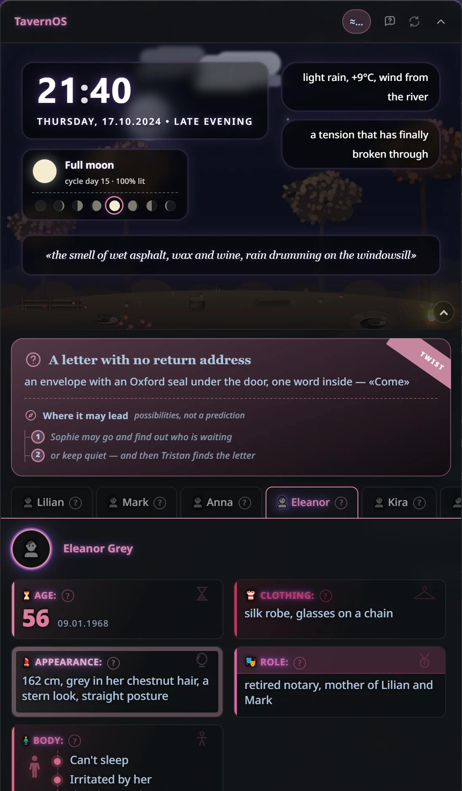</p>

TavernOS is an extension for [SillyTavern](https://github.com/SillyTavern/SillyTavern) that asks the model to send a compact `[HUD]` block with every reply and turns it into an interactive card with tabs right under the message. The interface is in English or Russian: switch **🌐 Язык / Language → ENG** at the very top of the extension settings. The model writes short English codes either way, which saves tokens.

---

## Why you need it

Long roleplay stories break on small things, and anyone who has played past a hundred messages knows it:

- **The model forgets.** A character is "again" wearing the jacket they took off three scenes ago. Yesterday's wound is gone. It was evening, and now it's morning without a single time skip.
- **The state is smeared across the text.** To remember who owes money to whom, where the gun is and what a character lied about, you have to scroll the chat.
- **You can't see behind the scenes.** What a character really thinks, what they hide, whom they text while you're not looking — it all stays in the model's head or disappears.
- **The world stands still.** No news, weather, prices or rumors — nothing for the story to hook on.
- **Memory costs tokens.** Keeping trackers by hand in every message is expensive and tiring.

TavernOS takes care of it:

- **The state is always in front of you.** One card shows where, when, who, in what, with whom and in what mood.
- **Continuity without extra tokens.** Chats, secrets, notes and events carry over from past turns *on screen only* — not a single extra character goes to the model. Old HUDs in the history shrink into short summaries; the latest one goes to the model as a snapshot so it updates the world instead of inventing it anew.
- **A second layer of the story.** Thoughts, subtext, "expectation vs reality", fears, intercepted chats of others, diaries, dreams — what isn't in the reply text itself.
- **The HUD counts what the model doesn't need to.** How many hours since eating and sleeping, the sleep debt for the week, that it's time for a shower, whether the money will last, what a character missed on their schedule while busy. The model writes nothing extra for this.
- **Beautiful.** 27 themes, 43 blocks with alternative views, weather and time of day in the background, avatars — a card you want to open, not a spreadsheet.

---

## What it looks like

Under every model reply there's a **TavernOS** card:

- **Scene header** — clock, date, weather, moon phase, the mood of the place. The background follows the time of day and the weather: rain, snow, fog, sunset, night.
- **Tab bar** — the characters of the scene, you, the phone, memory, daily life, intercepts, diary, dreams, nursery, world and more. A tab appears only when it has something to show.
- **Twist card** — if a real plot twist happened this turn, a banner pops up above the tabs: what happened and where it may lead.
- **Question marks** next to tab and field names — tap for an explanation: what it is, why it appeared and how to read it.

Old cards collapse into a title strip and expand on tap — a long chat stays light.

---

## Features

### 🎬 Scene

Time, date, weather, place and atmosphere. The time of day is computed from the clock adjusted for the month (in winter the sun sets earlier), with festive decorations around New Year. The moon phase sits on a disc in the header.

### 👤 Characters

A separate tab for everyone the model described in the turn:

- **Look and state** — clothing, appearance, role, body, physiology, health, inventory, place.
- **Inner life** — mood, thoughts, goals, schedule, fears, lines, hidden subtext, "expectation vs reality", the key point of the turn, flag monitor, jealousy, conflict depth, exposure risk.
- **Relationships and trust** — toward each person on a 0–100 scale; trust shifts are visible from turn to turn.
- **Body state** — energy, alertness, satiety, stress, sleep and plans for tomorrow.
- **Illnesses and injuries** — stage, symptoms, treatment and a recovery bar; body marks with a healing timer.
- **Shared memories** — accumulate across turns: the same memory reworded isn't duplicated.

<details><summary>📷 The whole character tab</summary>

<p align="center">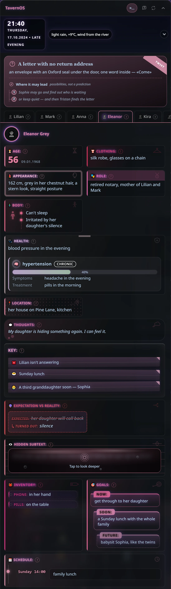</p>

</details>

### 🙋 You

The same set about your character — as the model sees them from outside: clothing, appearance, health, relationships, location. Plus a **"What they think of you"** summary: how each character feels about you and how much they trust you (computed from the cards, the model writes nothing extra).

### 📱 The character's phone

A full smartphone with a lock screen and notifications: **messages** (photos, videos, voice messages with transcripts, calls, replies, deleted messages), **contacts, wallet** with transactions, **calendar, gallery, notes, maps, search, call log, weather, health**. Each app is turned on separately: an app that's off isn't requested from the model and takes no room in the request.

<p align="center">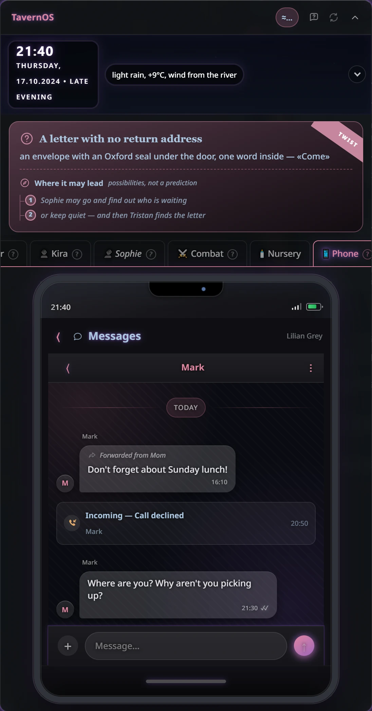</p>

<details><summary>📷 Phone apps: home screen, wallet, calendar, health, maps</summary>

<table><tr>
<td align="center">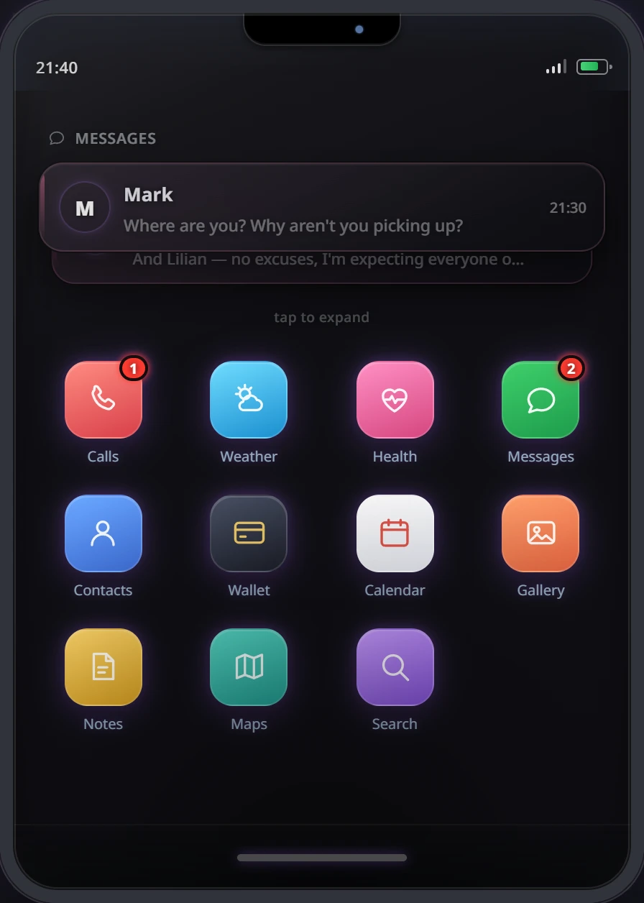<br>Home screen</td>
<td align="center">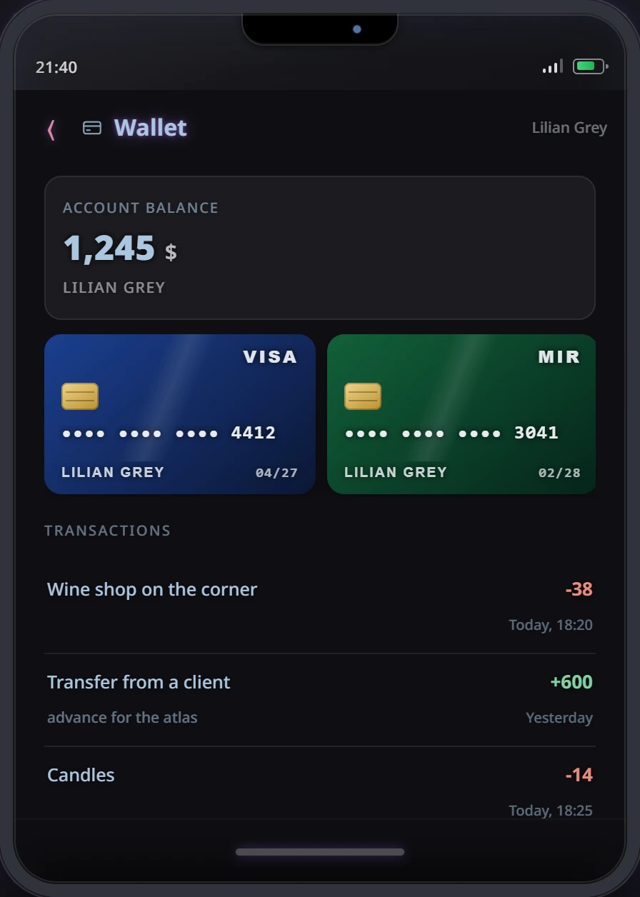<br>Wallet</td>
<td align="center">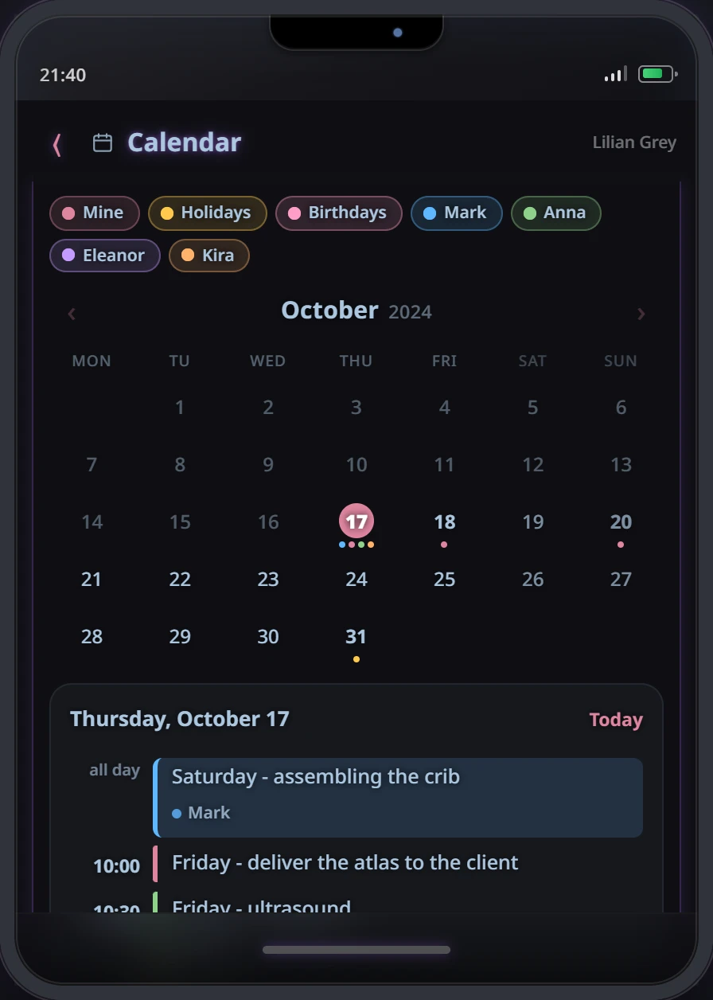<br>Calendar</td>
</tr><tr>
<td align="center">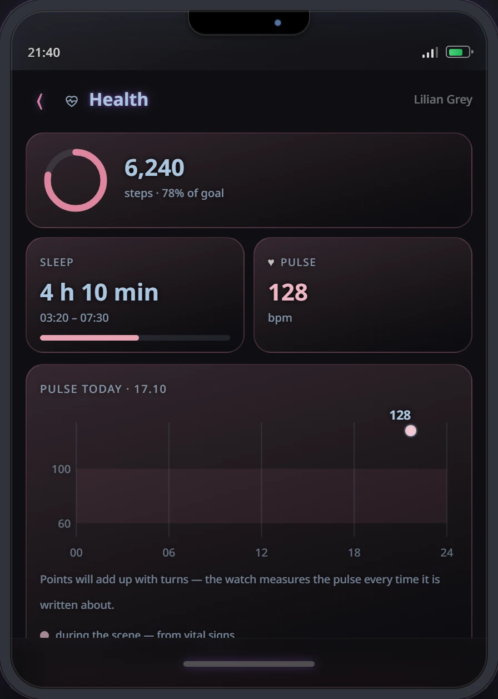<br>Health</td>
<td align="center">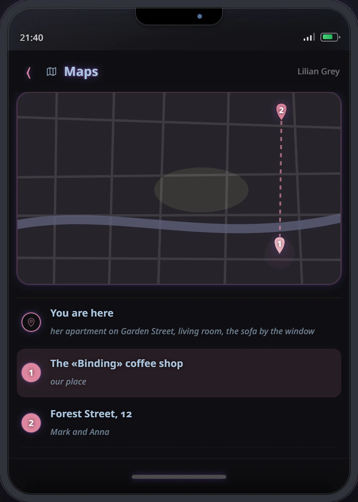<br>Maps</td>
<td></td>
</tr></table>

</details>

### 📡 Intercepts

Other people's chats and conversations your character shouldn't know about — a look over the author's shoulder. They appear only when the model itself decides to show what's behind the scenes.

<p align="center">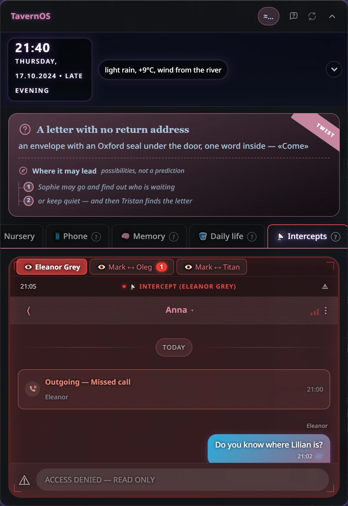</p>

### 🗝️ Medieval: the casket and overheard talk

For settings before phones, the smartphone is replaced by a **casket**: sealed letters (the seal breaks when opened), a church calendar with the moon phase, a purse with a ledger, quill notes, a map, charters and keepsakes. Intercepts are replaced by **overheard** talk: conversations through a wall and other people's letters opened in secret. The era is switched with one setting: **🧩 HUD blocks → Era**.

- **Period language** — labels and units fit the time: a saints' calendar instead of a calendar app, a purse with gold, silver and copper coins instead of a bank card, letters with wax seals instead of chats.
- **Parchment with any theme** — the casket and overheard talk look like aged paper with wax seals in dark, light and custom themes alike.
- **Inaudible** — what the character couldn't make out through the wall is blurred; tap it to see what was actually said.
- **Period music** — scene music can pick old music or a film-style soundtrack.

<table><tr>
<td align="center">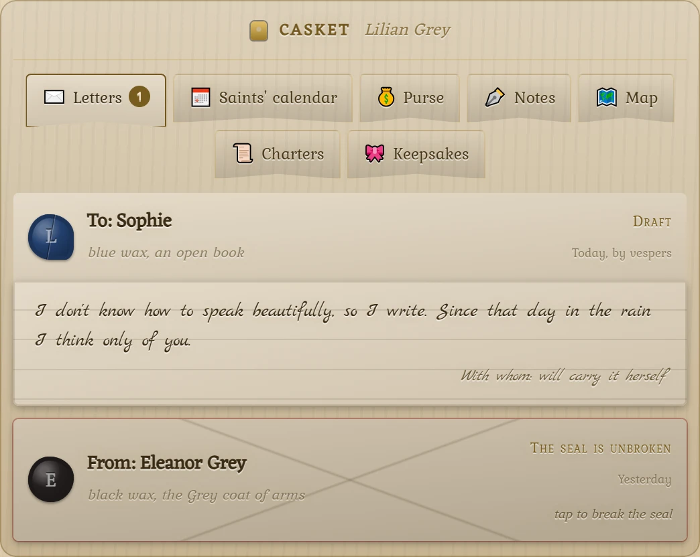<br>Letters: a draft and an unopened one</td>
<td align="center">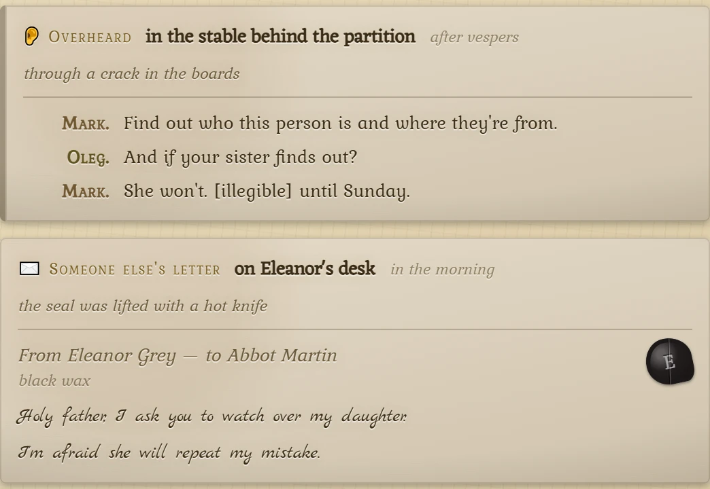<br>Overheard</td>
</tr><tr>
<td align="center">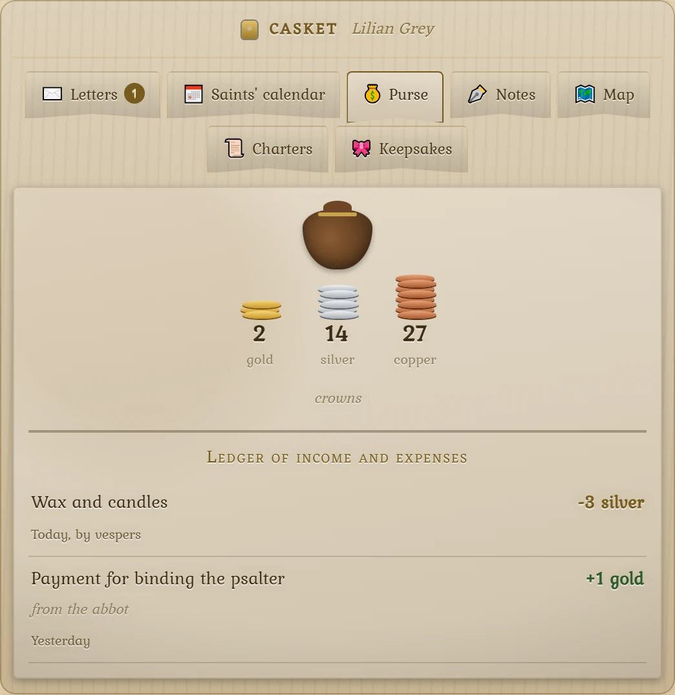<br>Purse</td>
<td align="center">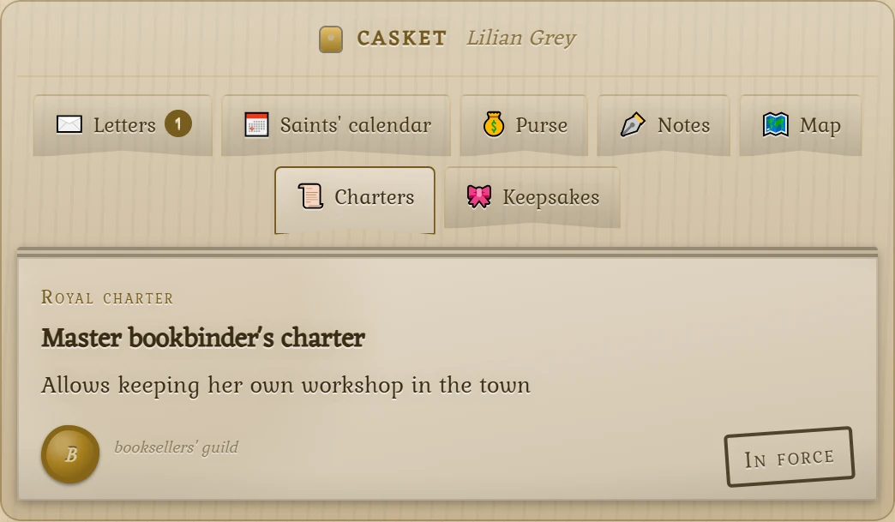<br>Charters</td>
</tr></table>

### 🧠 Memory

The tab where history accumulates instead of a snapshot:

- **Timeline** and **important** — what happened and in what order.
- **Secrets** — who hides what from whom, the danger and exposure level. A secret can be added to a lorebook with one button — then the model remembers it even without the HUD.
- **Chekhov's guns** — open plot threads: promises, threats, hints, mysteries.
- **Emotions** — how the main characters' mood changed; **route** — where they've been during this stretch.
- **Relationship graph** — a web of everyone's ties: romance, friendship, conflict, jealousy, fear, suspicion, family, parents and children, superiors, mentors, duty, the forbidden, accomplices, shared groups. Nodes with avatars; tapping a node or a link highlights its surroundings; the graph opens full screen.
- **Family tree** — a second view of the same graph when the relationships include kinship.

<details><summary>📷 The Memory tab with the relationship graph</summary>

<p align="center">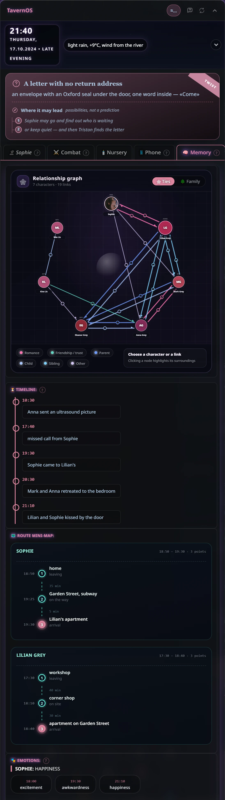</p>

</details>

<details><summary>📷 Family tree</summary>

<p align="center">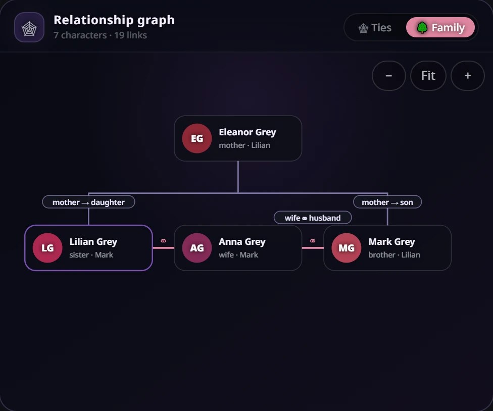</p>

</details>

### 🧺 Daily life

Food, sleep, showers, laundry, cleaning, clothing, money and home **across all past turns**: how long since the last time, the sleep debt for the week, what's in the laundry, familiar prices, what broke, who owes whom. "Could use a shower" is computed from hours, heat and exertion; "not dressed for the weather" — when a character is out in the frost without outerwear or in the heat in a coat. The HUD derives all this from what the model writes anyway. The daily-life summary can be shown to the model as one line, only when it's on topic, or via a macro — or kept just for you.

<details><summary>📷 The Daily life tab</summary>

<p align="center">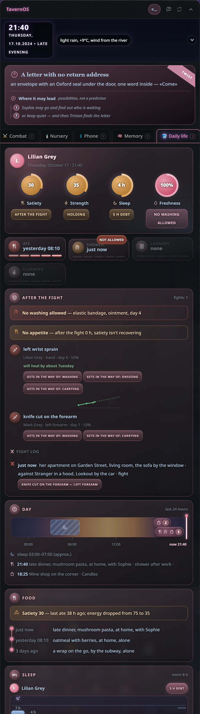</p>

</details>

### ⚔️ Combat

Appears only while there's danger: stage and turn order, distances, wounds on a silhouette, weapons with ammo, adrenaline with a crash timed by story time, composure, cover, a chase bar. In peaceful turns the model doesn't write this block and it costs nothing.

<details><summary>📷 The Combat tab</summary>

<p align="center">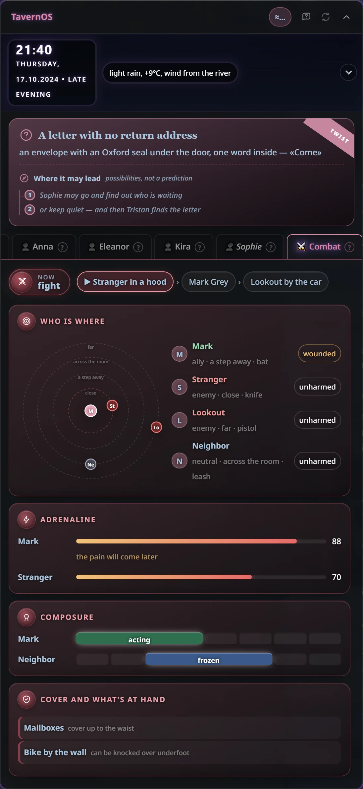</p>

</details>

### 💬 Verbal duel

While an argument is going on: who leads and by how much, who conceded what, the heat, and a memory brought up in the argument.

### 📖 Diary and 🕯 body diary

The character's personal notes in their own words (subjective — they can be wrong and lie to themselves) and the body diary — an entry about the body during intimacy and after it: what it wants, what it gets, what aches and which marks are left.

<p align="center">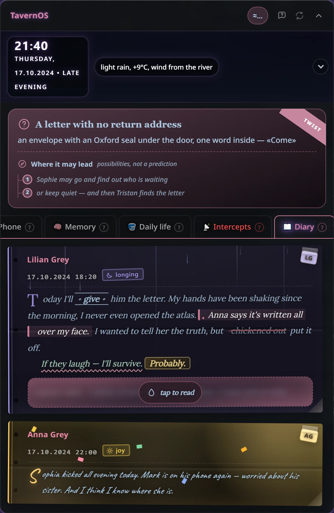</p>

### 🌙 Dreams

What the characters dreamed tonight — in images and hints, with an interpretation under each dream: what fear or desire is behind it. A dream is veiled in mist and clears up in a few taps, as if you're remembering it in the morning. A good way to show what a character won't admit even in their diary.

<p align="center">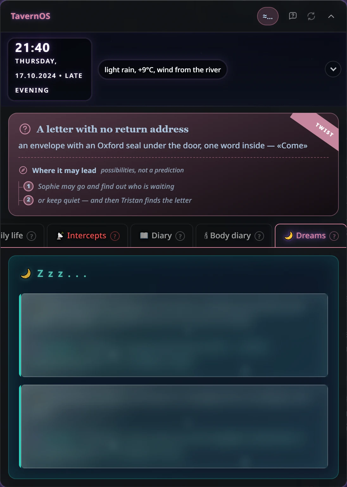</p>

<details><summary>📷 Dreams after a few taps — the mist has cleared</summary>

<p align="center">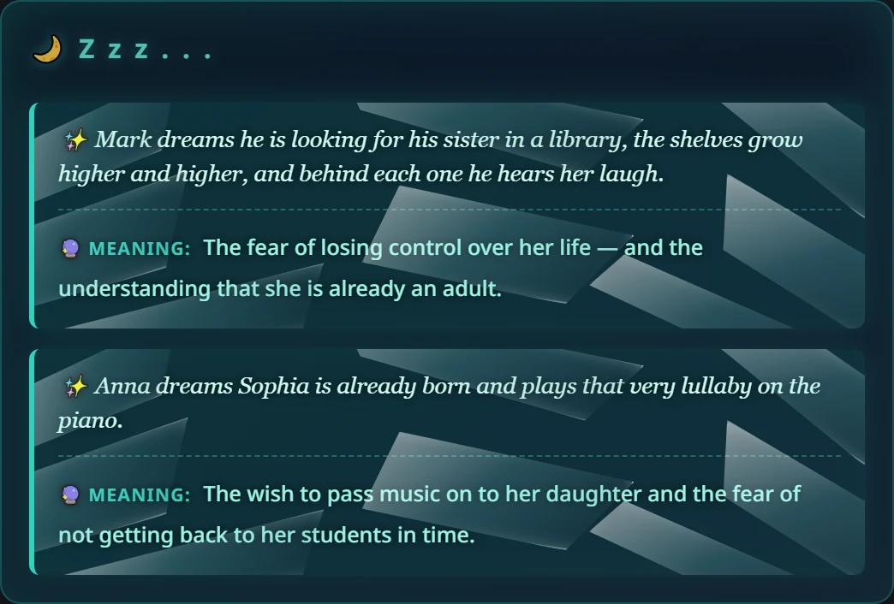</p>

</details>

### 🌸 Health and family

For stories where the body and family matter — three linked blocks. Each is turned on separately in the "Characters" group and appears only for those it concerns.

**Menstrual cycle.** A ring with the cycle day and current phase, the expected period, the PMS window, delays and cycle disruption from stress. Under the ring — tips for the phase and the conception chance with protection taken into account; you can "take a test" right from this block. The cycle is tracked for everyone who has one, including your character.

<details><summary>📷 The cycle card</summary>

<p align="center">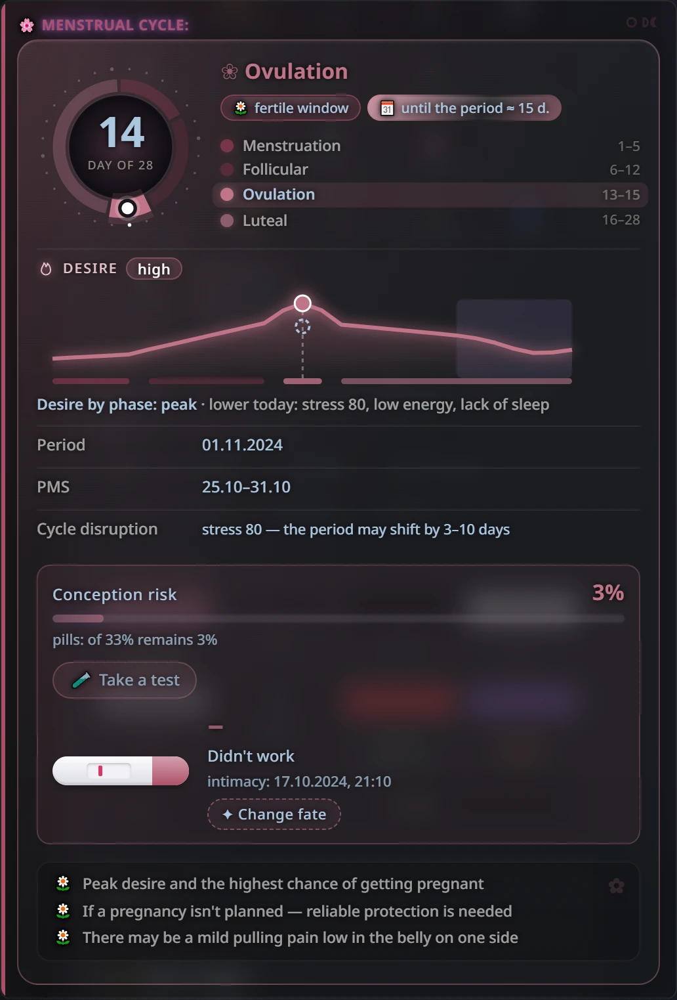</p>

</details>

**Pregnancy.** The term in weeks and the trimester, a bar to the birth, the baby's size compared to a fruit, what it can already do and the next milestone. The father, symptoms, cravings, who already knows, how the pregnancy is going, the next doctor's visit and tips for the term, including warning signs. The number and sex of the babies are decided by a die roll, and you can "change fate" if you want. This goes to the model as a hidden fact or not at all, as you choose.

<details><summary>📷 The pregnancy card</summary>

<p align="center">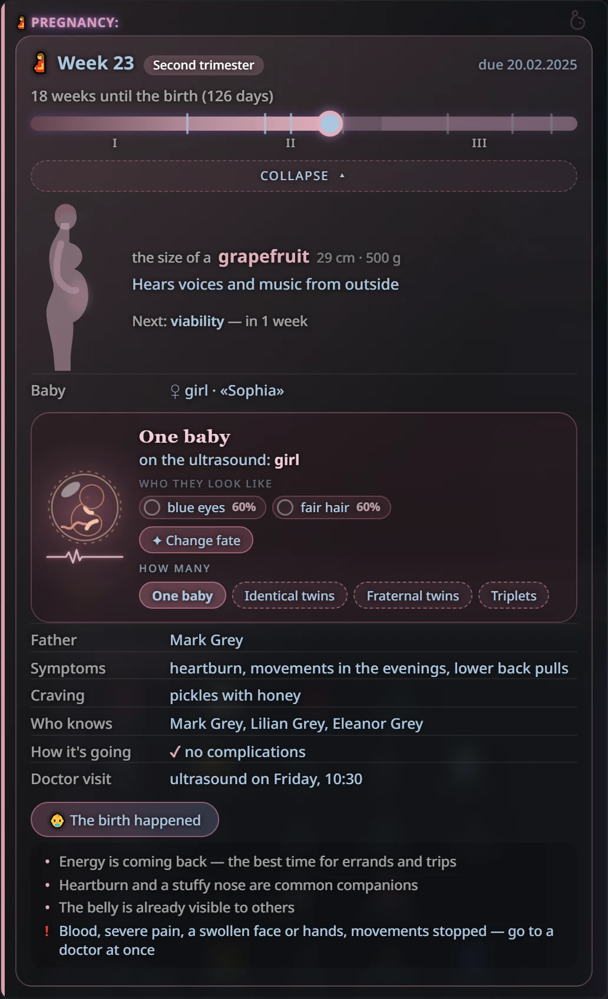</p>

</details>

**Birth and the "Nursery".** After the "The birth happened" button, pregnancy is replaced by the postpartum period: recovery and feeding. A **"Nursery"** tab appears with a card for each baby:
- **developmental milestones** on an age scale: what the baby can already do, what's about to appear, what comes later;
- **care norms by age:** feeding, sleep, diapers, teeth;
- **timers:** when to feed, how long they've slept, when the diaper was changed;
- **like the grown-ups:** state, health, thoughts, favorite things, schedule, relationships and trust toward adults, fears and first words.

When a child grows up (by default at three), they move from the "Nursery" to regular character cards.

<details><summary>📷 The Nursery tab</summary>

<p align="center">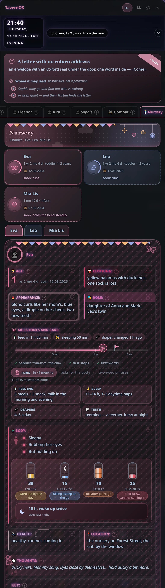</p>

</details>

### 🌍 World

A summary for today: news, rumors, ads, the weather forecast, a horoscope, online comments, exchange rates and prices, events (cinema, theater, concerts), city services (traffic, transport, incidents). The world deliberately doesn't carry over from past turns so news from different days doesn't mix.

<details><summary>📷 The World tab</summary>

<p align="center">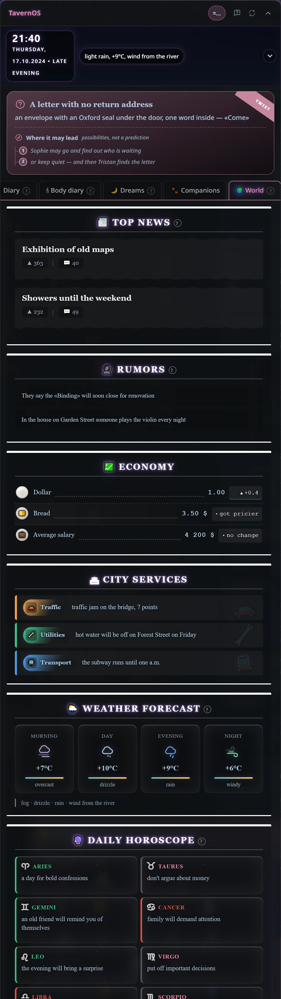</p>

</details>

### 🎵 Scene music

A "now playing" strip above the tabs: a **soundtrack** for the moment, like in a movie, and music **in the scene** — what the characters themselves hear (a car radio, an orchestra at a ball). The playlist is picked by a separate small request from the HUD scene, again only when the scene changes or on a button; each part can be picked separately. Tracks are checked by search, and made-up ones are marked. The ▶ button plays right in the Tavern: a clip or a full track. Volume, the number of tracks and a wish ("music for running") live right in the playlist. Each track has ♡ "like" and ⊘ "don't suggest": the next playlists lean toward your taste. You can pick the song language and a meme soundtrack (by a button, or by itself in a funny scene). If a radio plays in the scene, "In the scene" turns on a live broadcast: Radio Record or world stations. "Scene background" plays full free tracks matching the scene's mood with no breaks — from the Russian Fonau library, Audius, Incompetech, and in the Middle Ages also Wikimedia Commons; it can take over right after a song's 30-second clip. While music plays and its card is out of view, a tiny translucent icon sits at the edge. The character's phone gets a "Music" app: what they listen to now, their named playlists (the model builds them from the card, lorebooks and latest messages; "More" adds without repeats) and their "Liked". The archive gets a "Soundtrack" by chapters. Off by default.

<p align="center">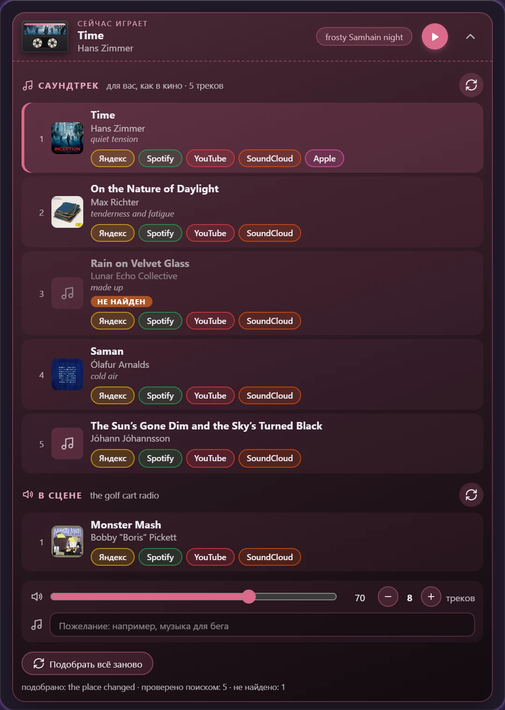</p>

<details><summary>📷 "Music" in the phone and the soundtrack in the archive</summary>

<p align="center">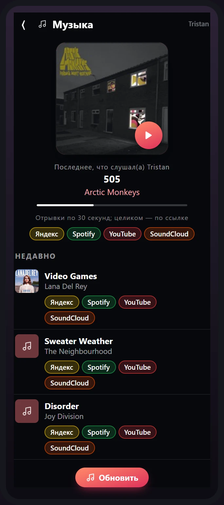 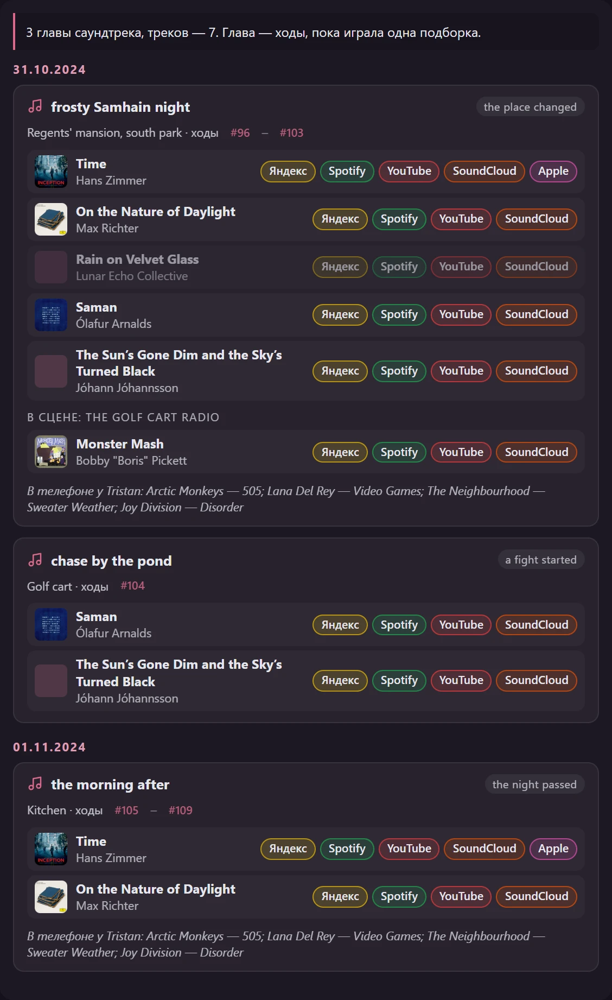</p>

</details>

### 🐾 Companions

Animals, familiars, drones: mood, condition, diet, attachment. Their own tab — only when there are companions.

<p align="center">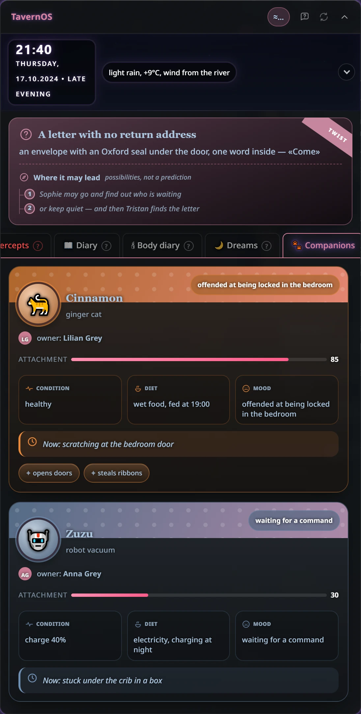</p>

### 🗄 HUD archive

A summary of the whole chat history, via the **🗄 HUD archive** button in the settings. Choose a range (the whole chat, the last 50 or 200 messages) and press "Analyze". Tabs:

- **Secrets** — every secret across the history: who knows and who doesn't, when it appeared and when it was last mentioned.
- **Guns** — Chekhov's guns: which threads are still hanging, which fired and when.
- **Relationships** — how pairs changed: shifts in attitude and trust by turn.
- **Timeline** — scenes by story day: where, how many turns, how much time passed.
- **Soundtrack** — music chapters by day (if scene music is on).
- **Statistics** and **Dashboard** — how many messages and days, who talks more, the model's reply length, repetition, dull zones, scene rhythm, dialogue vs description, who mentions whom. Dashboard widgets are picked with checkboxes.

The archive also works for chats the HUD has been cleaned out of: the HUD keeps a **chronicle** — short summaries of every turn in a separate file on your SillyTavern. You can attach another chat's chronicle of the same character (say, an old copy) to your own — its turns fill the gaps without duplicates. There's search within the report and JSON export.

### 🗂 HUD on the side

The card can live in a panel at the window edge instead of the messages. Turn it on in the settings: **✨ Display → Where the HUD is**.

- **In messages** — as before.
- **On the side and in messages** — a panel with the HUD of the latest reply; cards in chat stay.
- **Only on the side** — messages get a small button with the scene time and date from that turn's HUD instead of the card; it opens the turn in the panel, and the button of the turn currently in the panel is highlighted. Full cards are not built in the feed, so long chats get noticeably lighter.

The panel opens from an icon in the Tavern top bar and sits on the right or the left (a button in the panel header or the "Edge" setting). It follows the latest reply: a new reply, a swipe, a regeneration or an edit update it on their own. Arrows and dots page through past turns, "to the latest" jumps back; the open tab stays as you page. Drag the edge to resize it — from narrow to almost the whole window, over the chat; near the chat column it snaps to it ("up to the chat"), and from then on the panel takes all the room up to the column. On phones the panel slides out over the chat and closes with a tap outside it. All views, themes and card buttons work in the panel too.

### 🔞 Adult scenes (18+, optional)

For stories with adult content, the extension has a separate set of blocks. They appear only during an intimate scene and shortly after it. Each can be turned off separately in the settings, or you can turn off this whole part at once: then the model doesn't get a word about it. Outside such scenes these blocks simply don't exist — neither on screen nor in the request.

What they give:

- **The course of the scene** — stage, setting, duration, how the characters feel and react, aftercare.
- **Schematic visualizations** — the scene's tempo and simple diagrams built from the reply text itself, with no extra fields from the model.
- **Scene clock** — how much story time has passed and what the characters missed on their schedules meanwhile: dinner, a call, a meeting.

The cycle, pregnancy and the "Nursery" are not part of this: they're described above under "Health and family" and are turned on separately.

This part of the instruction is the largest, so by default it goes to the model **only while a scene is actually happening** (you can choose "always" or "never"). HUD tells that a scene is happening both from the text and from the last HUD: arousal in physiology, body, thoughts or subtext, desire in the diary or the body diary. There are deliberately no screenshots of these blocks in the README.

---

## Tools

| Tool | What it does |
|---|---|
| 🔄 **HUD regeneration** | Rebuilds only the message's HUD without touching the reply text. Can use another, cheaper connection profile, with chosen lorebooks and the card description. |
| ➕ **Create HUD** | A button on replies without a block — add a HUD to an existing message. |
| ↶ **HUD versions** | The previous HUD isn't lost on regeneration — restore it with one button. |
| 🩺 **Completeness check** | After a reply, the HUD is checked for required fields. An incomplete one can be completed by regeneration, or you can just get a warning. There's also a check for contradictions with daily life. |
| 🧩 **Fill in what was skipped** | If the previous HUD missed something required, a short request to include it now rides along with the regular request. It's not a separate generation. |
| 🎯 **Boosts** | If the model in this chat regularly leaves thoughts, the diary or the horoscope empty, a short reminder is added to the instruction. Counted separately for each model. |
| ❓ **Ask about the story** | A window for questions to an assistant: why a character behaves like this, what they hide, what could happen next. It answers from the HUD, recent messages, author's notes, the card, the persona and lorebooks — whatever you choose. Nothing is written to the chat. |
| 🎵 **Scene music** | A "now playing" strip above the tabs: a soundtrack for the moment and the music the characters hear. Picked by a separate small request from the HUD scene, again only when the scene changes or on a button; "Soundtrack" and "In the scene" can also be picked separately. Tracks are checked by search in turn — iTunes, NetEase, QQ Music, until the first hit; made-up ones are marked. The ▶ button plays a track right in the Tavern: a 30-second iTunes clip or, optionally, the full track — from YouTube via Invidious mirrors, via an unofficial NetEase service, or via MoodTube; the next one starts by itself. Volume, track count and a wish for the playlist ("music for running") are right in the open playlist. There are also links to Yandex Music, Spotify, YouTube and SoundCloud, and the MoodTube queue. A track's ♡ "like" and ⊘ "don't suggest" are your taste: the model leans toward what you liked and never suggests what you banned. Song language; a meme soundtrack (one-off button, in a funny scene, or always). Radio in the scene: the model names the station genre and a live broadcast plays — Radio Record (117 genre stations, for Russia and Russian genres) or world stations from the radio-browser catalog. A floating "now playing" icon while the music's card is out of view. Scene background in full: a queue of full free tracks matching the scene's mood with no model request — Fonau (a Russian library, search in Russian), Audius, Incompetech (catalog built in), in the Middle Ages Wikimedia Commons; it follows a song's clip right away. The playlist is stored in the turn and in the chronicle; the archive has a "Soundtrack" tab with chapters by day. The character's phone has a "Music" app: what they listen to now, named playlists (a separate request from the card, lorebooks and latest messages; "More" adds without repeats) and their own "Liked" — it goes only into their requests. Off by default. |
| 📚 **Save to Lorebook** | A secret or fact from the HUD becomes a lorebook entry with one button — you can let the model write it from the scene context. |
| 🗄 **HUD archive** | A summary of the whole chat history: secrets, Chekhov's guns, relationships, timeline, statistics and a dashboard — how everything changed and how many days passed. With JSON export. |
| ≈ **Token budget** | A "≈4.1k" chip in the card: how much the HUD instruction costs and what weighs how much in it. |

---

## Appearance

The **🎨 Customization** window with a live preview:

- **27 ready-made themes in 7 sets** — Kawaii, Dark Academia, Vamp, Cyberpunk, Noir, Middle Ages, Fantasy, Crime, Web 1.0, Cottagecore, Ice, Deep sea, Steampunk, Dieselpunk, Solarpunk, Biopunk, Space opera, Feudal Japan, Ancient Egypt, Western, Pirates, Witchcraft, Voodoo, Space horror, Darkroom, Tea Party, Bullet Journal. Light and dark; many themes have spare palettes — the same drawings in other colors.
- **Your own theme** — palette, glow, glass (frosted, tinted, clear, pearl, liquid), fonts, blur, separate colors for memory, the phone, alerts and intercepts. A theme can be saved to a file and shared — when loading someone else's file, only known fields are taken and their values are checked.
- **43 blocks with alternative views** — for example, trust as bars, hearts, a shield, a traffic light or orbits; fears as a list, thermometers, skulls, clouds or a radar; secrets as safes, folders, a web or envelopes; the route as a diagram, a strip, a map or tickets.
- **Tab order** — arrange the card's tabs (characters, phone, memory, daily life, diary…) in any order right in the chat: press and hold a tab for half a second and drag it along the strip — with a finger or the mouse, it works on phones too (a short tap still opens the tab, and a swipe scrolls the strip). The same in Customization → 🗂 Tabs: by the ⠿ handle or with ↑ ↓ buttons. Any tab can be pinned first or hidden — a hidden block is still written and accumulates, and you can see what it costs in tokens.
- **Avatars** — one image for any number of name spellings; names listed together count as one person in the graph, chats and intercepts. Photos show wherever there used to be initials: in intercepts, the phone, pets and other avatar circles.
- **Banners, portrait frames, decorative details** — plasters, bows on tabs, wax seals, aged paper, hanko, drop caps and more, each separately.

<table><tr>
<td align="center">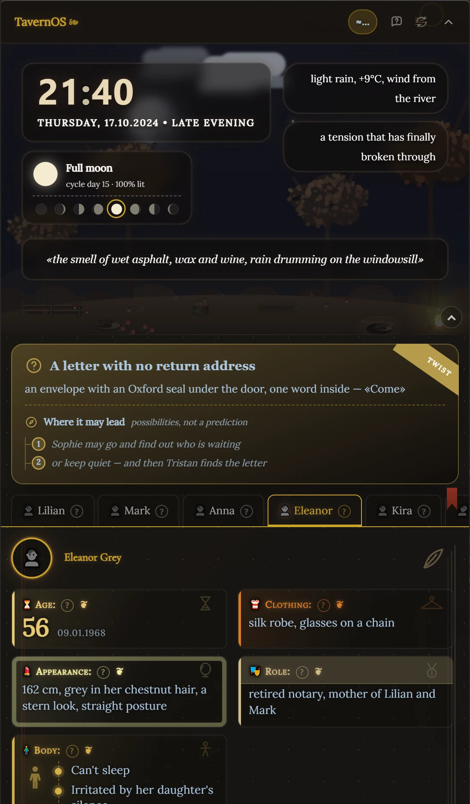<br>Dark Academia</td>
<td align="center">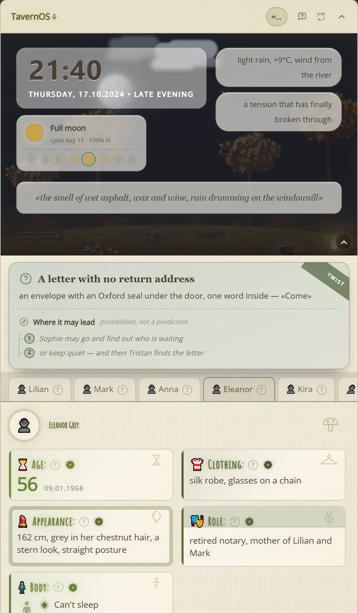<br>Cottagecore</td>
<td align="center">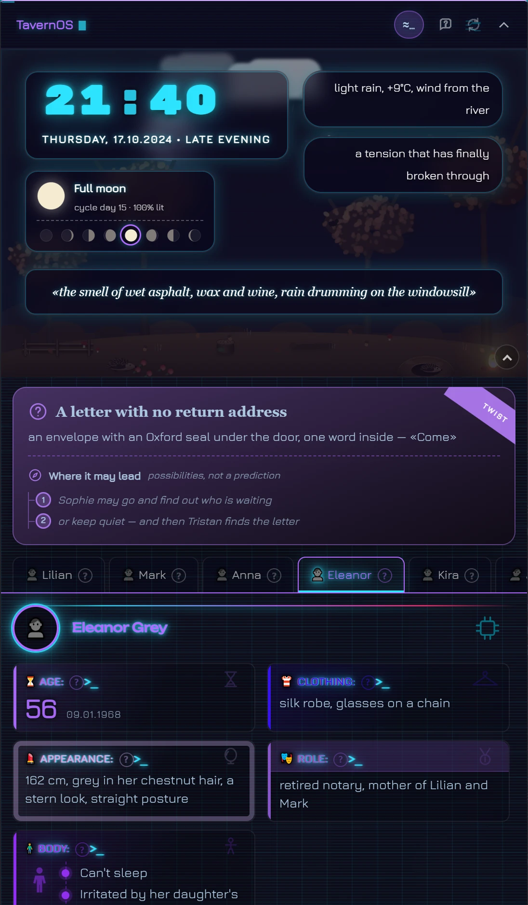<br>Cyberpunk</td>
</tr></table>

A few alternative block views (switched in "Customization" → "Block views"):

<table><tr>
<td align="center">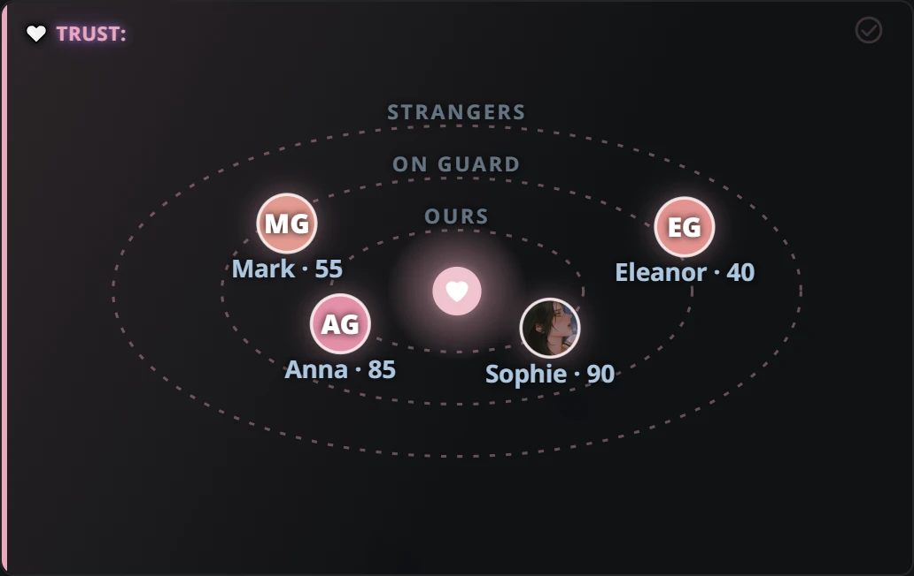<br>Trust — orbits</td>
<td align="center">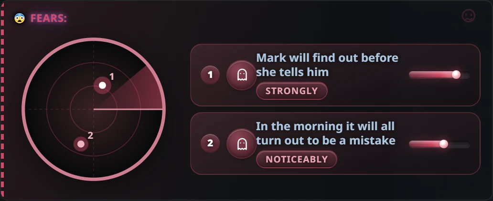<br>Fears — radar</td>
<td align="center">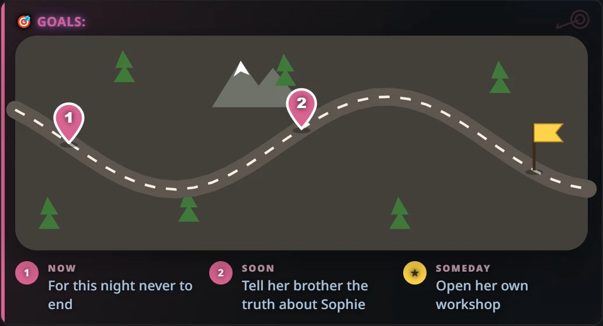<br>Goals — road</td>
</tr><tr>
<td align="center">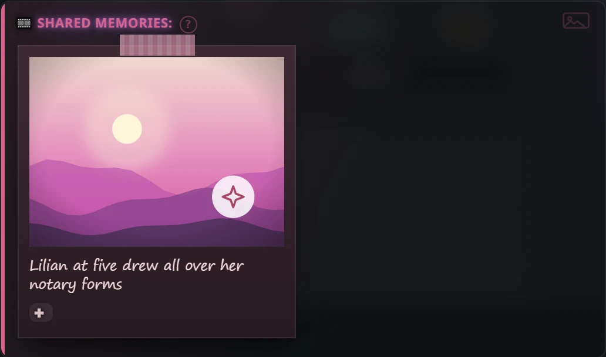<br>Memories — polaroids</td>
<td align="center">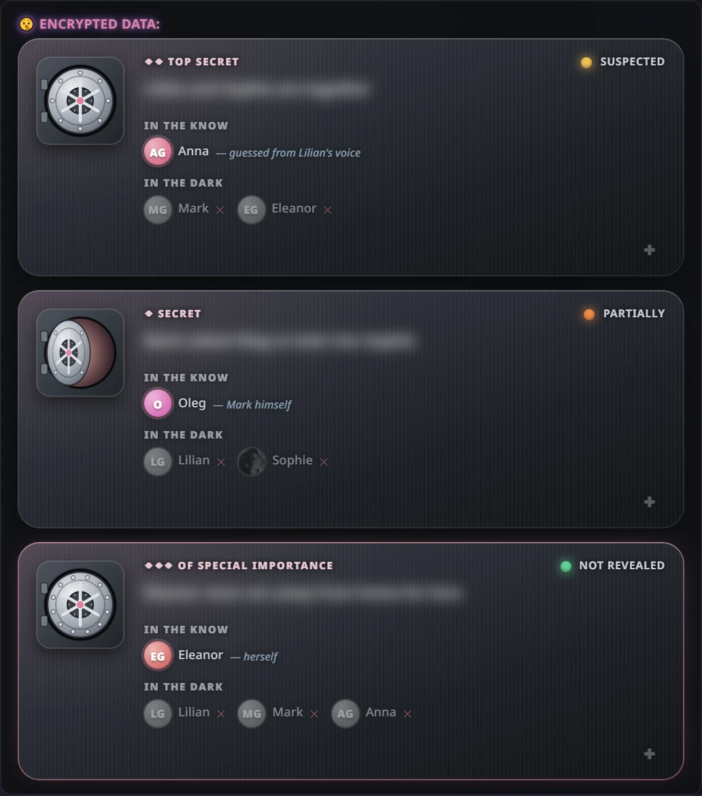<br>Secrets — safes</td>
<td align="center">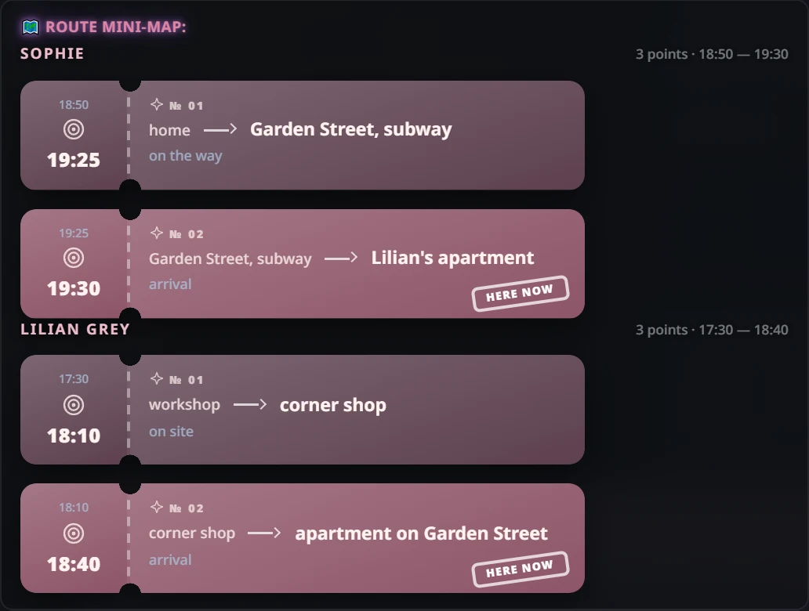<br>Route — tickets</td>
</tr></table>

---

## How it works

1. **Instruction.** Before each generation the extension adds the HUD schema to the request — the task, rules and field codes. Modules turned on and off rebuild the schema: a module that's off costs zero tokens.
2. **Reply.** The model writes a normal reply and, at the end, a block:

   ````text
   [HUD]
   ```json
   { "sc": { "T": "21:40 | late evening", "Wt": "light rain, +9°C" }, "cs": [ { "N": "Mark", "Md": "…", "Th": "…" } ] }
   ```
   [/HUD]
   ````

   Keys are short English codes (`sc`, `cs`, `Th`), values are full words in the interface language. On screen everything is shown in the interface language.
3. **Card.** The block is parsed (repairing truncated and malformed JSON, with a YAML fallback) and becomes a card in place of the raw text.
4. **Saving context.** In later requests, old HUDs in the history are replaced with short `[HUD_SUMMARY]` summaries, and the latest HUD goes to the model as a snapshot at the end of the instruction — the model updates it for the new reply.
5. **Continuity.** Chats, secrets, notes, the calendar and calls are gathered from past turns right before drawing. This works on screen only: message text and the request to the model don't change.

### Which requests get the HUD

The HUD instruction goes **only to chat reply requests** — a normal message, a swipe, a regeneration, a continue. Everything else goes without it:

- SillyTavern's **quiet generations** — summaries, auto-translation, image prompts;
- **Impersonate** — a message written for the player;
- **raw requests from other extensions** (`generateRaw`): summaries, TunnelVision, lorebook tools;
- **direct requests from extensions**, such as **Ext Blocks**;
- **MemoryBooks** — writing a memory to a lorebook;
- **the HUD's own service requests** — "Ask about the story", saving to a lorebook, picking music.

What's more, in those other requests the `[HUD]` blocks are cut out of the history and replaced with a short `[HUD_SUMMARY]` — date, time, who is where and wearing what. Summaries and memories know when and where things happened without dragging in the whole HUD.

---

## Works great with

- **[MoodTube](https://github.com/moonnsy/MoodTube)** — scene music plays full tracks right in the Tavern through MoodTube: the ▶ button with the "MoodTube" source, queue buttons in the playlist and in the archive soundtrack ("all to the MoodTube queue"). If MoodTube already tells the model its track, the HUD doesn't duplicate its own music line.
- **[SillyTavern-MemoryBooks](https://github.com/aikohanasaki/SillyTavern-MemoryBooks)** — with **"📚 MemoryBooks: count the scene without the full HUD"** (the "Lorebooks" group), MemoryBooks doesn't get full HUD blocks: the HUD sets up a rule for it and puts a short summary in place of each block. The scene for a memory gets several times shorter, MemoryBooks doesn't reject it for size, and the memory still knows the date, the place and who was wearing what.

---

## Security and privacy

- **The HUD has no servers.** No accounts, analytics, telemetry or "cloud" — the extension sends nothing to anyone.
- **Everything is stored only in your SillyTavern.** HUD blocks live inside your chat messages; the archive chronicle is a file on your own SillyTavern server (`user/files`); settings are in the browser (`localStorage`) with a copy in your SillyTavern extension settings (`settings.json`), the parse cache in the browser's IndexedDB.
- **The model sees only what goes through your API** in SillyTavern — the same channel as normal replies.
- **The only exception is scene music, and only if you turn it on.** To find a track, the HUD sends the catalog (iTunes, optionally NetEase and QQ Music) **only the artist and track title** — no chat text, no character names. Full tracks, if you pick such a source, play from YouTube mirrors (Invidious) or through MoodTube. Radio in the scene asks the radio-browser.info catalog **only for the station genre and a country code**; the scene background asks Fonau, Audius and Wikimedia Commons **only for mood words** ("тревожная", "dark ambient"); streams play straight from the stations (Radio Record from its own server). With music off, not a single external request is made.
- A theme can be loaded from someone else's file — only known fields are taken and their values are checked, so a file can't inject its own markup.

---

## Performance

The extension is built for chats with hundreds of messages and for phones:

- **Lazy tabs** — only the open tab is built, the rest on switching.
- **Lighter old cards** — a collapsed card keeps only its title on the page; when a chat opens, only the last few are built in full.
- **Virtualization** — in chats over 200 messages, cards far from the screen turn back into text and are rebuilt on scrolling.
- **Card limit** — you can keep only the last N in memory.
- **Only on the side** — a single full card is built, in the side panel; messages get a small button instead of the card.
- **Parse cache** in IndexedDB and a background worker for heavy history parsing.
- **KoboldCpp context cache** — in Text Completion the HUD instruction is a regular SillyTavern extension prompt placed before the reply prefix: it counts toward the context budget and stays the same between turns, so KoboldCpp doesn't reprocess the whole chat on every reply. Requests with a negative prompt also get the instruction and no longer need a second repair request.

---

## Installation

1. In SillyTavern open **Extensions → Install extension** and paste the repository address: `https://github.com/alewwi/HUD`
   *Or manually:* put the extension folder into `data/<your-user>/extensions/HUD` (or `public/scripts/extensions/third-party/`) and reload the page.
2. A **📊 TavernOS** block appears in **Extensions**.
3. For the English interface, set **🌐 Язык / Language → ENG** at the very top of the block; the page reloads.
4. Turn on **🔌 HUD in every reply** — then the main model writes the HUD along with each reply. If you don't want to spend every reply on it, leave it off: replies get a **➕ Create HUD** button, and the HUD is written by a separate request only when you press it — optionally with another, cheaper profile.
5. Send a message — a card appears under the reply.

Requires SillyTavern **1.12** or newer (tested on 1.18). The extension works with any API that supports Chat Completion or Text Completion. The HUD is generated by the same model that runs the story; regeneration and the assistant can go through a separate connection profile.

### Tips to start

- Start with a moderate set of modules and turn on the rest as needed: each module adds fields to the schema. How much each section weighs is shown in the token budget chip.
- The whole phone is about 800 tokens per turn; turn off the apps you don't use.
- **"How many expanded HUDs to keep" = 1** — the model sees only the snapshot of the latest HUD, the rest are compressed into summaries. This is the sweet spot of cost and quality.
- Models with a large context and careful format following do well. If the model drops fields, turn on "Fill in what was skipped" and "Boosts".

---

## Settings

All settings are in the **📊 TavernOS** block in "Extensions" and in the "Customization" window.

**🌐 Язык / Language** — the very first item, outside any group: RU or ENG. It changes the interface language (cards, windows, settings, notifications) and the language in which the model writes HUD values. The page reloads after you choose. Translation is a layer over the markup driven by a dictionary (`i18n.js`, `i18n-en.js`); character names and chat message text aren't translated.

**The same settings on every device.** HUD settings are kept both in the browser and in SillyTavern's extension settings, so a PC and a phone opening the same SillyTavern see the same thing: on load, the copy saved later wins. Backgrounds and banners uploaded as files stay on their own device — heavy images aren't sent to the server.

| Section | What you configure |
|---|---|
| 🧩 HUD blocks | HUD in every reply (network intercept) or only on the button; the player block; era (phone or casket) and individual apps; intercepts or overheard talk; memory and Chekhov's guns; illnesses, pregnancy, birth and babies, the cycle; "what they think of you"; family tree; body state; plot twists; companions; adult-scene blocks (each separately); verbal duel; combat (decide itself, always, never); daily life and the sleep norm; diary, dreams, world, economy, events, city services, horoscope. |
| ✨ Display | Where the HUD is: in messages, on the side and in messages, only on the side; panel width (custom or up to the chat) and edge (right or left). Question-mark hints; lists from past turns: how many turns to look back, the item limit per list and messages per chat. |
| ⚡ Performance | Lighter old cards, how many cards to build at once, lazy tabs, Performance Mode, virtualization, card limit. |
| 🖼️ Avatars | Images for character names, pinned avatars. |
| 📚 Lorebooks | Which lorebooks to add to the HUD regeneration request; how many messages to send when saving to a lorebook. |
| 🤖 Generation | HUD token limit; the instruction as a separate message; a snapshot of the latest HUD; completeness check; "Fill in what was skipped"; contradictions with daily life; the adult-scene part (auto, always, never); boosts; how many expanded HUDs to keep; context and profile for regeneration. |
| ❓ Assistant | The "Ask about the story" button; what the assistant sees (messages, HUD, author's notes, card, persona, lorebooks); profile, reply limit and system prompt. |
| 🎵 Scene music | Picking music for the scene; refreshing when the scene changes; connection profile; the Middle Ages (period music or a movie soundtrack); strip style (cassette, vinyl, scroll); how long to wait for a playlist (any number of seconds, 0 — no timer); reply limit (from 2048 tokens — with room for thinking models); the built-in player and source (clips, YouTube via mirrors, NetEase, MoodTube); checking tracks by search and fallback services (NetEase, QQ); the prompt: your own taste rules, how many messages to read, the character card, the persona, your lorebooks; in-scene music — to the model as one line; song language, meme soundtrack, radio in the scene, floating icon, clearing likes and bans; scene background in full, "after a clip — background", background sources (Fonau, Audius, Incompetech, Wikimedia Commons). |
| ⚠️ !!DANGER!! Remove HUD from chat | The very last item. Permanently cuts `[HUD]` blocks out of every message and swipe of the open chat, together with saved HUD versions and music picks. Asks first and shows how many messages and blocks it will touch. |

### Mini-guide: what does what

Settings are grouped — expand the one you need. Below is the essential part of each.

**🌐 Язык / Language** — the language of the interface and of the HUD values. The very first item.

**🧩 HUD blocks** — what goes into the card at all. Every block you turn off disappears both from the screen and from the model's instruction, so it saves tokens.
- *Era* — "modern" (phone and intercepts) or "medieval" (casket and overheard talk); phone apps and casket sections are turned on one by one.
- *Memory and plot* — timeline, secrets, routes; Chekhov's guns; plot twist cards.
- *Characters* — the player block, "What they think of you", the family tree, companions.
- *Body and health* — illnesses and injuries, body state (energy, sleep, stress), the cycle, pregnancy, birth and the "Nursery". The number and sex of babies can go to the model as a hidden fact or not at all.
- *Daily life* — the daily-life tab; "Daily life → model" decides whether the model sees the summary (one line, on topic only, or via the `{{hudByt}}` macro); the sleep norm.
- *Intimacy* — the adult-scene parts and the "decide itself / always / never" mode.
- *Combat and arguments* — combat (decide itself, always, never) and the verbal duel.
- *Diary, dreams and world* — diary, dreams, world, economy, events, city services, horoscope.

**🤖 Generation** — how the HUD goes to the model and how it's checked.
- *HUD in every reply* — the main switch: on — the model writes the HUD in every reply; off — the HUD only via the “➕ Create HUD” button, as a separate request.
- *Instruction as a separate message* — the schema goes as the last message after the preset and history. Turn it off if your backend doesn't accept a system message at the end.
- *Snapshot of the latest HUD* — the model updates the previous HUD instead of rebuilding the world. Helps continuity a lot.
- *How many expanded HUDs to keep* — the rest in the history shrink into summaries. 1 is the sweet spot.
- *Reply check* — what to do with an incomplete HUD (warn or complete it), contradictions with daily life, "Fill in what was skipped", "Boosts".
- *HUD regeneration* — connection profile (can be cheaper than the main one), how many messages to send, token limit.

**📚 Lorebooks** — which lorebooks to add to HUD regeneration; how many messages to send when saving to a lorebook; the MemoryBooks link.

**✨ Display** — where the HUD is (in messages or in the side panel, see “🗂 HUD on the side”), question-mark hints, the icon set, `[HUD_SUMMARY]` lines shown as a card. *Lists from past turns* — how many turns to look back and how many items to keep on screen (on screen only, nothing goes to the request).

**🖼️ Character avatars** — your own image for a name (or several spellings of one name), pinned player and character avatars.

**❓ Assistant** — the "Ask about the story" button: what it sees (how many messages, the HUD, author's notes, the card, the persona, lorebooks), profile, reply limit, your own system prompt.

**🎵 Scene music** — on/off and auto-refresh when the scene changes, profile, strip style, medieval music, the built-in player and sound source, checking tracks by search, how long to wait for a playlist, reply limit, your own prompt and context for picking.

**⚡ Performance** — lighter old cards, lazy tabs, speeding up two SillyTavern rules; for chats over 200 messages — Performance Mode and virtualization; a card limit.

**🧹 Maintenance** — "Clear cache": removes saved archive reports and reaction marks; settings, themes and avatars stay.

**⚠️ !!DANGER!! Remove HUD from chat** — at the very end of the settings, set apart on purpose. Permanently removes the HUD from the open chat: `[HUD]` blocks in every message and swipe, saved HUD versions, music picks. Reply text, `[HUD_SUMMARY]` summaries and HUD mentions inside `<plan>` stay. Everything HUD remembered from those cards goes with them: the phone, the diary, relationships. A window with the number of messages and blocks comes first; it can't be undone, so save a copy of the chat first (chat menu → "Manage chat files" → export).

The look (themes, colors, fonts, the view of each block) is in the **🎨 Customization** window, the button at the top of the settings.

### Macros

| Macro | Value |
|---|---|
| `{{hudLast}}` | The chat's latest HUD as compact JSON with short codes, without empty and disabled fields. Supports `{{if hudLast}}…{{/if}}` in the new macro engine. |
| `{{hudByt}}` | The daily-life and scene-clock summary in one line ("no food for 7 h; sleep debt 6 h; dinner at 19:00 missed") — if "Daily life → model" is set to the macro. |

---

## FAQ

**Does the extension change my messages?**
No. The `[HUD]` block stays in the reply text as is — the card is drawn over it. Carrying lists over from past turns works on screen only. Messages change only when you press HUD regeneration, "Create HUD" or restore a previous version yourself.

**How much does it cost in tokens?**
It depends on the modules you turn on: the instruction is built for them, and the budget chip shows its weight by section. Old HUDs in the history shrink into short summaries, so the history doesn't bloat with every turn.

**Where does the data go?**
Nowhere but your API in SillyTavern. The HUD has no servers of its own; see "Security and privacy" for details.

**The model writes the HUD with errors.**
The parser fixes typical breakage: a truncated reply, missing commas, quotes inside strings, YAML instead of JSON. If a block is incomplete, turn on the completeness check — the HUD will be completed by regeneration.

**Can I use it without adult content?**
Yes. All such blocks can be turned off separately, and the corresponding part of the instruction can be turned off entirely — the model won't know about it.

**How do I remove the HUD from a chat or uninstall the extension?**
Open the chat and press **⚠️ !!DANGER!! Remove HUD from chat** at the end of the settings: blocks are cut out of every message and swipe, reply text stays. Do this in every chat where you no longer want the HUD, then remove the extension. To only hide the blocks without touching files, add a Regex extension rule with "Alter Chat Display" and "Alter Outgoing Prompt": `/\[HUD\](?:(?!\[HUD\])[\s\S])*?\[\/HUD\]/gi` with an empty replacement.

**Settings differ between my PC and phone.**
Since version 23.88.7 HUD settings are stored in SillyTavern too, and the fresher copy wins on load. Change any setting on the device whose look you like — the other one picks it up after a page reload. Backgrounds and banners uploaded as files move only by hand.

**It's slow in a long chat.**
Turn on lazy tabs, lighter old cards and Performance Mode; lower "Build the last N cards at once" and set a card limit.

---

## Development

```bash
node tests/run.mjs                          # all test suites
node tests/tools/audit-chat.mjs "<chat.jsonl>"  # run a real chat: parse and draw every turn
node tests/tools/build-cq.mjs               # rebuild style copies for the narrow card
node bump-version.cjs 23.61.1               # change the asset version (otherwise phones keep old modules)
node tests/tools/docs-shots.mjs [--lang en] [--era medieval] # README screenshots (SillyTavern must be running)
```

English interface: a new Russian label in the markup is translated by the `i18n-en.js` dictionary — a whole string in `СЛОВАРЬ_EN`, a string with numbers or substitutions in `ШАБЛОНЫ_EN`. Labels in CSS (`content`) are duplicated in `css/lang-en.css`, Russian examples in the model instruction in `prompt-en.js`. `node tests/i18n.mjs` checks the translator, the instruction without Cyrillic, the CSS and the parsing of English values.
