<p align="center">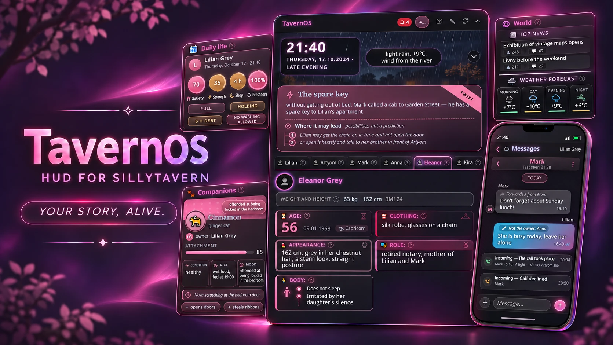</p>

# TavernOS HUD — a living dashboard for roleplay chats in SillyTavern

<p align="center"><a href="README.md">RU</a> · <b>ENG</b></p>

> Every model reply gets a card with the state of the world: the time and weather of the scene, who is wearing what, who thinks and hides what, whose phone is blowing up with messages, how many hours a character hasn't slept or eaten, who is related to whom — and none of it gets lost from turn to turn.

<p align="center">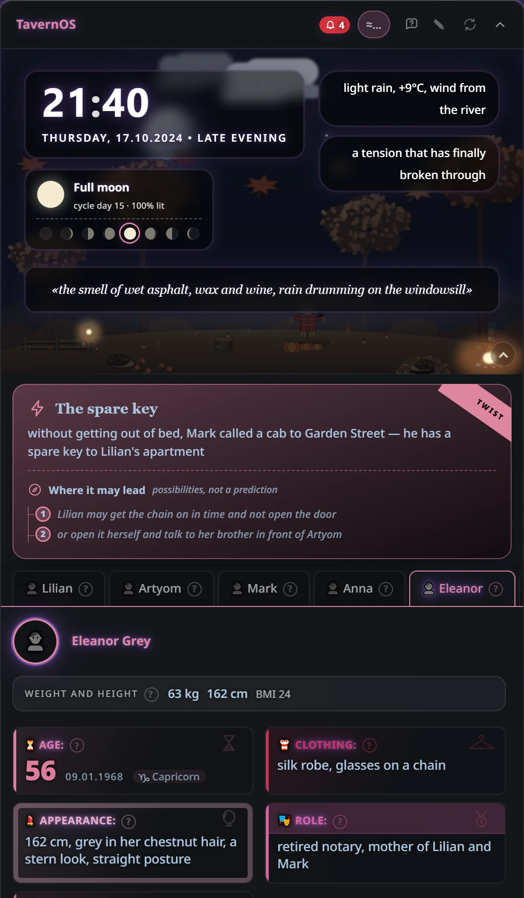</p>

TavernOS is an extension for [SillyTavern](https://github.com/SillyTavern/SillyTavern) that asks the model to send a compact `[HUD]` block with every reply and turns it into an interactive card with tabs right under the message. The interface is in English or Russian: switch **🌐 Язык / Language → ENG** at the very top of the extension settings. The model writes short English codes either way, which saves tokens.

---

## Why you need it

Long roleplay stories break on small things, and anyone who has played past a hundred messages knows it:

- **The model forgets.** A character is "again" wearing the jacket they took off three scenes ago. Yesterday's wound is gone. It was evening, and now it's morning without a single time skip.
- **The state is smeared across the text.** To remember who owes money to whom, where the gun is and what a character lied about, you have to scroll the chat.
- **You can't see behind the scenes.** What a character really thinks, what they hide, whom they text while you're not looking — it all stays in the model's head or disappears.
- **The world stands still.** No news, weather, prices or rumors — nothing for the story to hook on.
- **Memory costs tokens.** Keeping trackers by hand in every message is expensive and tiring.

TavernOS takes care of it:

- **The state is always in front of you.** One card shows where, when, who, in what, with whom and in what mood.
- **Continuity without extra tokens.** Chats, secrets, notes and events carry over from past turns *on screen only* — not a single extra character goes to the model. Old HUDs in the history shrink into short summaries; the latest one goes to the model as a snapshot so it updates the world instead of inventing it anew.
- **A second layer of the story.** Thoughts, subtext, "expectation vs reality", fears, intercepted chats of others, diaries, dreams — what isn't in the reply text itself.
- **The HUD counts what the model doesn't need to.** How many hours since eating and sleeping, the sleep debt for the week, that it's time for a shower, whether the money will last, what a character missed on their schedule while busy. The model writes nothing extra for this.
- **Beautiful.** 27 themes, 43 blocks with alternative views, weather and time of day in the background, avatars — a card you want to open, not a spreadsheet.

---

## What it looks like

Under every model reply there's a **TavernOS** card:

- **Scene header** — clock, date, weather, moon phase, the mood of the place. The background follows the time of day and the weather: rain, snow, fog, sunset, night.
- **Tab bar** — the characters of the scene, you, the phone, memory, daily life, intercepts, diary, dreams, nursery, world and more. A tab appears only when it has something to show.
- **Twist card** — if a real plot twist happened this turn, a banner pops up above the tabs: what happened and where it may lead.
- **Question marks** next to tab and field names — tap for an explanation: what it is, why it appeared and how to read it.

Old cards collapse into a title strip and expand on tap — a long chat stays light.

---

## Features

### 🎬 Scene

Time, date, weather, place and atmosphere. The time of day is computed from the clock adjusted for the month (in winter the sun sets earlier), with festive decorations around New Year. The moon phase sits on a disc in the header.

### 👤 Characters

A separate tab for everyone the model described in the turn:

- **Look and state** — clothing, appearance, role, body, physiology, health, inventory, place.
- **Inner life** — mood, thoughts, goals, schedule, fears, lines, hidden subtext, "expectation vs reality", the key point of the turn, flag monitor, jealousy, conflict depth, exposure risk.
- **Relationships and trust** — toward each person on a 0–100 scale; trust shifts are visible from turn to turn.
- **Relationship scars** — the model briefly writes why trust moved. A deep wound or a drop of 15 or more leaves a scar: the character remembers the hurt until trust returns. You can remove a scar with its cross, after an "Are you sure?" question: the model stops being reminded, and only a new fall in trust can bring it back. Reminders about scars and the neglected state go out once every three replies, and at once if something changes. After a big shift a character stays under the impression for a few turns, and if someone is named a rival, their gain costs the player.
- **Body state** — energy, alertness, satiety, stress, sleep and plans for tomorrow.
- **Weight and height** — a line on the card: weight, height, BMI and change. The model writes them once, then HUD asks to update them weekly in story time. If someone should not be counted, remove them in Daily life.
- **Neglected state** — a plate when a person goes several days with almost no food, water or sleep. The model shows it in the story and in time records it as an illness, and undernourishment lowers the chance of conception and disturbs the cycle.
- **Living details** — the model shows hunger, tiredness, stress and pain through small details instead of naming them, with pauses between them.
- **Illnesses and injuries** — stage, symptoms, treatment and a recovery bar; body marks with a healing timer.
- **Shared memories** — accumulate across turns: the same memory reworded isn't duplicated.

<details><summary>📷 The whole character tab</summary>

<p align="center">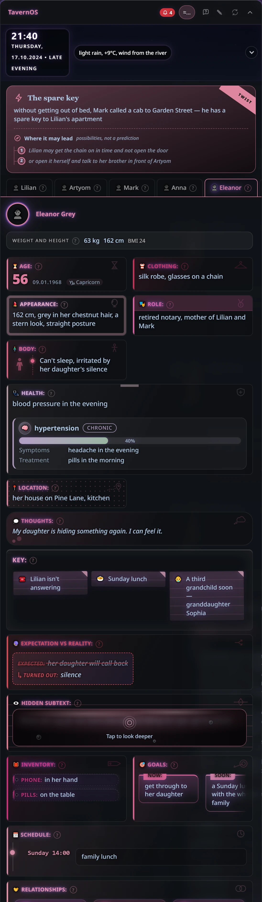</p>

</details>

### 🙋 You

The same set about your character — as the model sees them from outside: clothing, appearance, health, relationships, location. Plus a **"What they think of you"** summary: how each character feels about you and how much they trust you (computed from the cards, the model writes nothing extra).

### 📱 The character's phone

A full smartphone with a lock screen and notifications: **messages** (photos, videos, voice messages with transcripts, calls, replies, deleted messages), **contacts, wallet** with transactions, **calendar, gallery, notes, maps, search, call log, weather, health**. Each app is turned on separately: an app that's off isn't requested from the model and takes no room in the request.

<p align="center">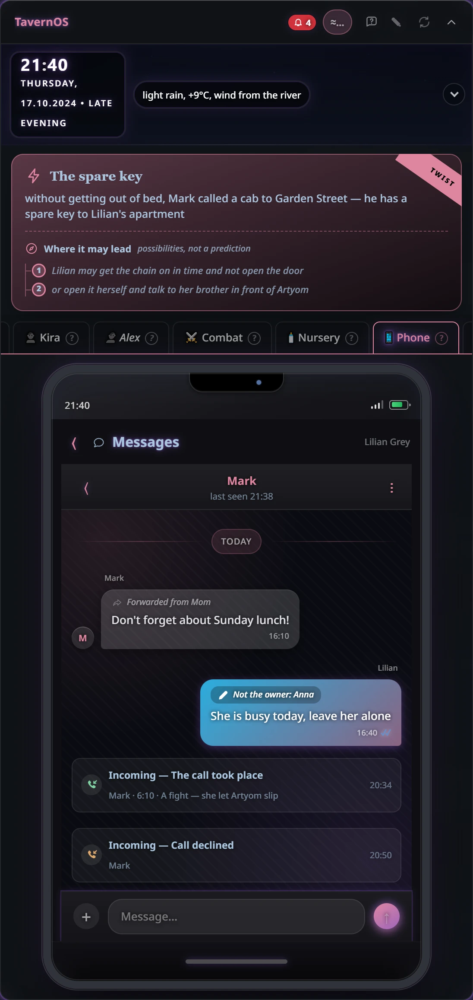</p>

<details><summary>📷 Phone apps: home screen, wallet, calendar, health, maps</summary>

<table><tr>
<td align="center">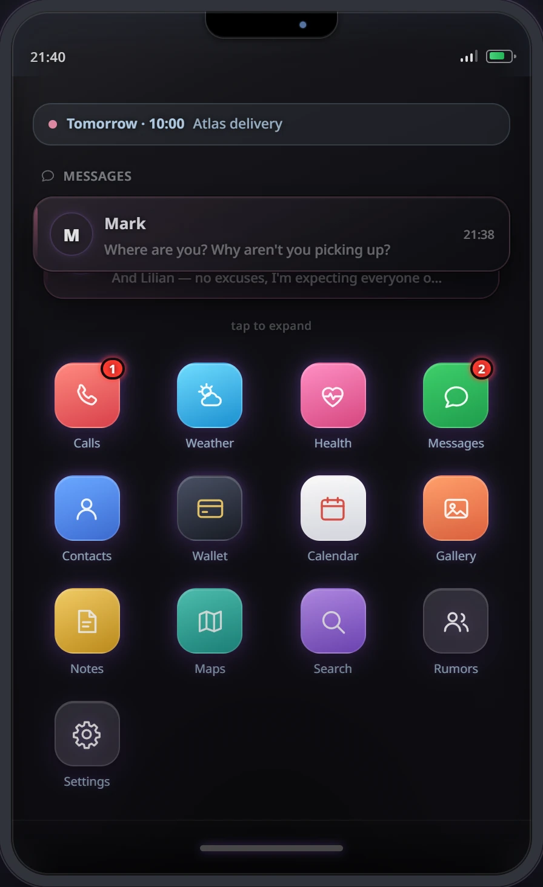<br>Home screen</td>
<td align="center">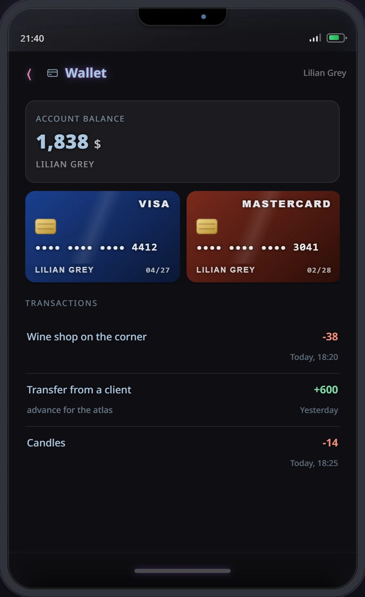<br>Wallet</td>
<td align="center">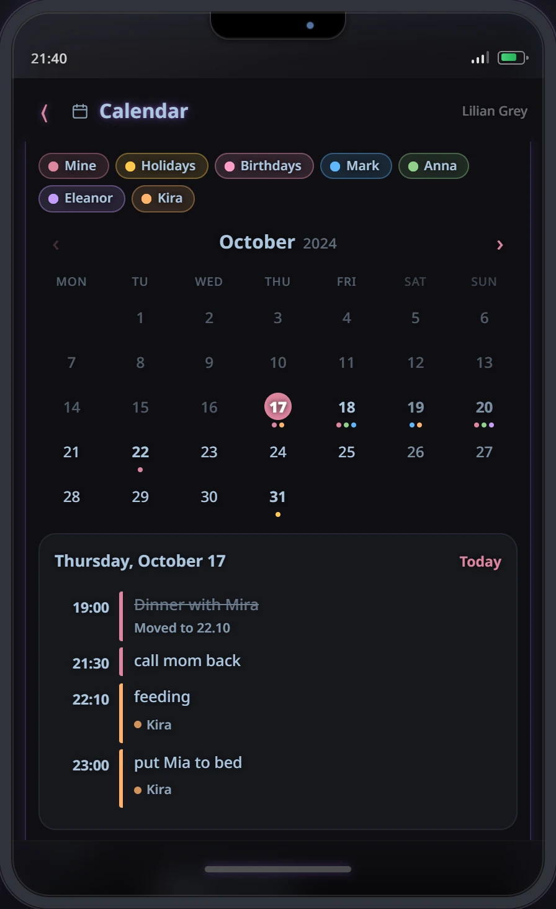<br>Calendar</td>
</tr><tr>
<td align="center">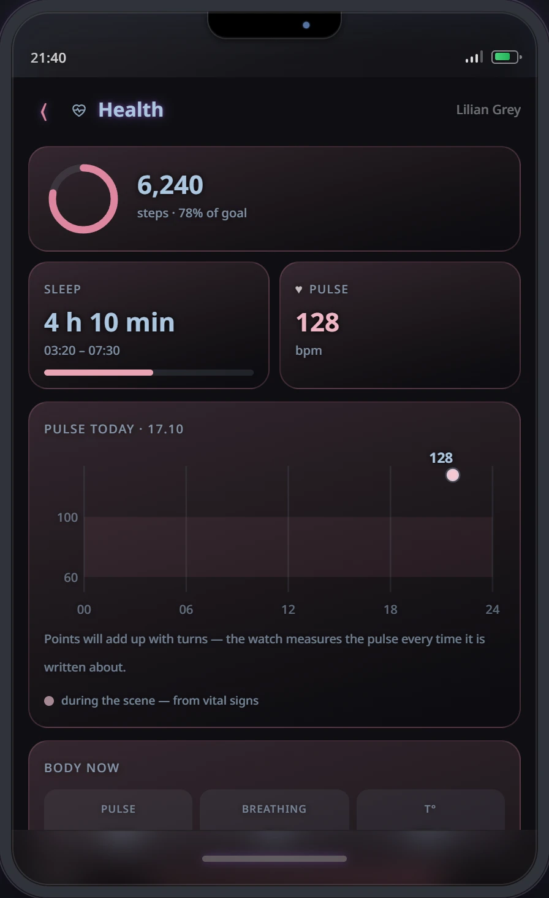<br>Health</td>
<td align="center">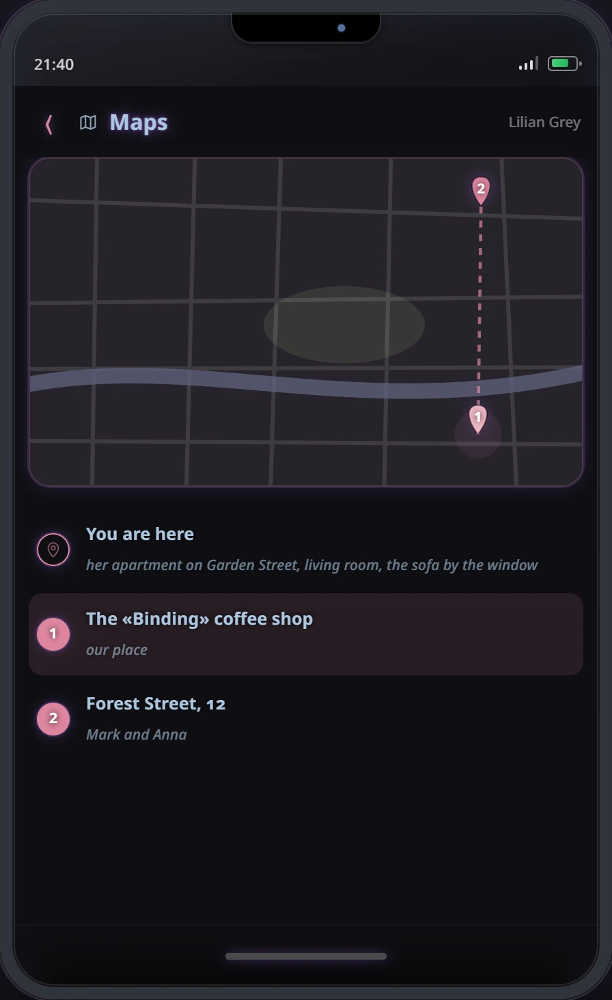<br>Maps</td>
<td></td>
</tr></table>

</details>

### 📡 Intercepts

Other people's chats and conversations your character shouldn't know about — a look over the author's shoulder. They appear only when the model itself decides to show what's behind the scenes.

<p align="center">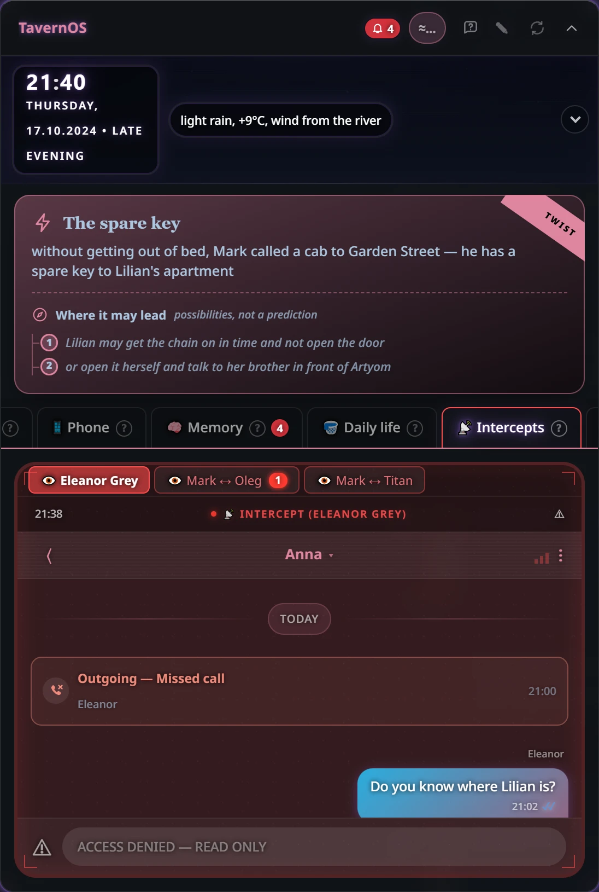</p>

### 🗝️ Medieval: the casket and overheard talk

For settings before phones, the smartphone is replaced by a **casket**: sealed letters (the seal breaks when opened), a church calendar with the moon phase, a purse with a ledger, quill notes, a map, charters and keepsakes. Intercepts are replaced by **overheard** talk: conversations through a wall and other people's letters opened in secret. The era is switched with one setting: **🧩 HUD blocks → Era**.

- **Period language** — labels and units fit the time: a saints' calendar instead of a calendar app, a purse with gold, silver and copper coins instead of a bank card, letters with wax seals instead of chats.
- **Parchment with any theme** — the casket and overheard talk look like aged paper with wax seals in dark, light and custom themes alike.
- **Inaudible** — what the character couldn't make out through the wall is blurred; tap it to see what was actually said.
- **Period music** — scene music can pick old music or a film-style soundtrack.

<table><tr>
<td align="center">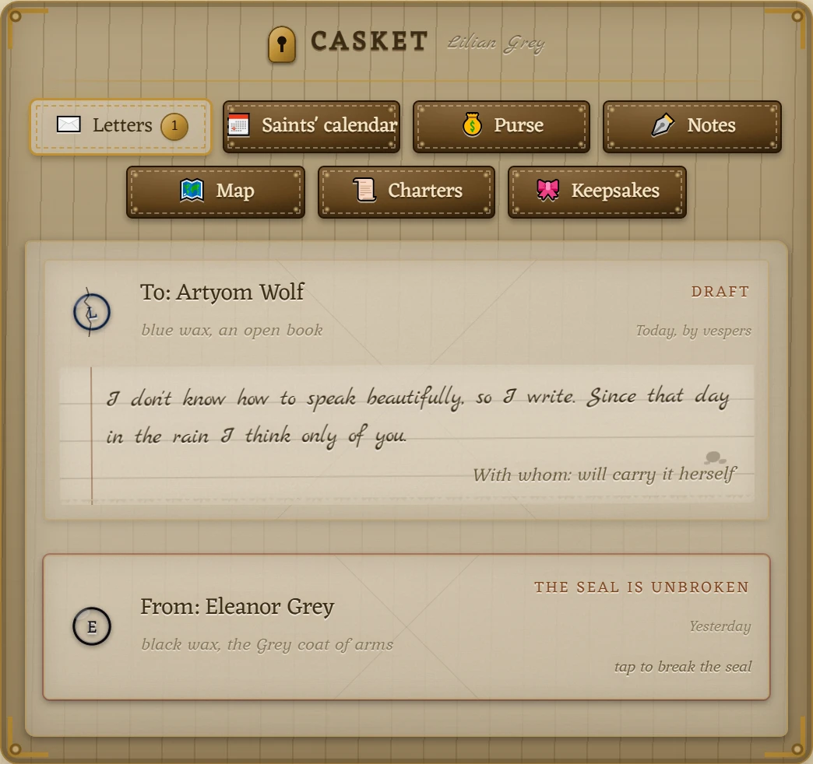<br>Letters: a draft and an unopened one</td>
<td align="center">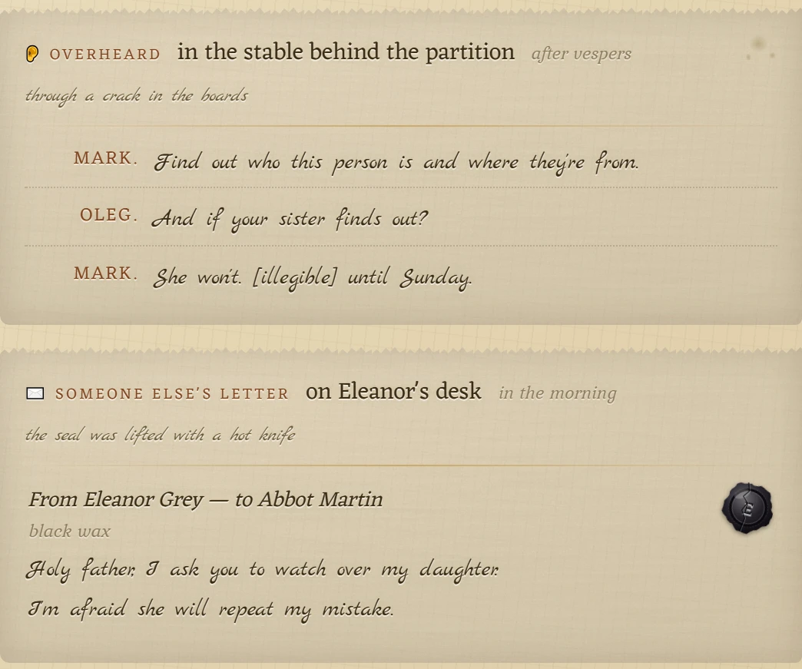<br>Overheard</td>
</tr><tr>
<td align="center">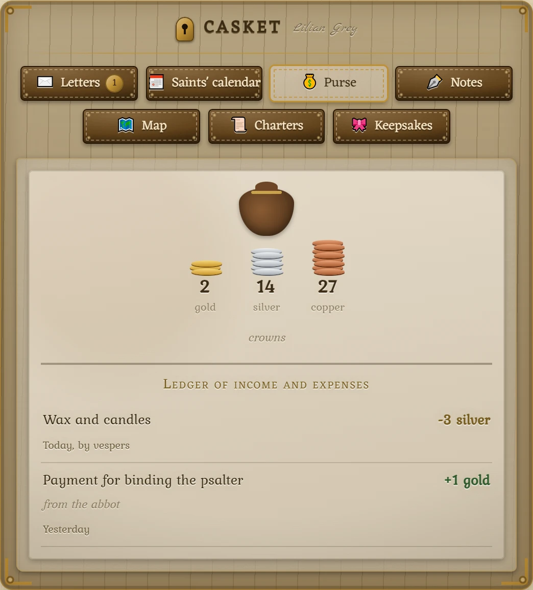<br>Purse</td>
<td align="center">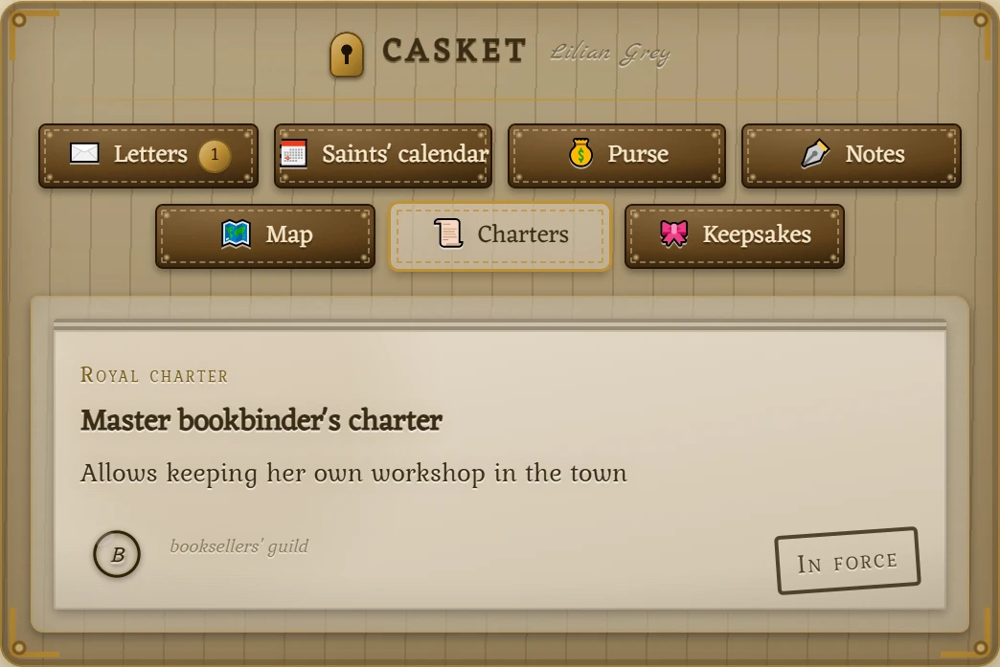<br>Charters</td>
</tr></table>

### 🧠 Memory

The tab where history accumulates instead of a snapshot:

- **Timeline** and **important** — what happened and in what order.
- **Secrets** — who hides what from whom, the danger and exposure level. A secret can be added to a lorebook with one button — then the model remembers it even without the HUD.
- **Chekhov's guns** — open plot threads: promises, threats, hints, mysteries.
- **Long lists.** Up to three items stay as they are. With more, they scroll right on PC and down on phones: this covers character pills and block views. Paper sheets and axes that can't lie sideways (scroll, notebook) scroll down on PC too. On phones a finger carries through the whole turn: at the end of a list the swipe continues in the tab, then in the chat.
- **Phone icons.** Every theme has its own set of twelve app icons. Pick one in Customize → Blocks: Phone: Auto by theme, Regular, or any other set; a set from another theme adapts to the theme colors, both the drawing and the tile.
- **Deleting items.** Important, Chekhov's guns and secrets have a trash icon in the header: it turns on delete mode, items get highlighted, and tapping one opens a window with every similar wording from the chat: only the checked ones are removed from the HUD of the whole chat. Message text and `[HUD_SUMMARY]` stay. Bring deleted items back with ↶ in the card header: the last 30 deletions are kept, in any order. The item also returns to blocks edited or regenerated after the deletion and to the latest HUD of the chat, so the model sees it again.
- **One-time nudge.** A star button in a block header: tap a pill and it goes to the model in the next reply. HUD sends nothing by itself, the nudge simply joins the request. It works from an old card too, holds for one reply and all its swipes, and a new message clears it. The queue (up to three) shows above the input.
- **Deadlines on threads.** A gun can have a date and a task kind: main, side, small. The deadline shows in the phone calendar, and an overdue thread asks for a resolution. Overdue calendar plans are marked too, and the model settles whether they happened or were missed.
- **Earlier items.** Old Important items fold away, and the thirty newest stay in view.
- **Answer badge.** When HUD is waiting for your decision, a red badge with a number appears on the tab: invitations and "came up in an argument" in Memory, a closed threat outcome and check-up for a pregnant character. The same number shows in the header of a collapsed card and on the stub when the side panel is closed. The badge goes away once you answer.
- **Invitations.** When the model writes an invitation, HUD looks for your answer in your message. If it can't tell, it shows an Accept and Decline card. Promised and didn't come: the character is hurt.
- **Emotions** — how the main characters' mood changed; **route** — where they've been during this stretch.
- **Relationship graph** — a web of everyone's ties: romance, friendship, conflict, jealousy, fear, suspicion, family, parents and children, superiors, mentors, duty, the forbidden, accomplices, shared groups. Nodes with avatars; tapping a node or a link highlights its surroundings; the graph opens full screen.
- **Family tree** — a second view of the same graph when the relationships include kinship. If the model calls someone an uncle or aunt and the HUD has no kinship with the parents, the tree asks whose sibling they are, or "not family", and remembers the answer.

<details><summary>📷 The Memory tab with the relationship graph</summary>

<p align="center">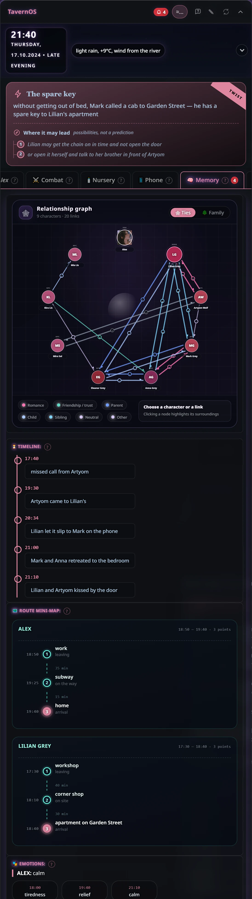</p>

</details>

<details><summary>📷 Family tree</summary>

<p align="center">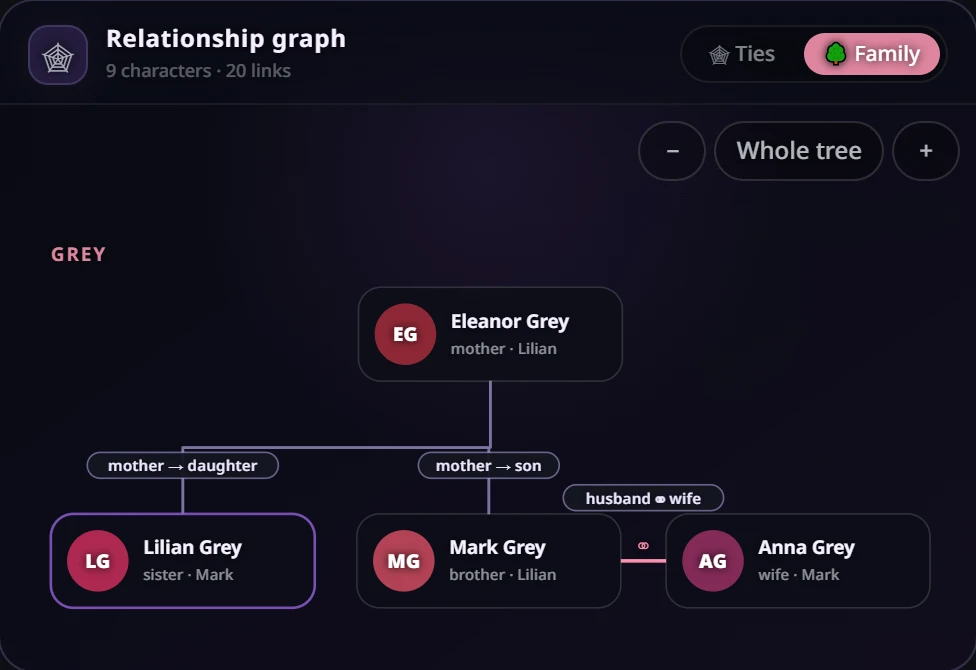</p>

</details>

### 🧺 Daily life

Food, sleep, showers, laundry, cleaning, clothing, money and home **across all past turns**: how long since the last time, the sleep debt for the week, what's in the laundry, familiar prices, what broke, who owes whom. "Could use a shower" is computed from hours, heat and exertion; "not dressed for the weather" — when a character is out in the frost without outerwear or in the heat in a coat. The HUD derives all this from what the model writes anyway. The daily-life summary can be shown to the model as one line, only when it's on topic, or via a macro — or kept just for you.

**Weight and calories.** In Daily life everyone has a card: weight, a curve, a calorie norm that accounts for activity and pregnancy, and how much the person eats on average. Swipes create no fake gain: the last number of a story day counts. If you delete a reply with a weight, the record rolls back.

**Remove a person from Daily life.** If someone should no longer be counted, say a character who died or left, press the trash button next to their name in weight, sleep or wardrobe. After the "Are you sure?" question, their weight, sleep, wardrobe and wounds leave the tab, and the weight line leaves their card. The model stops counting their weight and sleep and no longer asks for their weight, and the summary moves to the next person in the scene. The records stay: bring the person back at the bottom of the tab, under Not counted. Each chat has its own list, and you can remove yourself too.

<details><summary>📷 The Daily life tab</summary>

<p align="center">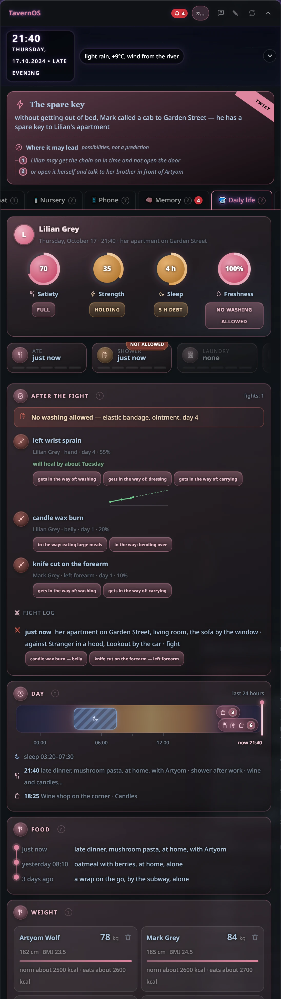</p>

</details>

### ⚔️ Combat

Appears only while there's danger: stage and turn order, distances, wounds on a silhouette, weapons with ammo, adrenaline with a crash timed by story time, composure, cover, a chase bar. In peaceful turns the model doesn't write this block and it costs nothing.

<details><summary>📷 The Combat tab</summary>

<p align="center">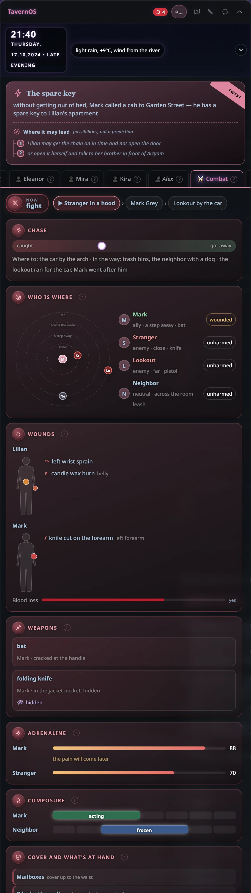</p>

</details>

### 💬 Verbal duel

While an argument is going on: who leads and by how much, who conceded what, the heat, and a memory brought up in the argument.

### 📖 Diary and 🕯 body diary

The character's personal notes in their own words (subjective — they can be wrong and lie to themselves) and the body diary — an entry about the body during intimacy and after it: what it wants, what it gets, what aches and which marks are left.

<p align="center">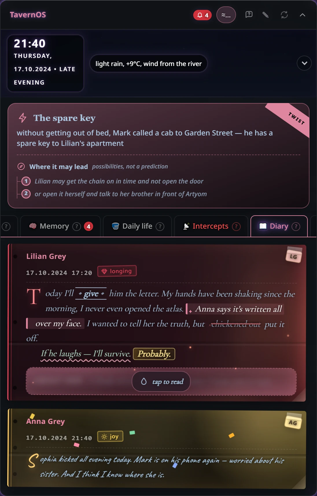</p>

### 🌙 Dreams

What the characters dreamed tonight — in images and hints, with an interpretation under each dream: what fear or desire is behind it. A dream is veiled in mist and clears up in a few taps, as if you're remembering it in the morning. A good way to show what a character won't admit even in their diary.

<p align="center">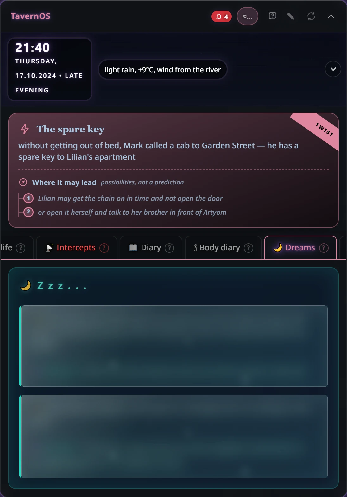</p>

<details><summary>📷 Dreams after a few taps — the mist has cleared</summary>

<p align="center">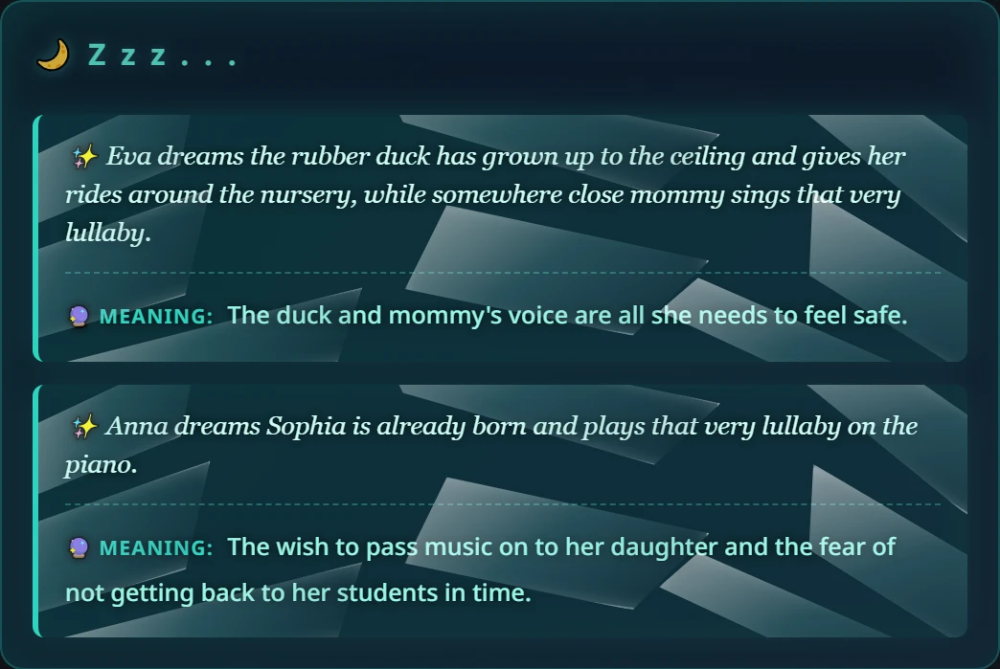</p>

</details>

### 🌸 Health and family

For stories where the body and family matter — three linked blocks. Each is turned on separately in the "Characters" group and appears only for those it concerns.

**Menstrual cycle.** A ring with the cycle day and current phase, the expected period, the PMS window, delays and cycle disruption from stress. Under the ring — tips for the phase and the conception chance with protection taken into account; you can "take a test" right from this block. A small "? why N%" button smoothly unfolds how the number was reached: the cycle day and where ovulation is, the chance for that day, what protection leaves, what else lowers it (breastfeeding, illness) and the result as a multiplication. The same breakdown sits in the scene modifiers — for your own chance and your partner's. The cycle is tracked for everyone who has one, including your character.

<details><summary>📷 The cycle card</summary>

<p align="center">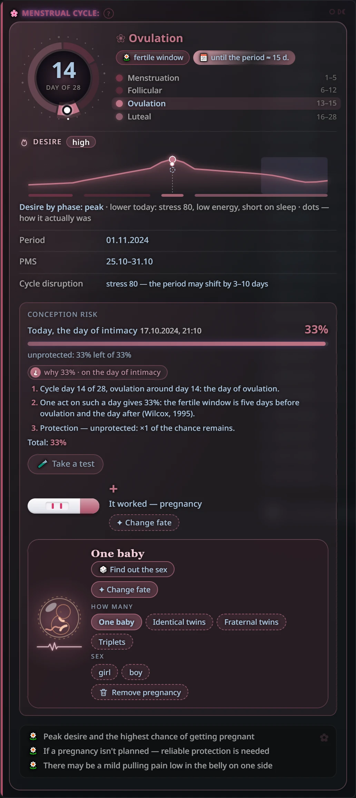</p>

</details>

**Pregnancy.** The term in weeks and the trimester, a bar to the birth, the baby's size compared to a fruit, what it can already do and the next milestone. The father, symptoms, cravings, who already knows, how the pregnancy is going, the next doctor's visit and tips for the term, including warning signs. The number and sex of the babies are decided by a die roll, and you can "change fate" if you want. This goes to the model as a hidden fact or not at all, as you choose.

**Remove pregnancy.** The button next to Change fate erases the pregnancy from the HUD of the whole chat as if it never happened: the term, the babies, the dice result. Children already born and message text stay. Bring it back with ↶ in the card header.

<details><summary>📷 The pregnancy card</summary>

<p align="center">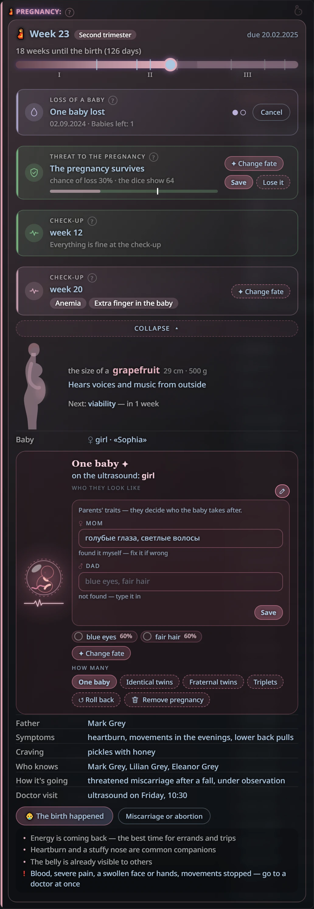</p>

</details>

**Miscarriage and abortion.** The model marks a miscarriage, abortion, missed miscarriage or stillbirth with `lost`, while a threat or bleeding stays in the "how it's going" line. If the model missed it, the **Miscarriage or abortion** button next to "The birth happened" lets you pick the kind and date. For a character without a pregnancy field, the button sits on the positive test plate. HUD closes the pregnancy for this character only: a plate replaces the countdown, and the model learns on the next turn that the pregnancy is over. Unlike Remove pregnancy, the history stays: older cards show the term as it was. **Cancel** on the plate brings everything back as it was before the mark. If you regenerate or delete the turn where the model wrote about the loss, HUD removes the mark itself. A mark made with the button stays until you cancel it.

- **Recovery depends on the term.** Before week 13 the cycle returns in about 5 weeks, from week 13 in 6, from week 22 in 8. Milk appears only late: from week 16 a little may come in, from week 22 it comes in on day 2–5 and is gone in 1–2 weeks.
- **Chance of conception.** Ovulation comes before the first period, so getting pregnant again can happen soon. Before the first ovulation there is almost no chance, until the first period it's a bit lower, then normal. After surgery, trauma or infection it stays slightly lower for about three more months.
- **Twins and triplets.** Not all babies have to be lost: the pregnancy goes on with those who remain.
- **Threat dice.** If the pregnancy field mentions a threatened miscarriage, HUD rolls for the outcome. The chance depends on the term and severity. You reveal the result with a button and can change fate; the model gets it only after that.
- **Intimacy reminder.** A translucent line just for you: the date to wait until after a loss or abortion (two to six weeks depending on the term, longer with a complication) and after childbirth (six weeks). A fresh wound on the torso says intimacy would hurt. The model does not see these reminders.
- **What stays in the history.** The Pregnancies tab in the archive shows all births and losses of the chat and who knows about them. Losses also appear in the archive Timeline. They don't go to the phone calendar.

**Check-ups.** At weeks 12, 20 and 30 the dice decide what was found: complications and the baby's traits. You reveal the result and can change fate, and the model learns only what you revealed. Serious findings have their own checkbox. Disclosure depends on the era: in the Middle Ages there are no check-ups, and nobody knows anything before the birth. The event log is in the archive and downloads as a file.

**Birth and the "Nursery".** After the "The birth happened" button, pregnancy is replaced by the postpartum period: recovery and feeding. A **"Nursery"** tab appears with a card for each baby:
- **developmental milestones** on an age scale: what the baby can already do, what's about to appear, what comes later;
- **care norms by age:** feeding, sleep, diapers, teeth;
- **timers:** when to feed, how long they've slept, when the diaper was changed;
- **like the grown-ups:** state, health, thoughts, favorite things, schedule, relationships and trust toward adults, fears and first words.

When a child grows up (by default at three), they move from the "Nursery" to regular character cards.

<details><summary>📷 The Nursery tab</summary>

<p align="center">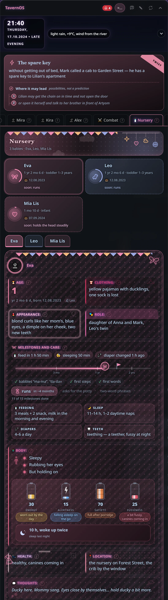</p>

</details>

### 🌍 World

A summary for today: news, rumors, ads, the weather forecast, a horoscope, online comments, exchange rates and prices, events (cinema, theater, concerts), city services (traffic, transport, incidents). The world deliberately doesn't carry over from past turns so news from different days doesn't mix.

**Online comments** come from ordinary people of this world under their nicknames: a city forum, a chat, the darknet. They know only what is public or leaked, can be wrong, and never address the reader.

**Holidays of the era.** Holidays follow the era, place and faith: Russia, Europe with each country's own day, the USA, the Middle Ages. They show in the phone calendar, a light background appears in the scene a few days ahead, and a short recap follows the next day. In a fantasy world you can turn them off in the settings.

<details><summary>📷 The World tab</summary>

<p align="center">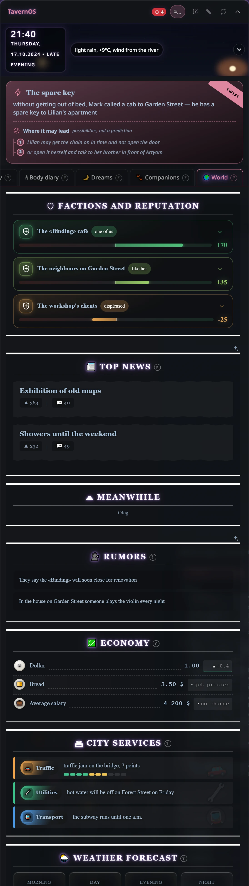</p>

</details>

### 🎵 Scene music

A "now playing" strip above the tabs: a **soundtrack** for the moment, like in a movie, and music **in the scene** — what the characters themselves hear (a car radio, an orchestra at a ball). The playlist is picked by a separate small request from the HUD scene, again only when the scene changes or on a button; each part can be picked separately. Tracks are checked by search, and made-up ones are marked. The ▶ button plays right in the Tavern: a clip or a full track. Volume, the number of tracks and a wish ("music for running") live right in the playlist. Each track has ♡ "like" and ⊘ "don't suggest": the next playlists lean toward your taste. You can pick the song language and a meme soundtrack (by a button, or by itself in a funny scene). If a radio plays in the scene, "In the scene" turns on a live broadcast: Radio Record or world stations. "Scene background" plays full free tracks matching the scene's mood with no breaks — from the Russian Fonau library, Audius, Incompetech, and in the Middle Ages also Wikimedia Commons; it can take over right after a song's 30-second clip. While music plays and its card is out of view, a tiny translucent icon sits at the edge. The character's phone gets a "Music" app: what they listen to now, their named playlists (the model builds them from the card, lorebooks and latest messages; "More" adds without repeats) and their "Liked". The archive gets a "Soundtrack" by chapters. Off by default.

<p align="center">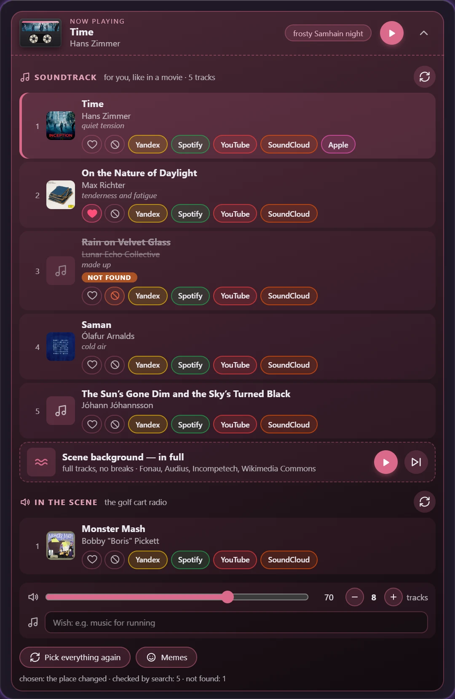</p>

<details><summary>📷 "Music" in the phone and the soundtrack in the archive</summary>

<p align="center">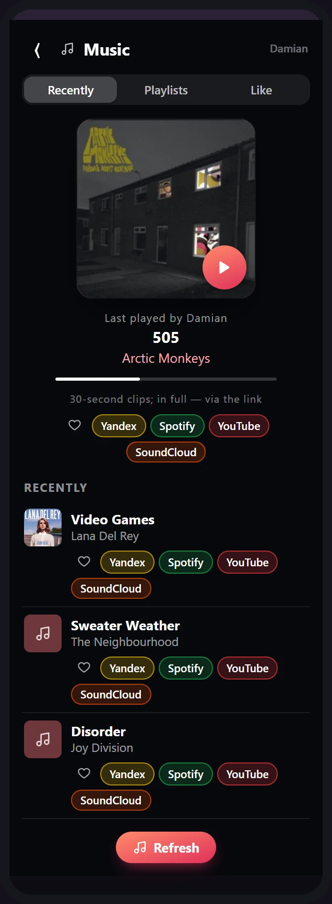 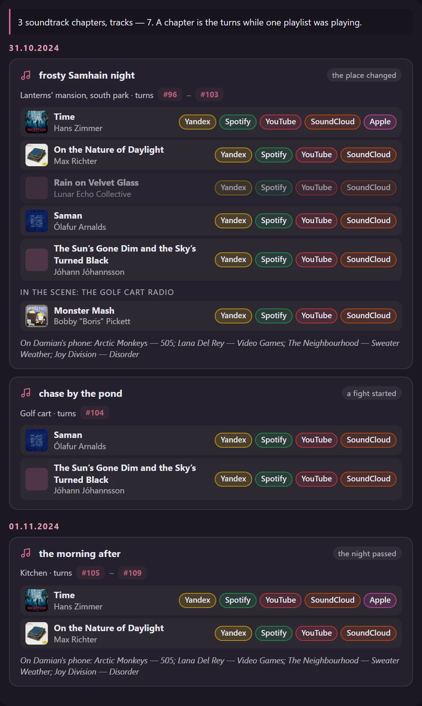</p>

</details>

### 🐾 Companions

Animals, familiars, drones: mood, condition, diet, attachment. Their own tab — only when there are companions.

<p align="center">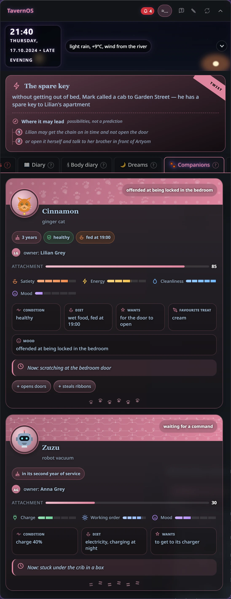</p>

### 📊 Custom stats

Missing something? Add it yourself: hunger, mana, standing at court, a bounty, rumours. Add as many stats as you like. For each one you set:
- **name and meaning** — describe in a small box what the stat means and what changes it; the model reads that as a rule and writes the stat every turn;
- **view** — a number, a percent ring, a 0–10 scale, stars, a description or a tag list;
- **icon and colour** — the theme accent (default), the colour of one of the field groups, or your own;
- **whose it is** — every character, the player, or one value for the whole story (then also the tab: characters, player, memory, daily life, world).

On the card a stat is a block in the theme's style. Choose its place in the settings ("after the Role field") or right on the card: press and hold the block and drag it. The shared custom-stats prompt can be rewritten completely, and one checkbox switches them all off while keeping the list. Each stat's name sits right in its owner's schema — a character's or the player's — so the model doesn't skip it.

**Fine tuning.** In "HUD blocks" every section is split into groups, and any field — or even a single sub-label inside a field — can be switched off. Switched-off parts are cut cleanly out of the instruction: the model doesn't write them and no tokens are spent.

Two sections are not about reply fields:
- **Model notes** — what HUD adds for the model on a turn: scars, the impression after a trust shift, the rival, living details, the neglected state, the request to write the weight, holidays, deadlines and invitations. Single parts can be switched off inside, for example only the calories in the weight request.
- **On-screen hints** — what only you see: intimacy reminders, question badges, one-time nudges, check-ups and the threat die.

### 🗄 HUD archive

A summary of the whole chat history, via the **🗄 HUD archive** button in the settings. Choose a range (the whole chat, the last 50 or 200 messages) and press "Analyze". Tabs:

- **Secrets** — every secret as of the latest moment: the latest wording, the status, who knows and who doesn't. Below, "Who learned it and when" expands: date and time, the name, how they learned, status changes and the first wording. If the model rewrote a secret in its own words, it is still one card. It also shows when it appeared and when it was last mentioned.
- **Guns** — Chekhov's guns: which threads are still hanging, which fired and when; the thread history is under the card.
- **Relationships** — how pairs changed: shifts in attitude and trust by turn.
- **Trust** — on the same tab: a pair's chart, the reasons for shifts, and scars.
- **Timeline** — scenes by story day: where, how many turns, how much time passed.
- **Pregnancies** — every pregnancy of the chat by turns: from which week to which, dates, the father, who knows, the expected birth and the outcome (birth, miscarriage, abortion). It also shows how it went (with a history by turns), symptoms, check-ups, the threat of loss and complications. Check-ups and threat outcomes you have not opened stay hidden.

Every turn number shows the scene date and time of that turn. Tabs show the number of records. The newest is on top; long lists are collapsed to 10 records with "More" and "Show all", and filters split records by status: revealed secrets, fired guns, ongoing pregnancies and so on.
- **Soundtrack** — music chapters by day (if scene music is on).
- **Statistics** and **Dashboard** — how many messages and days, who talks more, the model's reply length, repetition, dull zones, scene rhythm, dialogue vs description, who mentions whom. Dashboard widgets are picked with checkboxes.

The archive also works for chats the HUD has been cleaned out of: the HUD keeps a **chronicle** — short summaries of every turn in a separate file on your SillyTavern. You can attach another chat's chronicle of the same character (say, an old copy) to your own — its turns fill the gaps without duplicates. One chat can be attached: the next one replaces the previous one. A branch of the open chat is already part of its chronicle, and HUD says so. The chosen chat is remembered and stays chosen the next time the archive opens, and if it got new messages, the archive reads it again before the analysis. There's search within the report and JSON export.

### 🗂 HUD on the side

The card can live in a panel at the window edge instead of the messages. Turn it on in the settings: **✨ Display → Where the HUD is**.

- **In messages** — as before.
- **On the side and in messages** — a panel with the HUD of the latest reply; cards in chat stay.
- **Only on the side** — messages get a small button with the scene time and date from that turn's HUD instead of the card; it opens the turn in the panel, and the button of the turn currently in the panel is highlighted. Full cards are not built in the feed, so long chats get noticeably lighter.

The panel opens from an icon in the Tavern top bar and sits on the right or the left (a button in the panel header or the "Edge" setting). It follows the latest reply: a new reply, a swipe, a regeneration or an edit update it on their own. Arrows and dots page through past turns, "to the latest" jumps back; the open tab stays as you page. Drag the edge to resize it — from narrow to almost the whole window, over the chat; near the chat column it snaps to it ("up to the chat"), and from then on the panel takes all the room up to the column. On phones the panel slides out over the chat and closes with a tap outside it. All views, themes and card buttons work in the panel too.

### 🔞 Adult scenes (18+, optional)

For stories with adult content, the extension has a separate set of blocks. They appear only during an intimate scene and shortly after it. Each can be turned off separately in the settings, or you can turn off this whole part at once: then the model doesn't get a word about it. Outside such scenes these blocks simply don't exist — neither on screen nor in the request.

What they give:

- **The course of the scene** — stage, setting, duration, how the characters feel and react, aftercare.
- **Schematic visualizations** — the scene's tempo and simple diagrams built from the reply text itself, with no extra fields from the model.
- **Scene clock** — how much story time has passed and what the characters missed on their schedules meanwhile: dinner, a call, a meeting.

The cycle, pregnancy and the "Nursery" are not part of this: they're described above under "Health and family" and are turned on separately.

This part of the instruction is the largest, so by default it goes to the model **only while a scene is actually happening** (you can choose "always" or "never"). HUD tells that a scene is happening both from the text and from the last HUD: arousal in physiology, body, thoughts or subtext, desire in the diary or the body diary. There are deliberately no screenshots of these blocks in the README.

---

## Tools

| Tool | What it does |
|---|---|
| 🔄 **HUD regeneration** | Rebuilds only the message's HUD without touching the reply text. Can use another, cheaper connection profile, with chosen lorebooks and the card description. |
| ➕ **Create HUD** | A button on replies without a block — add a HUD to an existing message. |
| ↶ **HUD versions** | The previous HUD isn't lost on regeneration — restore it with one button. |
| 🩺 **Completeness check** | After a reply, the HUD is checked for required fields. An incomplete one can be completed by regeneration, or you can just get a warning. There's also a check for contradictions with daily life. |
| 🧩 **Fill in what was skipped** | If the previous HUD missed something required, a short request to include it now rides along with the regular request. It's not a separate generation. |
| 🎯 **Boosts** | If the model in this chat regularly leaves thoughts, the diary or the horoscope empty, a short reminder is added to the instruction. Counted separately for each model. |
| ❓ **Ask about the story** | A window for questions to an assistant: why a character behaves like this, what they hide, what could happen next. It answers from the HUD, recent messages, author's notes, the card, the persona and lorebooks — whatever you choose. Nothing is written to the chat. |
| 🎵 **Scene music** | A "now playing" strip above the tabs: a soundtrack for the moment and the music the characters hear. Picked by a separate small request from the HUD scene, again only when the scene changes or on a button; "Soundtrack" and "In the scene" can also be picked separately. Tracks are checked by search in turn — iTunes, NetEase, QQ Music, until the first hit; made-up ones are marked. The ▶ button plays a track right in the Tavern: a 30-second iTunes clip or, optionally, the full track — from YouTube via Invidious mirrors, via an unofficial NetEase service, or via MoodTube; the next one starts by itself. Volume, track count and a wish for the playlist ("music for running") are right in the open playlist. There are also links to Yandex Music, Spotify, YouTube and SoundCloud, and the MoodTube queue. A track's ♡ "like" and ⊘ "don't suggest" are your taste: the model leans toward what you liked and never suggests what you banned. Song language; a meme soundtrack (one-off button, in a funny scene, or always). Radio in the scene: the model names the station genre and a live broadcast plays — Radio Record (117 genre stations, for Russia and Russian genres) or world stations from the radio-browser catalog. A floating "now playing" icon while the music's card is out of view. Scene background in full: a queue of full free tracks matching the scene's mood with no model request — Fonau (a Russian library, search in Russian), Audius, Incompetech (catalog built in), in the Middle Ages Wikimedia Commons; it follows a song's clip right away. The playlist is stored in the turn and in the chronicle; the archive has a "Soundtrack" tab with chapters by day. The character's phone has a "Music" app: what they listen to now, named playlists (a separate request from the card, lorebooks and latest messages; "More" adds without repeats) and their own "Liked" — it goes only into their requests. Off by default. |
| 📚 **Save to Lorebook** | A secret or fact from the HUD becomes a lorebook entry with one button — you can let the model write it from the scene context. |
| 🗄 **HUD archive** | A summary of the whole chat history: secrets, Chekhov's guns, relationships, timeline, past pregnancies, statistics and a dashboard — how everything changed and how many days passed. With JSON export. |
| 🗑 **Question before deleting** | Before deleting a scar, a custom stat, a theme, a picture, a person from Daily life and other important things, HUD asks "Are you sure?" and says whether it can be undone. |
| ≈ **Token budget** | A "≈4.1k" chip in the card: how much the HUD instruction costs and what weighs how much in it. |

---

## Appearance

The **🎨 Customization** window with a live preview:

- **27 ready-made themes in 7 sets** — Kawaii, Dark Academia, Vamp, Cyberpunk, Noir, Middle Ages, Fantasy, Crime, Web 1.0, Cottagecore, Ice, Deep sea, Steampunk, Dieselpunk, Solarpunk, Biopunk, Space opera, Feudal Japan, Ancient Egypt, Western, Pirates, Witchcraft, Voodoo, Space horror, Darkroom, Tea Party, Bullet Journal. Light and dark; many themes have spare palettes — the same drawings in other colors.
- **Your own theme** — palette, glow, glass (frosted, tinted, clear, pearl, liquid), fonts, blur, separate colors for memory, the phone, alerts and intercepts. A theme can be saved to a file and shared — when loading someone else's file, only known fields are taken and their values are checked.
- **43 blocks with alternative views** — for example, trust as bars, hearts, a shield, a traffic light or orbits; fears as a list, thermometers, skulls, clouds or a radar; secrets as safes, folders, a web or envelopes; the route as a diagram, a strip, a map or tickets.
- **Tab order** — arrange the card's tabs (characters, phone, memory, daily life, diary…) in any order right in the chat: press and hold a tab for half a second and drag it along the strip — with a finger or the mouse, it works on phones too (a short tap still opens the tab, and a swipe scrolls the strip). The same in Customization → 🗂 Tabs: by the ⠿ handle or with ↑ ↓ buttons. Any tab can be pinned first or hidden — a hidden block is still written and accumulates, and you can see what it costs in tokens.
- **Avatars** — one image for any number of name spellings; names listed together count as one person in the graph, chats and intercepts. Photos show wherever there used to be initials: in intercepts, the phone, pets and other avatar circles.
- **Banners, portrait frames, decorative details** — plasters, bows on tabs, wax seals, aged paper, hanko, drop caps and more, each separately.

<table><tr>
<td align="center">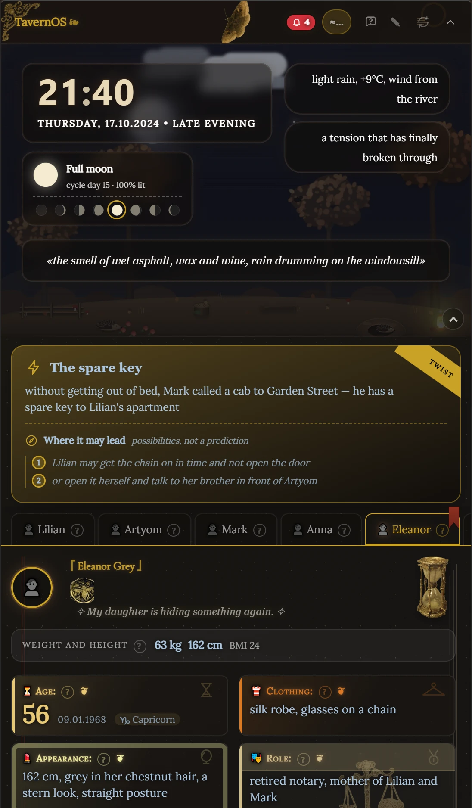<br>Dark Academia</td>
<td align="center">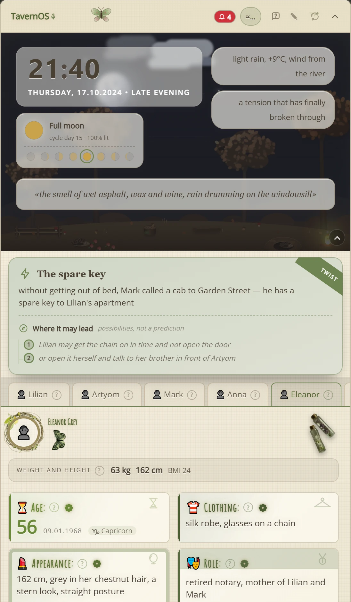<br>Cottagecore</td>
<td align="center">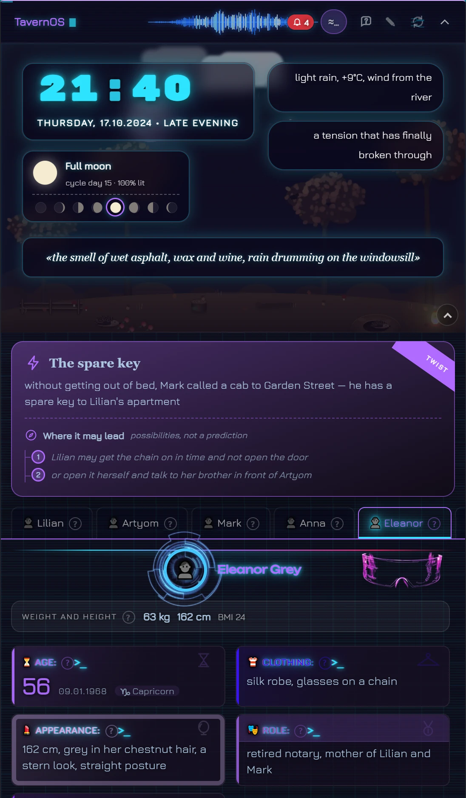<br>Cyberpunk</td>
</tr></table>

A few alternative block views (switched in "Customization" → "Block views"):

<table><tr>
<td align="center">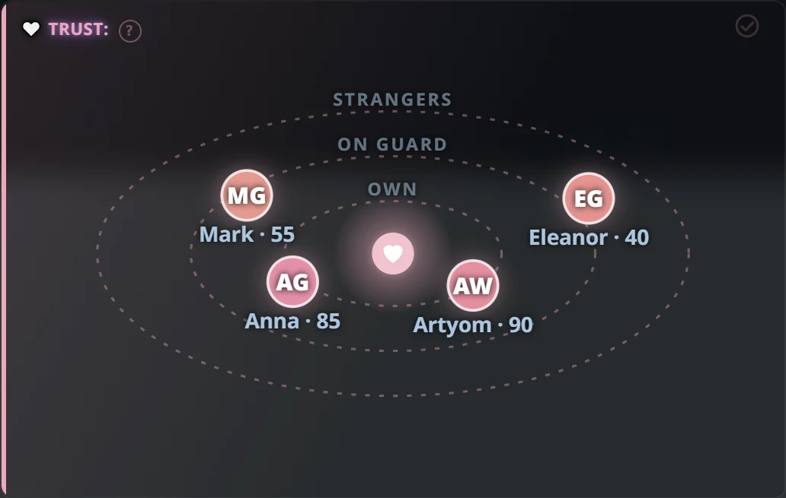<br>Trust — orbits</td>
<td align="center">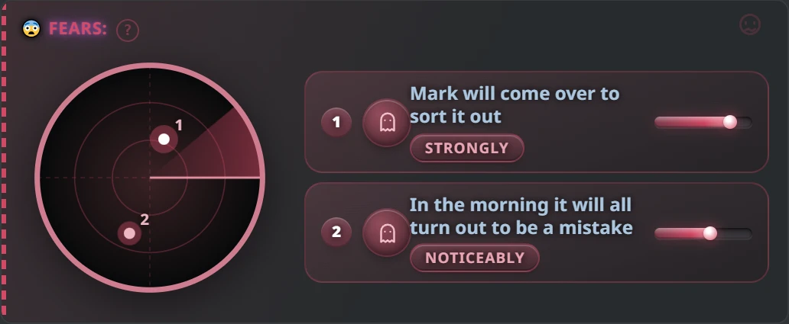<br>Fears — radar</td>
<td align="center">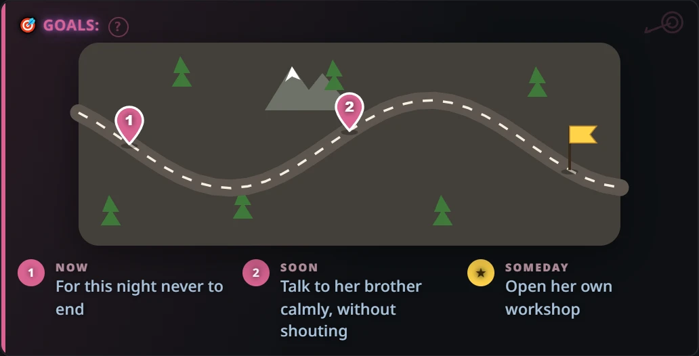<br>Goals — road</td>
</tr><tr>
<td align="center">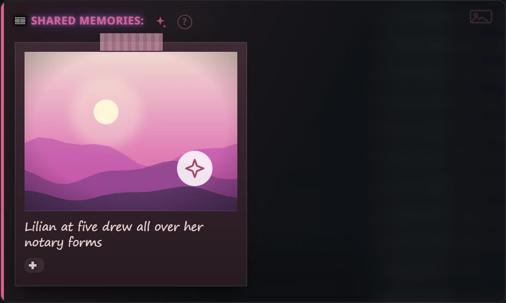<br>Memories — polaroids</td>
<td align="center">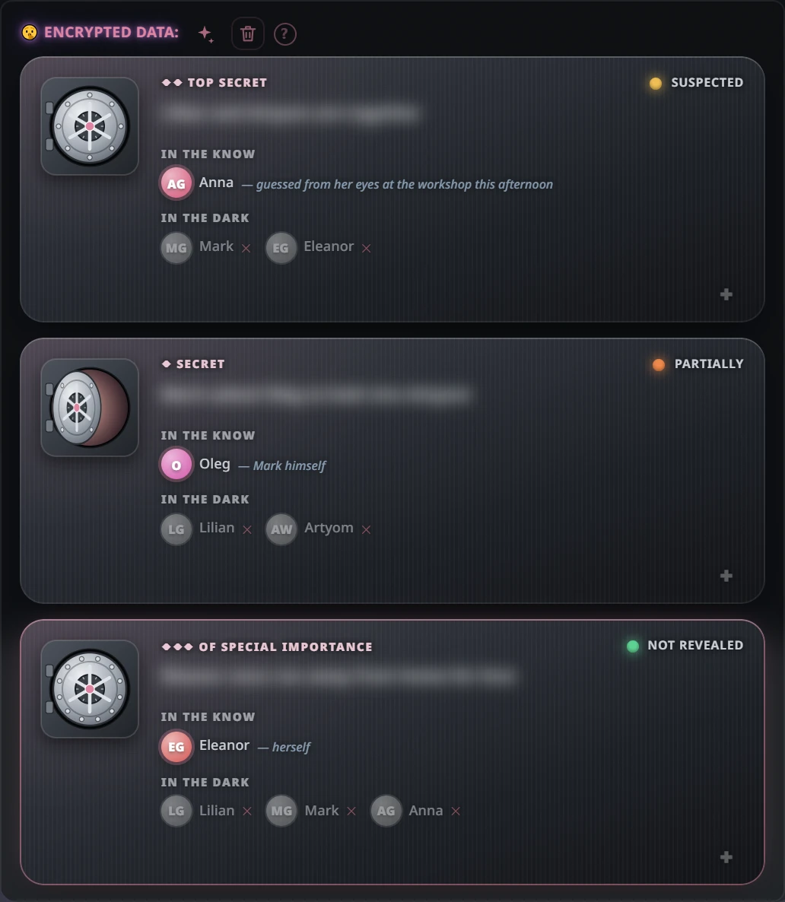<br>Secrets — safes</td>
<td align="center">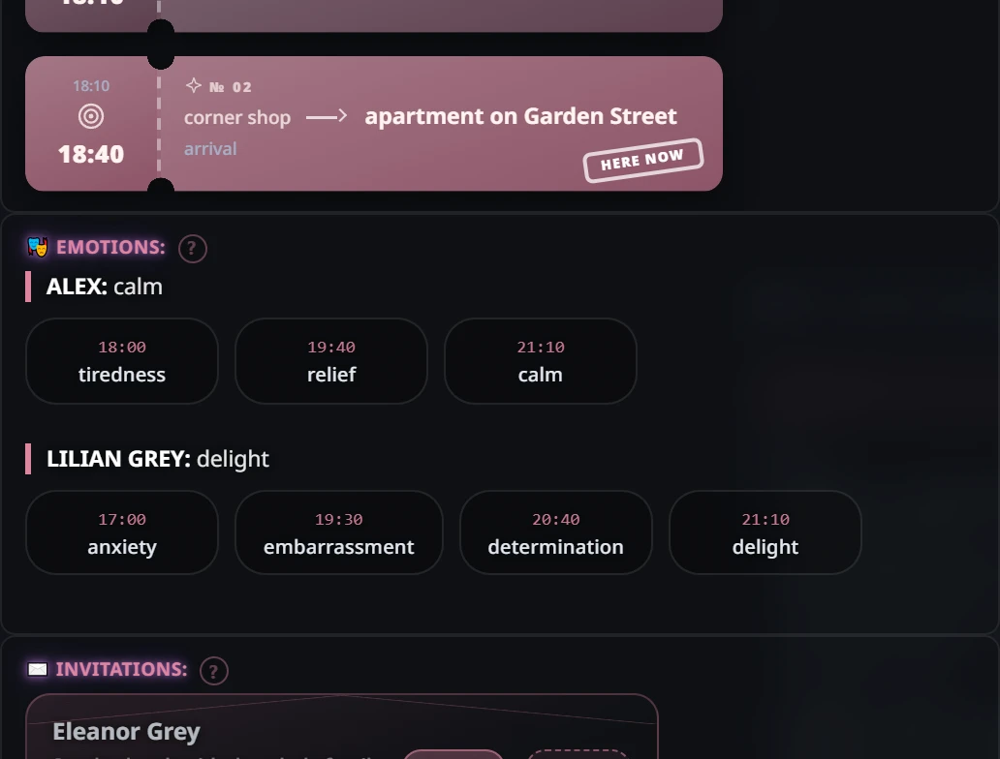<br>Route — tickets</td>
</tr></table>

---

## How it works

1. **Instruction.** Before each generation the extension adds the HUD schema to the request — the task, rules and field codes. Modules turned on and off rebuild the schema: a module that's off costs zero tokens.
2. **Reply.** The model writes a normal reply and, at the end, a block:

   ````text
   [HUD]
   ```json
   { "sc": { "T": "21:40 | late evening", "Wt": "light rain, +9°C" }, "cs": [ { "N": "Mark", "Md": "…", "Th": "…" } ] }
   ```
   [/HUD]
   ````

   Keys are short English codes (`sc`, `cs`, `Th`), values are full words in the interface language. On screen everything is shown in the interface language.
3. **Card.** The block is parsed (repairing truncated and malformed JSON, with a YAML fallback) and becomes a card in place of the raw text.
4. **Saving context.** In later requests, old HUDs in the history are replaced with short `[HUD_SUMMARY]` summaries, and the latest HUD goes to the model as a snapshot at the end of the instruction — the model updates it for the new reply.
5. **Continuity.** Chats, secrets, notes, the calendar and calls are gathered from past turns right before drawing. This works on screen only: message text and the request to the model don't change.
6. **Group chats.** In "swap" mode SillyTavern sends only the card of the character who is speaking. The HUD describes everyone, so the instruction also carries the cards of the other group members — looks and personality stay true to their cards. A HUD regeneration carries the cards of all members. With "Join character cards" SillyTavern sends them itself, and the HUD adds nothing.

### Which requests get the HUD

The HUD instruction goes **only to chat reply requests** — a normal message, a swipe, a regeneration, a continue. Everything else goes without it:

- SillyTavern's **quiet generations** — summaries, auto-translation, image prompts;
- **Impersonate** — a message written for the player;
- **raw requests from other extensions** (`generateRaw`): summaries, TunnelVision, lorebook tools;
- **direct requests from extensions**, such as **Ext Blocks**;
- **MemoryBooks** — writing a memory to a lorebook;
- **the HUD's own service requests** — "Ask about the story", saving to a lorebook, picking music.

**A swipe** reads the HUD of the previous message, not of the reply being replaced. Scars, impressions and invitations from the reply being replaced do not reach the model as things that already happened.

What's more, in those other requests the `[HUD]` blocks are cut out of the history and replaced with a short `[HUD_SUMMARY]` — date, time, who is where and wearing what. Summaries and memories know when and where things happened without dragging in the whole HUD.

---

## Works great with

- **[MoodTube](https://github.com/moonnsy/MoodTube)** — scene music plays full tracks right in the Tavern through MoodTube: the ▶ button with the "MoodTube" source, queue buttons in the playlist and in the archive soundtrack ("all to the MoodTube queue"). If MoodTube already tells the model its track, the HUD doesn't duplicate its own music line.
- **[SillyTavern-MemoryBooks](https://github.com/aikohanasaki/SillyTavern-MemoryBooks)** — with **"📚 MemoryBooks: count the scene without the full HUD"** (the "Lorebooks" group), MemoryBooks doesn't get full HUD blocks: the HUD sets up a rule for it and puts a short summary in place of each block. The scene for a memory gets several times shorter, MemoryBooks doesn't reject it for size, and the memory still knows the date, the place and who was wearing what.
- **SillyTavern chat translation** (the built-in Chat Translation extension) — with **"🛡 Protect HUD during chat translation"** (main settings, on by default) the HUD block is not sent for translation and does not get mangled, and the card of a translated reply is shown in the translation language by the same service. The model still gets the original. If **ExtBlocks** is installed, its blocks are added after the translation instead of wiping it.

---

## Security and privacy

- **The HUD has no servers.** No accounts, analytics, telemetry or "cloud" — the extension sends nothing to anyone.
- **Everything is stored only in your SillyTavern.** HUD blocks live inside your chat messages; the archive chronicle is a file on your own SillyTavern server (`user/files`); settings are in the browser (`localStorage`) with a copy in your SillyTavern extension settings (`settings.json`), the parse cache in the browser's IndexedDB.
- **The model sees only what goes through your API** in SillyTavern — the same channel as normal replies.
- **The only exception is scene music, and only if you turn it on.** To find a track, the HUD sends the catalog (iTunes, optionally NetEase and QQ Music) **only the artist and track title** — no chat text, no character names. Full tracks, if you pick such a source, play from YouTube mirrors (Invidious) or through MoodTube. Radio in the scene asks the radio-browser.info catalog **only for the station genre and a country code**; the scene background asks Fonau, Audius and Wikimedia Commons **only for mood words** ("тревожная", "dark ambient"); streams play straight from the stations (Radio Record from its own server). With music off, not a single external request is made.
- A theme can be loaded from someone else's file — only known fields are taken and their values are checked, so a file can't inject its own markup.

---

## Performance

The extension is built for chats with hundreds of messages and for phones:

- **Fast chat opening** — SillyTavern no longer colours HUD blocks as code, the latest turn's card is built first, and old turns are parsed after it in small portions.
- **Lazy tabs** — only the open tab is built, the rest on switching.
- **Lighter old cards** — a collapsed card keeps only its title on the page; when a chat opens, only the last few are built in full.
- **Virtualization** — in chats over 200 messages, cards far from the screen turn back into text and are rebuilt on scrolling.
- **Card limit** — you can keep only the last N in memory.
- **Only on the side** — a single full card is built, in the side panel; messages get a small button instead of the card.
- **Parse cache** in IndexedDB and a background worker for heavy history parsing.
- **KoboldCpp context cache** — in Text Completion the HUD instruction is a regular SillyTavern extension prompt placed before the reply prefix: it counts toward the context budget and stays the same between turns, so KoboldCpp doesn't reprocess the whole chat on every reply. Requests with a negative prompt also get the instruction and no longer need a second repair request.
- **🗜 Unload the chat** (⚡ Performance) — full HUDs of old turns, inactive swipes and message copies move into SillyTavern files, and a turn summary stays in their place. SillyTavern rewrites the whole chat on every save, so a lighter file saves noticeably faster: a 111-reply chat went from 67 to 29 MB. The model sees the same summaries as before; daily life, the archive and lists from past turns read the full blocks from the file; «Restore all» brings the chat back byte for byte, and every summary has a «bring back the full HUD» button.

---

## Installation

1. In SillyTavern open **Extensions → Install extension** and paste the repository address: `https://github.com/alewwi/HUD`
   *Or manually:* put the extension folder into `data/<your-user>/extensions/HUD` (or `public/scripts/extensions/third-party/`) and reload the page.
2. A **📊 TavernOS** block appears in **Extensions**.
3. For the English interface, set **🌐 Язык / Language → ENG** at the very top of the block; the page reloads.
4. Turn on **🔌 HUD in every reply** — then the main model writes the HUD along with each reply. If you don't want to spend every reply on it, leave it off: replies get a **➕ Create HUD** button, and the HUD is written by a separate request only when you press it — optionally with another, cheaper profile. With **➕ HUD as a separate request after the reply** (Generation → HUD regeneration) it is written that way by itself after every reply: one model, a local one for example, writes the story, another the HUD.
5. Send a message — a card appears under the reply.

Requires SillyTavern **1.12** or newer (tested on 1.18). The extension works with any API that supports Chat Completion or Text Completion. The HUD is generated by the same model that runs the story; regeneration and the assistant can go through a separate connection profile.

### Tips to start

- Start with a moderate set of modules and turn on the rest as needed: each module adds fields to the schema. How much each section weighs is shown in the token budget chip.
- The whole phone is about 800 tokens per turn; turn off the apps you don't use.
- **"How many expanded HUDs to keep" = 1** — the model sees only the snapshot of the latest HUD, the rest are compressed into summaries. This is the sweet spot of cost and quality.
- Models with a large context and careful format following do well. If the model drops fields, turn on "Fill in what was skipped" and "Boosts".

---

## Settings

All settings are in the **📊 TavernOS** block in "Extensions" and in the "Customization" window.

**🌐 Язык / Language** — the very first item, outside any group: RU or ENG. It changes the interface language (cards, windows, settings, notifications) and the language in which the model writes HUD values. The page reloads after you choose. Translation is a layer over the markup driven by a dictionary (`i18n.js`, `i18n-en.js`); character names and chat message text aren't translated.

**The same settings on every device.** HUD settings are kept both in the browser and in SillyTavern's extension settings, so a PC and a phone opening the same SillyTavern see the same thing: on load, the copy saved later wins. Backgrounds and banners uploaded as files stay on their own device — heavy images aren't sent to the server.

| Section | What you configure |
|---|---|
| 🧩 HUD blocks | HUD in every reply (network intercept) or only on the button; the player block; era (phone or casket) and individual apps; intercepts or overheard talk; memory and Chekhov's guns; illnesses, pregnancy, birth and babies, the cycle; "what they think of you"; family tree; body state; plot twists; companions; adult-scene blocks (each separately); verbal duel; combat (decide itself, always, never); daily life and the sleep norm; diary, dreams, world, economy, events, city services, horoscope. "Fine tuning" — switch off single fields and sub-labels; they are cut from the instruction. Checkboxes for the new features: question badges, one-time nudges, invitations, thread deadlines, scars, era holidays, living details, the neglected state, weight, check-ups, the threat die, miscarriage and abortion, intimacy reminders. |
| 📊 Custom stats | Master switch; the list of stats: name, meaning, view, icon, colour, whose, tab and place; the shared prompt with a "Restore the default text" button. |
| ✨ Display | Where the HUD is: in messages, on the side and in messages, only on the side; panel width (custom or up to the chat) and edge (right or left). Question-mark hints; lists from past turns: how many turns to look back, the item limit per list and messages per chat. |
| ⚡ Performance | Lighter old cards, how many cards to build at once, lazy tabs, Performance Mode, virtualization, card limit; 🗜 unload the chat and restore all. |
| 🖼️ Avatars | Images for character names, pinned avatars. |
| 📚 Lorebooks | Which lorebooks to add to the HUD regeneration request; how many messages to send when saving to a lorebook. |
| 🤖 Generation | HUD token limit; the instruction as a separate message; a snapshot of the latest HUD; completeness check; "Fill in what was skipped"; contradictions with daily life; the adult-scene part (auto, always, never); boosts; how many expanded HUDs to keep; context and profile for regeneration. |
| ❓ Assistant | The "Ask about the story" button; what the assistant sees (messages, HUD, author's notes, card, persona, lorebooks); profile, reply limit and system prompt. |
| 🎵 Scene music | Picking music for the scene; refreshing when the scene changes; connection profile; the Middle Ages (period music or a movie soundtrack); strip style (cassette, vinyl, scroll); how long to wait for a playlist (any number of seconds, 0 — no timer); reply limit (from 2048 tokens — with room for thinking models); the built-in player and source (clips, YouTube via mirrors, NetEase, MoodTube); checking tracks by search and fallback services (NetEase, QQ); the prompt: your own taste rules, how many messages to read, the character card, the persona, your lorebooks; in-scene music — to the model as one line; song language, meme soundtrack, radio in the scene, floating icon, clearing likes and bans; scene background in full, "after a clip — background", background sources (Fonau, Audius, Incompetech, Wikimedia Commons). |
| ⚠️ !!DANGER!! Remove HUD from chat | The very last item. Permanently cuts `[HUD]` blocks out of every message and swipe of the open chat, together with saved HUD versions and music picks. Asks first and shows how many messages and blocks it will touch. |

### Mini-guide: what does what

Settings are grouped — expand the one you need. Below is the essential part of each.

**🌐 Язык / Language** — the language of the interface and of the HUD values. The very first item.

**🧩 HUD blocks** — what goes into the card at all. Every block you turn off disappears both from the screen and from the model's instruction, so it saves tokens.
- *Era* — "modern" (phone and intercepts) or "medieval" (casket and overheard talk); phone apps and casket sections are turned on one by one.
- *Memory and plot* — timeline, secrets, routes; Chekhov's guns; plot twist cards; the family tree and how many HUD messages to scan for it.
- *Characters* — the player block, "What they think of you", companions.
- *Body and health* — illnesses and injuries, body state (energy, sleep, stress), the cycle, pregnancy, birth and the "Nursery". The number and sex of babies can go to the model as a hidden fact or not at all.
  Each new feature has its own checkbox here:
  - for the screen: question badges, one-time nudges, intimacy reminders;
  - for the story: invitations, thread deadlines, relationship scars, era holidays;
  - for the body: living details, the neglected state, weight and calories;
  - for pregnancy: check-ups, serious findings, the threat die, miscarriage and abortion.

  A switched-off feature leaves the screen and the request to the model. Single parts are switched off in Fine tuning, in the Model notes and On-screen hints sections.
- *Daily life* — the daily-life tab; "Daily life → model" decides whether the model sees the summary (one line, on topic only, or via the `{{hudByt}}` macro); the sleep norm.
- *Intimacy* — the adult-scene parts and the "decide itself / always / never" mode.
- *Combat and arguments* — combat (decide itself, always, never) and the verbal duel.
- *Diary, dreams and world* — diary, dreams, world, economy, events, city services, horoscope.

**🤖 Generation** — how the HUD goes to the model and how it's checked.
- *HUD in every reply* — the main switch: on — the model writes the HUD in every reply; off — the HUD only via the “➕ Create HUD” button, as a separate request.
- *Instruction as a separate message* — the schema goes as the last message after the preset and history. Turn it off if your backend doesn't accept a system message at the end.
- *Snapshot of the latest HUD* — the model updates the previous HUD instead of rebuilding the world. Helps continuity a lot.
- *How many expanded HUDs to keep* — the rest in the history shrink into summaries. 1 is the sweet spot.
- *Reply check* — what to do with an incomplete HUD (warn or complete it), contradictions with daily life, "Fill in what was skipped", "Boosts".
- *HUD regeneration* — connection profile (can be cheaper than the main one), how many messages to send, token limit.

**📚 Lorebooks** — which lorebooks to add to HUD regeneration; how many messages to send when saving to a lorebook; the MemoryBooks link.

**✨ Display** — where the HUD is (in messages or in the side panel, see “🗂 HUD on the side”), question-mark hints, the icon set, `[HUD_SUMMARY]` lines shown as a card. *Lists from past turns* — how many turns to look back and how many items to keep on screen (on screen only, nothing goes to the request).

**🖼️ Character avatars** — your own image for a name (or several spellings of one name), pinned player and character avatars.

**❓ Assistant** — the "Ask about the story" button: what it sees (how many messages, the HUD, author's notes, the card, the persona, lorebooks), profile, reply limit, your own system prompt.

**🎵 Scene music** — on/off and auto-refresh when the scene changes, profile, strip style, medieval music, the built-in player and sound source, checking tracks by search, how long to wait for a playlist, reply limit, your own prompt and context for picking.

**⚡ Performance** — lighter old cards, lazy tabs, speeding up two SillyTavern rules; for chats over 200 messages — Performance Mode and virtualization; a card limit. *🗜 Unload the chat* — full HUDs of old turns into separate SillyTavern files with turn summaries in their place; «↩ Restore all» puts them back.

**🧹 Maintenance** — "Clear cache": removes saved archive reports and reaction marks; settings, themes and avatars stay.

**💾 Settings file** — all HUD settings in one file: main settings, customization, your themes and stats, images. "Save to file" exports them, "Load from file" replaces the current ones and reloads the page. Chats and HUD records are not included. API keys and passwords stay out too: HUD does not store them, and if a key was pasted into a text field, that field is not saved.

**🧳 Before removing the extension** — a button next to the section below. Puts offloaded HUDs back into the open chat and removes service files from disk: offload files and this chat's chronicle. The chat and its HUD stay intact. If other chats of the character are offloaded, HUD names them and keeps the offload files.

**⚠️ !!DANGER!! Remove HUD from chat** — at the very end of the settings, set apart on purpose. Permanently removes the HUD from the open chat: `[HUD]` blocks in every message and swipe, saved HUD versions, music picks. Reply text, `[HUD_SUMMARY]` summaries and HUD mentions inside `<plan>` stay. Everything HUD remembered from those cards goes with them: the phone, the diary, relationships. A window with the number of messages and blocks comes first; it can't be undone, so save a copy of the chat first (chat menu → "Manage chat files" → export).

The look (themes, colors, fonts, the view of each block) is in the **🎨 Customization** window, the button at the top of the settings.

### Macros

| Macro | Value |
|---|---|
| `{{hudLast}}` | The chat's latest HUD as compact JSON with short codes, without empty and disabled fields. Supports `{{if hudLast}}…{{/if}}` in the new macro engine. |
| `{{hudByt}}` | The daily-life and scene-clock summary in one line ("no food for 7 h; sleep debt 6 h; dinner at 19:00 missed") — if "Daily life → model" is set to the macro. |

---

## FAQ

**Does the extension change my messages?**
No. The `[HUD]` block stays in the reply text as is — the card is drawn over it. Carrying lists over from past turns works on screen only. Messages change only when you press HUD regeneration, "Create HUD" or restore a previous version yourself.

**How much does it cost in tokens?**
It depends on the modules you turn on: the instruction is built for them, and the budget chip shows its weight by section. Old HUDs in the history shrink into short summaries, so the history doesn't bloat with every turn.

**Where does the data go?**
Nowhere but your API in SillyTavern. The HUD has no servers of its own; see "Security and privacy" for details.

**The model writes the HUD with errors.**
The parser fixes typical breakage: a truncated reply, missing commas, quotes inside strings, YAML instead of JSON. If a block is incomplete, turn on the completeness check — the HUD will be completed by regeneration.

**Can I use it without adult content?**
Yes. All such blocks can be turned off separately, and the corresponding part of the instruction can be turned off entirely — the model won't know about it.

**How do I remove the HUD from a chat or uninstall the extension?**
To remove only the extension, first press **🧳 Remove service files** at the end of the settings with the chat open: HUD returns to the messages, offload files and the chronicle leave the disk, and the chat stays whole. SillyTavern itself deletes only the extension folder. To remove HUD from a chat entirely:
Open the chat and press **⚠️ !!DANGER!! Remove HUD from chat** at the end of the settings: blocks are cut out of every message and swipe, reply text stays. Do this in every chat where you no longer want the HUD, then remove the extension. To only hide the blocks without touching files, add a Regex extension rule with "Alter Chat Display" and "Alter Outgoing Prompt": `/\[HUD\](?:(?!\[HUD\])[\s\S])*?\[\/HUD\]/gi` with an empty replacement.

**The chat is open on two devices.**
SillyTavern silently accepts a save of an old copy: the last save wins. So after a deletion or restore on another device, HUD offers to update the chat, and asks again before saving over it. HUD doesn't track text edits and new messages: for those it's still best to reload the page when switching devices.

**What carries over to another device?**
Everything lives on the SillyTavern server, so every device sees the same thing: chats, HUD, the deletion journal, settings, the chronicle. Only reactions and the parse cache stay in the browser. Moving to another server, a plain chat export doesn't take HUD files: first put offloaded HUDs back into the chat with **↩ Restore all** or **🧳 Remove service files**.

**Settings differ between my PC and phone.**
Since version 23.88.7 HUD settings are stored in SillyTavern too, and the fresher copy wins on load. Change any setting on the device whose look you like — the other one picks it up after a page reload. Backgrounds and banners uploaded as files move only by hand.

**A character died or left, but Daily life still counts them.**
Press the trash button next to their name in weight, sleep or wardrobe. The model stops counting their weight and sleep. Bring the person back at the bottom of Daily life, under Not counted.

**It's slow in a long chat.**
Turn on lazy tabs, lighter old cards and Performance Mode; lower "Build the last N cards at once" and set a card limit. If the chat itself is slow to save and open, press **🗜 Unload** (⚡ Performance → 🗜 Unload the chat): the chat file gets several times lighter, and everything comes back with one button.

---

## Changelog

The latest version is **23.89.22**:

- The family tree no longer makes uncles out of grown-ups the children merely call "uncle"; "Not family" removes the word from a twin too.
- The autumn leaf gust shows only in windy weather.
- The moving weather scene is lighter: daytime stars and unseen fireflies no longer animate, tree lights blink in groups.
- No rainbow at night, and the snowman no longer sinks in the drifts on a tall card.
- Weather scenes polished: bare trees branch, spruces come in tiers, a birdhouse with a chick, a woodpecker on a twig; spring gets fields, a farmstead and a windmill in the distance; medieval winter gets log huts, a castle, a snowman in a pot and a wooden sledge.
- Weather scenes are richer: new details in all four seasons (a palm, a lighthouse, a scarecrow, spruces, a sled, a duck with ducklings and more), the old ones redrawn; the hedgehogs walk in short runs and meet at a new burrow.
- Translations are complete: with a language from the table the model writes the HUD in that language, and the Customization sample is translated with the interface. A third new view for eight blocks, richer Thoughts and Subtext, dark paper on dark themes; pregnancy exams open per swipe.
- The family tree question about an "uncle" goes away right after you answer.
- New views for pregnancy, relations, combat, the graph, the family tree, the timeline and emotions. Customization follows the card and the player's tab order, every click on the sample leads to its own setting, changing a view keeps the scroll and no longer blinks; desire under the cycle and the secrets grid moved to the main settings.
- The family tree asks whose brother an "uncle" is when the HUD has no kinship, and no longer makes a family friend the mother's brother.
- New views for the diary, body diary, intercepts, thoughts and subtext, plus one more view for eight blocks. The Nursery asks who got a child's age wrong, decides on its own who is a child rather than a character, and no longer shows time-skip children as newborns; children show up in the family tree.
- The phone can be regenerated on its own; phone rumors get a date and time; every theme picture can be hidden one by one; fixed swipe scars, the Key block with section styles and Label on dark themes.
- Eight blocks get a choice of view, "Meanwhile" moves to the World tab, phone rumors become a live feed with tabs, long Memory lists fold.
- The HUD can be written by a separate request after the reply through another profile: one model (a local one, for example) writes the story, another the HUD. The archive collapses long lists, filters them by status and no longer loses pregnancies.
- SillyTavern chat translation no longer mangles the HUD, and the card of a translated reply is shown in the translation language; ExtBlocks no longer wipes the translation.
- The interface can be translated into any language with a spreadsheet through English; your own translation can be checked right in the HUD settings.
- The tab height setting is translated in the English interface.
- Theme "Reset" brings back the whole default look; the Customization sample is one coherent made-up story, and the player in it has no ties to anyone.
- One setting sets the height of every tab; in Customization a click on the sample leads to the right setting; theme pictures can be hidden one by one.
- Phone: iPhone, Android or keypad, cracks, Settings and Rumors apps, notification and clock styles, a chat background, the next plan, "last seen", false contact names, someone else at the phone, calendar statuses. Settings, language and settings files apply without a reload, and a loading plate replaces raw code.
- The combat block and intimacy turn on more accurately in the prompt: only the story counts, without HUD memory, the model's reasoning or stray words. Music reads the scene's mood better, dreams in Daily life go to the one who had them, and "broken" lists only what gets repaired.
- Music and assistant settings work again: since 23.88.100 they did nothing. X-ray moves in one rhythm under the cursor, the body map uses rows on wide screens, and the samples show the new blocks.
- Ages on memory entries ("not everything was yesterday"), memory edits by number, "Does not know" in the card, trust locks, promises, "Meanwhile" and the zodiac sign by date of birth. On phones long lists open smoothly, and the button says how many of how many are hidden. Jealousy in chat shows the names (who they fear losing, and to whom), as in the sample.
- Underwear sits right under clothing and is drawn as what is worn: men get boxers or briefs, not a bra. Rounds of one act and acts in one fertile window add up as in real life.
- Music no longer picks covers and remixes instead of the song and tries several versions of a full track; x-ray in a second round shows thrusts, not ejaculation.
- Characters of one card no longer merge by name; oral sex carries no conception risk; a moral "debt" no longer counts as money owed.
- HUD finds a character's sex more accurately, no longer mistakes sleep for unconsciousness, and recognises snowstorms and blizzards.
- A "What's new" window after updates. Cancel really stops the model for music, the assistant, lorebook entries and regeneration; profile lists update on their own.
- Family tree settings now live under "HUD blocks → Memory and plot".
- On phones, long pill lists open with a "More N" button and scroll together with the whole HUD.
- Family tree: families as separate branches, couples under their parents, no former spouses without a shared child; a "Whole tree" and "Normal size" button.
- When a message is deleted, weight and scars return to the previous HUD at once; deleting higher in the chat loses nothing. The family tree has no extra spouses and no card prefix in its labels.
- The family tree takes relatives from past HUDs (0 to 500, no copies), and someone else's "twin" no longer becomes kinship.
- `nc` is also allowed in health, status, inventory, marks and illnesses, only if nothing changed, and no longer shows on screen. Weight is updated with "up, down or as before". Reminders go only about people in the last HUD.
- Weight: every 3 story days, in tenths, with a rate limit, and the change shows its period. Fears with no subject are hidden.
- Music: going back to a track that already played needs no waiting, and YouTube mirrors are asked all at once.
- Fixed Health on the phone (pulse 0, "no data", another person's body) and Life (decimal temperatures, one main person, transaction dates and repeats, items being worn, laundry).
- The "First-aid kit" view of Health is a closed case in the theme color that opens on a tap. Cycle badges are small chips, the libido chart and Relationships cards stretch, Place and Role have a lighter background.
- A morning "after the fog" is no longer foggy; the schedule splits day and time for a long date too and takes a part of the day ("in the evening") as the time.
- Conception risk is counted by the day of intimacy, not by today, and shown in two lines: today and on the day of intimacy. "(!…)" no longer shows in Relationships.
- Trust scars are reminded to the model less often — once every eight replies.
- Archive: a pregnancy shows how it went, symptoms, check-ups, the threat of loss and complications; the dashboard sees hidden turns, so NSFW scene frequency is no longer empty.
- Dreams split more accurately into nightmares and ordinary ones; companions and archive checkboxes follow the theme colours.
- The model writes a shorter HUD: "nc" for what did not change, the world once a day, memory as updates; the HUD expands it into a full one itself. An experimental provider cache for Chat Completion.
- Archive: no duplicate secrets and guns, a "who learned it and when" history for secrets, date and time at turns, all pregnancies, a new look.
- In English mode the model rewrites in English the Russian values left over from the start of a chat.
- In the archive the chosen chat no longer drops when it closes, and a chat that grew is read again before the analysis.
- Pregnancy losses no longer appear in the phone calendar.
- You can remove a person from Daily life by hand: the model stops counting their weight and sleep, and you can bring them back at the bottom of the tab.
- Adding other chats in the archive is clear again, and the model no longer reads stale hidden facts.
- Every new feature has a switch in the main settings, and fine tuning gained "Model notes" and "On-screen hints".
- Weight: swipes no longer create a fake gain, and deleting messages rolls the record back.
- A swipe no longer tells the model what happened in the reply being replaced, and a refusal no longer counts as acceptance.
- A big check of all themes, eras and block views: the Customize window on light themes, the header in a narrow card, Bullet Journal, translation.
- Plate lists follow the finger and fit inside the tab window.
- Chats open much faster: on a long chat the text appears about 13 seconds sooner.
- A swipe scrolls through the whole turn: the list, the tab and the chat.
- The Unconscious plate no longer shows for someone else's state from thoughts and subtext.
- The code is now released under GNU AGPL-3.0.
- An "Are you sure?" question before deleting: the dialog says whether it can be undone.
- The Body field asks for a state, not a retelling of actions.
- After answering a badge, the card stays on the same tab.
- Notes about a pregnancy loss and losing one of twins go out only until HUD has recorded them.
- Swipe looks at the HUD of the previous message.
- Notes about scars and the neglected state go to the model once every three replies.
- Translucent intimacy reminders after a loss, childbirth and a fresh wound, just for you.
- Settings and customization save to a file and load back.
- A badge on the tab where HUD is waiting for your answer.
- One-time nudge for the model: a pill goes into the next reply and holds across its swipes.
- Relationship scars, lingering impressions, trust reasons and a chart in the archive.
- Living details, neglected state, weight and calories.
- Pregnancy check-ups, disclosure modes and a log.
- Holidays of the era, invitations, deadlines on plot threads.
- Network comments now come from people inside the world.

The full history is in [CHANGELOG.en.md](CHANGELOG.en.md).

## Development

```bash
node tests/run.mjs                          # all test suites
node tests/tools/audit-chat.mjs "<chat.jsonl>"  # run a real chat: parse and draw every turn
node tests/tools/build-cq.mjs               # rebuild style copies for the narrow card
node bump-version.cjs 23.61.1               # change the asset version (otherwise phones keep old modules)
node tests/tools/docs-shots.mjs [--lang en] [--era medieval] # README screenshots (SillyTavern must be running)
```

English interface: a new Russian label in the markup is translated by the `i18n-en.js` dictionary — a whole string in `СЛОВАРЬ_EN`, a string with numbers or substitutions in `ШАБЛОНЫ_EN`. Labels in CSS (`content`) are duplicated in `css/lang-en.css`, Russian examples in the model instruction in `prompt-en.js`. `node tests/i18n.mjs` checks the translator, the instruction without Cyrillic, the CSS and the parsing of English values.

Other languages go through English: translators fill in a spreadsheet of English strings. The guide is in [translations/README.md](translations/README.md). `node translations/build.mjs` builds the language files, and a new language appears in 🌐 Language by itself.

---

## Contact

Questions, bugs, ideas — get in touch:

- **Telegram:** [t.me/alewwiHUD](https://t.me/alewwiHUD)
- **Discord:** `alewwi`

---

## License

The TavernOS HUD code is released under [GNU AGPL-3.0](LICENSE): you can copy and change it, but changed versions must stay open under the same license. Images in `img/` and screenshots in `docs/screens/` are not covered, and some of them belong to other authors. See [NOTICE.md](NOTICE.md).
