# TavernOS HUD — живая приборная панель для ролевых чатов в SillyTavern

<p align="center"><b>RU</b> · <a href="README.en.md">ENG</a></p>

> Каждый ответ модели получает карточку состояния мира: время и погода сцены, что на ком надето, кто что думает и скрывает, чей телефон разрывается от сообщений, сколько часов персонаж не спал и не ел, кто кому кем приходится — и всё это не теряется от хода к ходу.

<p align="center">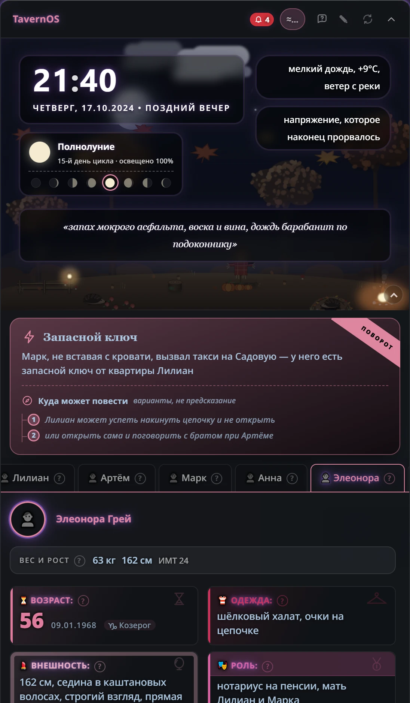</p>

TavernOS — расширение для [SillyTavern](https://github.com/SillyTavern/SillyTavern), которое просит модель вместе с каждым ответом присылать компактный блок `[HUD]` и превращает его в интерактивную карточку с вкладками прямо под сообщением. Интерфейс на русском или английском (переключатель **🌐 Язык / Language** в самом верху настроек), модель при этом пишет короткие английские коды — так дешевле в токенах.

---

## Зачем это нужно

Длинные ролевые истории ломаются на мелочах, и это знает каждый, кто играл больше сотни сообщений:

- **Модель забывает.** Персонаж «снова» в куртке, которую снял три сцены назад. Рана, полученная вчера, исчезла. Был вечер — стало утро без единого скачка времени.
- **Состояние размазано по тексту.** Чтобы вспомнить, кому персонаж должен денег, где лежит пистолет и о чём он соврал, приходится листать чат.
- **Не видно закулисья.** Что персонаж на самом деле думает, что скрывает, с кем переписывается, пока вы не смотрите, — всё это остаётся у модели в голове или пропадает совсем.
- **Мир стоит на месте.** Нет новостей, погоды, цен, слухов — истории не за что зацепиться.
- **Память стоит токенов.** Вести трекеры вручную в каждом сообщении — дорого и утомительно.

TavernOS берёт это на себя:

- **Состояние всегда перед глазами.** Одна карточка — и видно, где, когда, кто, в чём, с кем и в каком настроении.
- **Непрерывность без лишних токенов.** Переписки, секреты, заметки и события копятся из прошлых ходов *только на экране* — в запрос к модели не уходит ни одного лишнего символа. Старые HUD в истории сжимаются в короткие сводки, последний уходит модели снимком, чтобы она обновляла мир, а не придумывала его заново.
- **Второй слой истории.** Мысли, подтекст, «ожидание и реальность», страхи, перехваченные чужие переписки, дневники, сны — то, чего нет в самом тексте ответа.
- **HUD сам считает то, что модели считать не нужно.** Сколько часов назад ели и спали, долг сна за неделю, что пора в душ, хватит ли денег, что персонаж пропустил по расписанию, пока был занят. Модель для этого ничего не пишет.
- **Красиво.** 27 тем, 43 блока с альтернативными видами, погода и время суток на фоне, аватарки — карточка, которую хочется открывать, а не таблица.

---

## Как это выглядит

Под каждым ответом модели — карточка **TavernOS**:

- **Шапка сцены** — часы, дата, погода, фаза луны, настроение места. Фон меняется по времени суток и погоде: дождь, снег, туман, закат, ночь.
- **Полоса вкладок** — персонажи сцены, вы, телефон, память, быт, перехваты, дневник, сны, детская, мир и другие. Вкладка появляется, только когда в ней есть что показать.
- **Карточка поворота** — если в ходе случился настоящий поворот сюжета, над вкладками всплывает плашка: что произошло и куда это может повести.
- **Вопросики** рядом с названиями вкладок и полей — по нажатию объяснение: что это, почему показалось и как это читать.

Старые карточки сворачиваются в полоску заголовка и раскрываются по нажатию — длинный чат остаётся лёгким.

---

## Возможности

### 🎬 Сцена

Время, дата, погода, место и атмосфера. Фаза суток считается по часам с поправкой на месяц (зимой солнце садится раньше), с праздничным оформлением в новогодние дни. Фаза луны — на диске в шапке.

### 👤 Персонажи

Отдельная вкладка на каждого, кого модель описала в ходе:

- **Облик и состояние** — одежда, внешность, роль, тело, физиология, здоровье, инвентарь, место.
- **Внутреннее** — настроение, мысли, цели, расписание, страхи, реплики, скрытый подтекст, «ожидание vs реальность», ключевое в ходе, флаг-монитор, ревность, глубина конфликта, риск разоблачения.
- **Отношения и доверие** — к каждому по шкале от 0 до 100; смещения доверия видны от хода к ходу.
- **Шрамы отношений** — модель кратко пишет причину сдвига доверия. Глубокая рана или падение на 15 и больше оставляет шрам: персонаж помнит обиду, пока доверие не вернётся. Шрам можно убрать крестиком, после вопроса «Вы уверены?»: модель перестанет о нём напоминать, а вернуть его сможет только новое падение доверия. Напоминания о шрамах и запущенном состоянии уходят раз в три ответа и сразу, если что-то изменилось. После большого сдвига персонаж ещё несколько ходов под впечатлением, а если кто-то назван соперником, его рост отзывается на игроке.
- **Состояние тела** — энергия, бодрость, сытость, стресс, сон и дела на завтра.
- **Вес и рост** — строка в карточке: вес, рост, ИМТ и сдвиг. Модель пишет их один раз, потом HUD просит обновить раз в неделю сюжета. Если кого-то считать не нужно, его можно убрать в «Быте».
- **Запущенное состояние** — плашка, если человек несколько дней почти без еды, воды или сна. Модель покажет это в сюжете и со временем запишет как болезнь, а недоедание снижает шанс зачатия и сбивает цикл.
- **Живые детали** — голод, усталость, стресс, боль модель показывает мелкими приметами, а не называет, с паузами между ними.
- **Болезни и травмы** — стадия, симптомы, лечение и шкала выздоровления; следы на теле с таймером заживания.
- **Общие воспоминания** — копятся по ходам: одно и то же воспоминание в новой формулировке не дублируется.

<details><summary>📷 Вкладка персонажа целиком</summary>

<p align="center">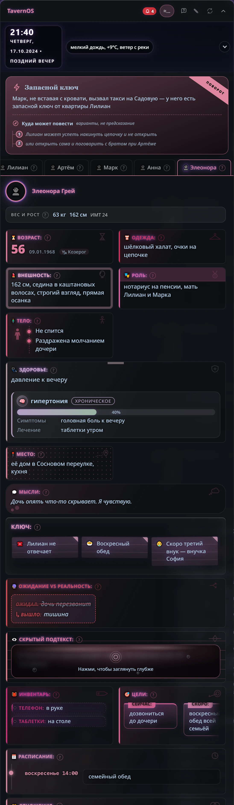</p>

</details>

### 🙋 Вы

Тот же набор про вашего персонажа — каким его видит модель снаружи: одежда, внешность, здоровье, отношения, локация. И сводка **«Что о тебе думают»**: как к вам относится и насколько доверяет каждый персонаж (считается из карточек, модель ничего не дописывает).

### 📱 Телефон персонажа

Полноценный смартфон с экраном блокировки и уведомлениями: **сообщения** (фото, видео, голосовые с расшифровкой, звонки, ответы на сообщения, удалённые сообщения), **контакты, кошелёк** с транзакциями, **календарь, галерея, заметки, карты, поиск, журнал звонков, погода, здоровье**. Каждое приложение включается отдельно: выключенное не просится у модели и не занимает места в запросе.

<p align="center">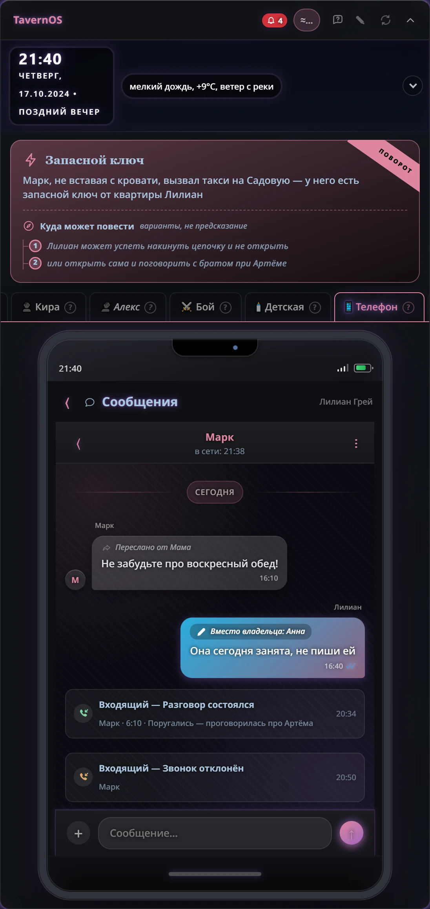</p>

<details><summary>📷 Приложения телефона: рабочий стол, кошелёк, календарь, здоровье, карты</summary>

<table><tr>
<td align="center">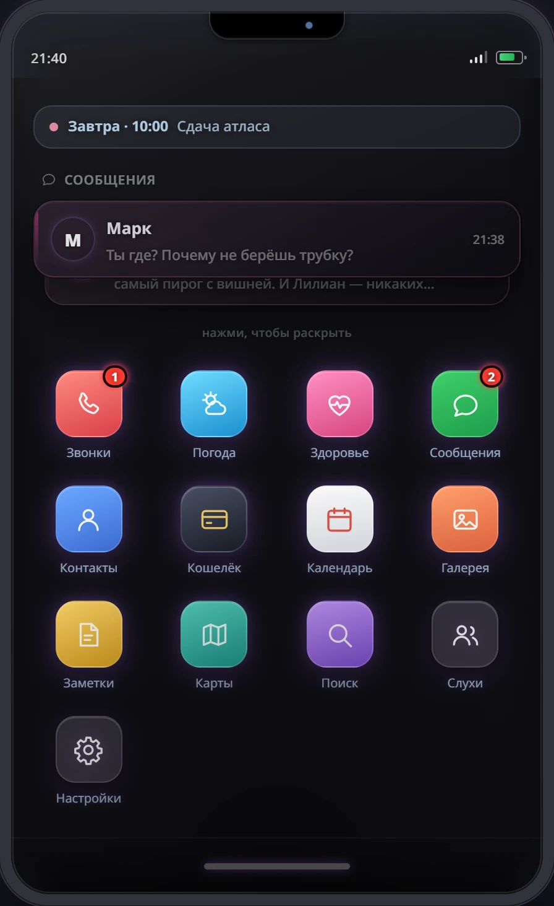<br>Рабочий стол</td>
<td align="center">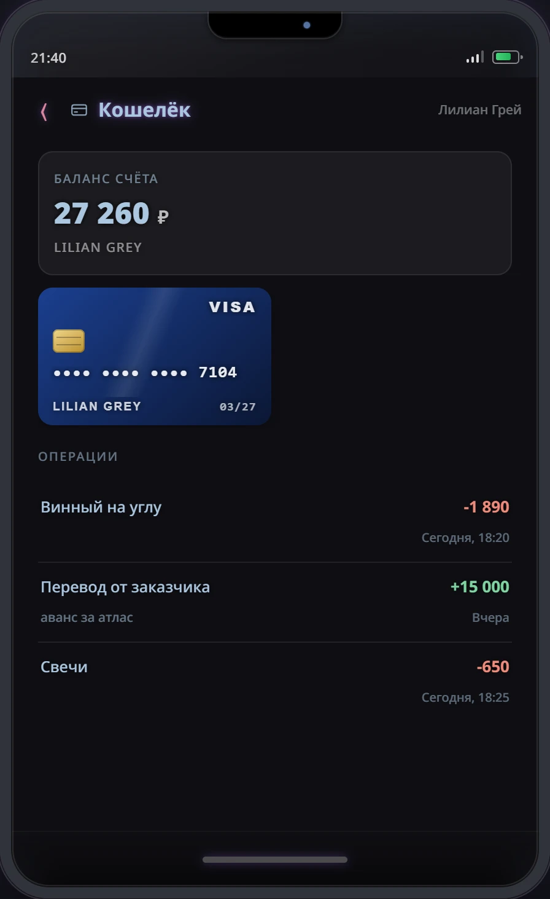<br>Кошелёк</td>
<td align="center">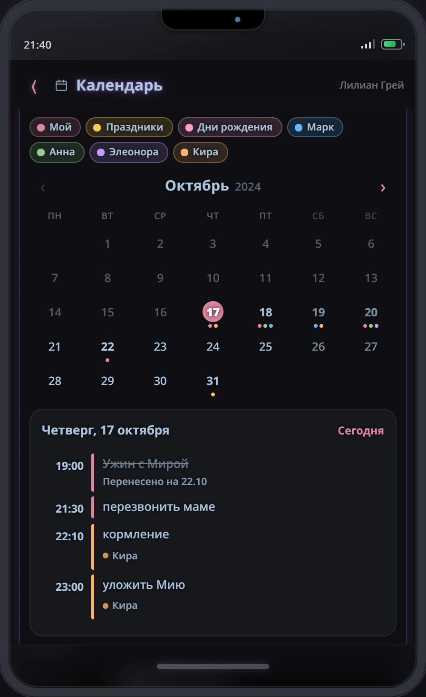<br>Календарь</td>
</tr><tr>
<td align="center">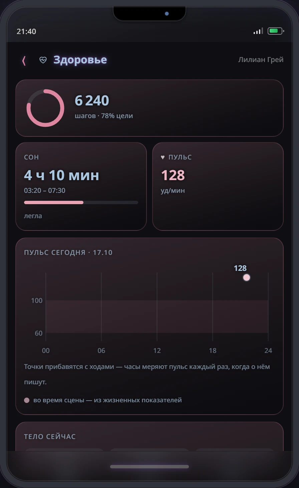<br>Здоровье</td>
<td align="center">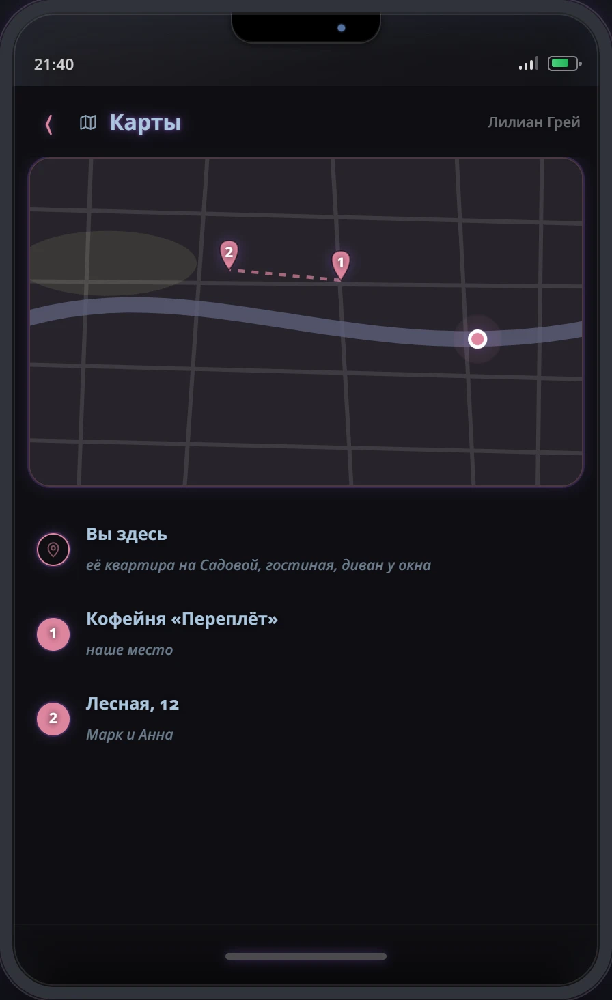<br>Карты</td>
<td></td>
</tr></table>

</details>

### 📡 Перехваты

Чужие переписки и разговоры, которые ваш персонаж знать не должен, — взгляд поверх плеча автора. Появляются только тогда, когда модель сама решила показать закулисье.

<p align="center">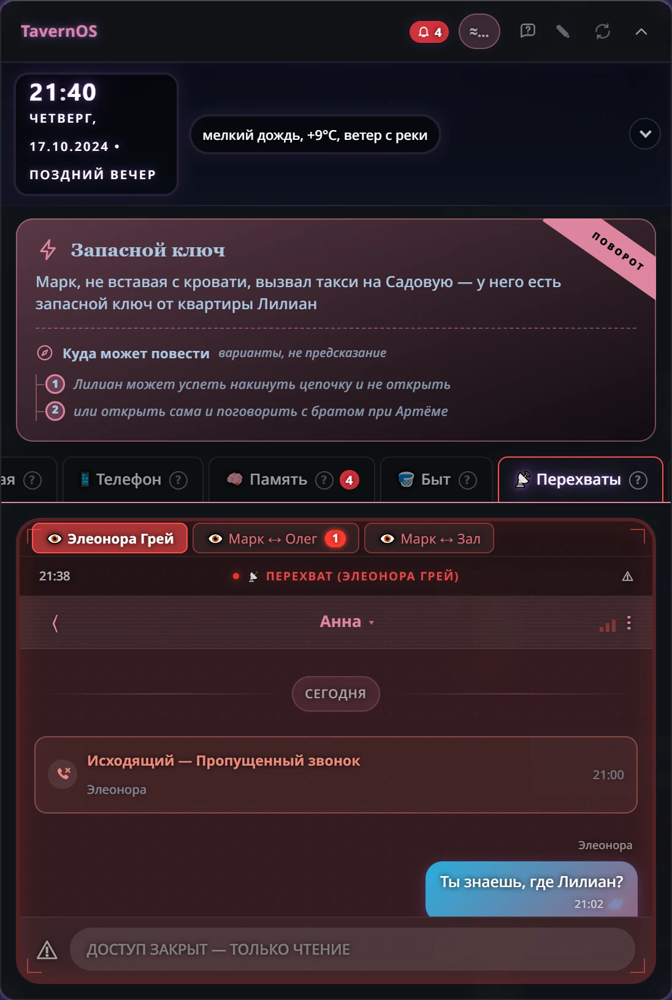</p>

### 🗝️ Средневековье: шкатулка и подслушанное

Для сеттингов до телефонов вместо смартфона — **шкатулка**: письма с печатями (печать ломается при открытии), святцы с фазой луны, кошель с приходной книгой, записи пером, карта, грамоты и памятные вещи. Вместо перехватов — **подслушанное**: разговоры сквозь стену и тайком вскрытые чужие письма. Эпоха переключается одной настройкой: **🧩 Блоки HUD → Эпоха**.

- **Язык эпохи** — подписи и меры под время: святцы вместо календаря, кошель и монеты (золото, серебро, медь) вместо карты банка, письма с сургучом вместо чатов.
- **Пергамент под любую тему** — шкатулка и подслушанное выглядят состаренной бумагой с восковыми печатями и в тёмных, и в светлых, и в своих темах.
- **Неразборчивое** — то, что персонаж не расслышал через стену, скрыто размытием; нажатие показывает, что там было на самом деле.
- **Музыка эпохи** — у музыки сцены есть выбор: старинная музыка или киношный саундтрек.

<table><tr>
<td align="center">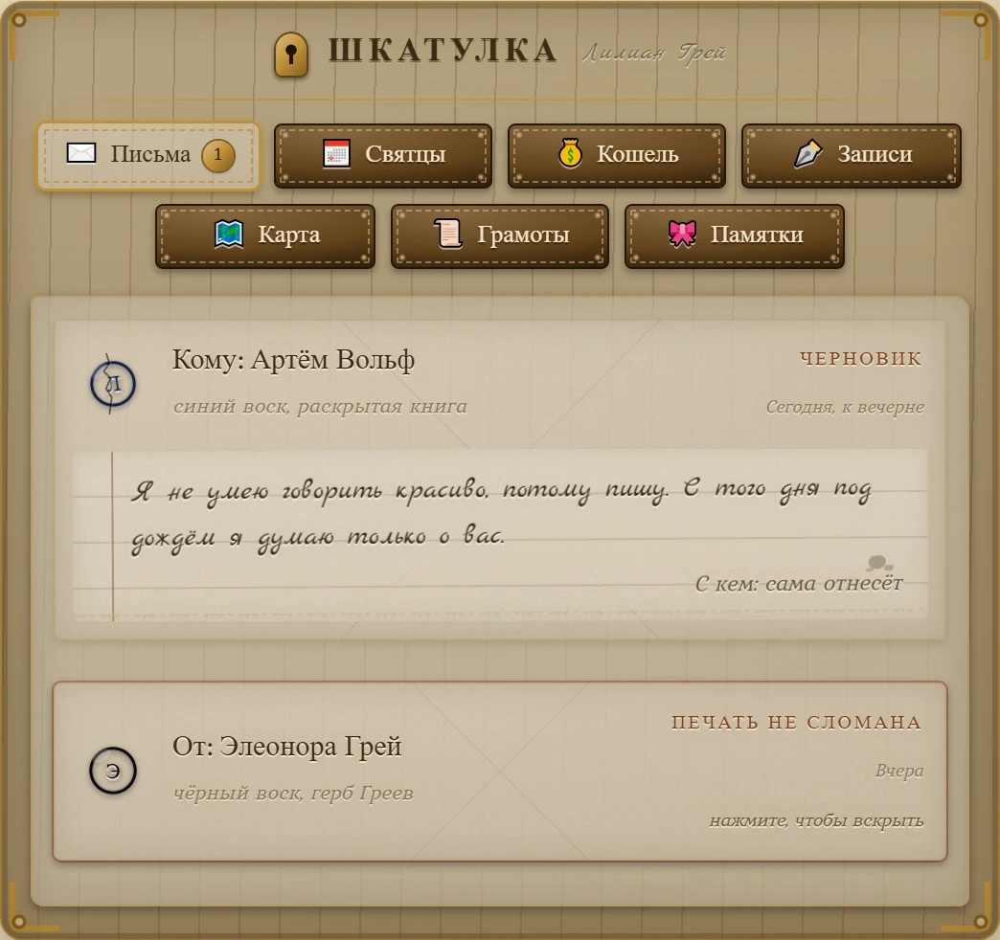<br>Письма: черновик и нераспечатанное</td>
<td align="center">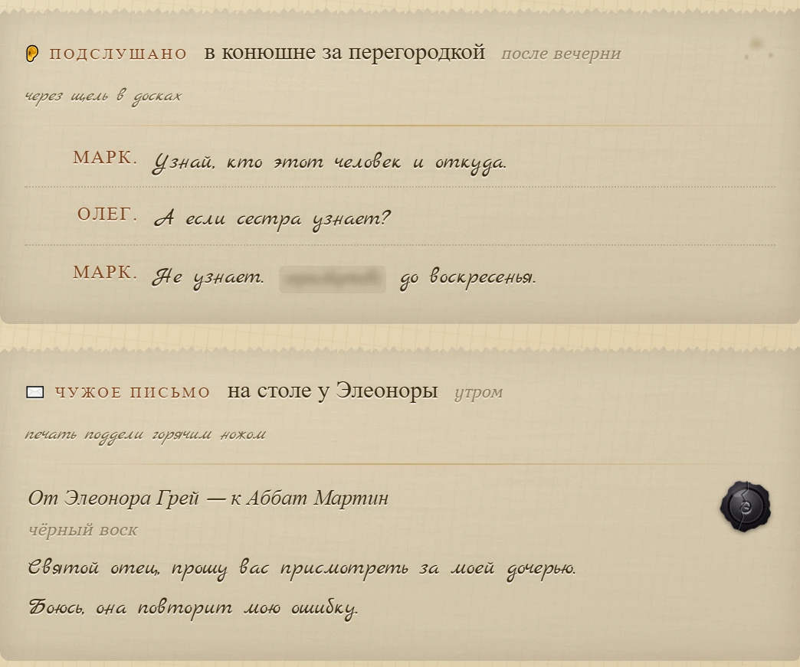<br>Подслушанное</td>
</tr><tr>
<td align="center">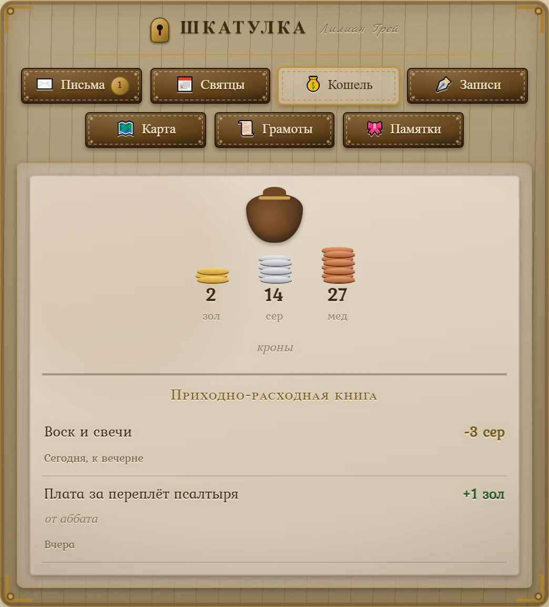<br>Кошель</td>
<td align="center">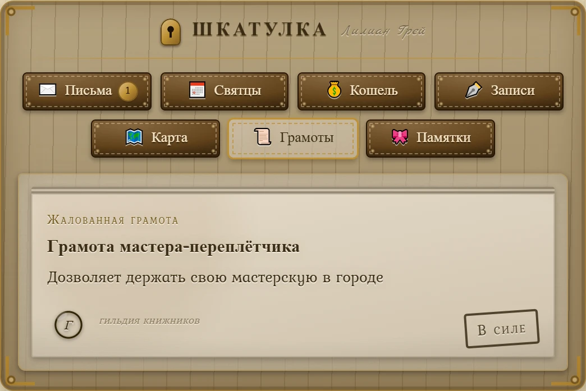<br>Грамоты</td>
</tr></table>

### 🧠 Память

Вкладка, где копится история, а не срез:

- **Таймлайн** и **важное** — что случилось и в каком порядке.
- **Секреты** — кто что скрывает и от кого, уровень опасности и огласки. Секрет можно одной кнопкой вписать в лорбук — тогда модель будет помнить его и без HUD.
- **Ружья Чехова** — незакрытые сюжетные нити: обещания, угрозы, намёки, загадки.
- **Длинные списки.** До трёх плашек стоят как есть. Если их больше, на ПК они листаются вправо, на телефоне вниз: так работают пилюли персонажей и виды блоков. Листы бумаги и оси, которые вбок не лягут (свиток, блокнот), листаются вниз и на ПК. На телефоне палец ведёт весь ход насквозь: дойдя до конца списка, свайп продолжается во вкладке, а дальше в чате.
- **Значки телефона.** У каждой темы свой набор из двенадцати значков. Набор выбирается в Кастомизации → Блоки: Телефон: «Авто по теме», «Обычные» или любой другой; чужой набор подстраивается под цвета темы: и рисунок, и плитка.
- **Удаление плашек.** У «Важного», «Ружей Чехова» и секретов в заголовке есть корзина: она включает режим удаления, плашки подсвечиваются, а нажатие на плашку открывает окно со всеми похожими формулировками из чата: удаляются только отмеченные, из HUD всего чата. Текст сообщений и `[HUD_SUMMARY]` остаются. Вернуть удалённое можно через «↶» в шапке карточки: хранятся последние 30 удалений, в любом порядке. Пункт вернётся и в блоки, которые поправили или перегенерировали после удаления, и в последний HUD чата, поэтому модель снова его увидит.
- **Разовая подсказка.** Кнопка со звёздочкой в заголовке блока: нажмите на плашку, и она уйдёт модели в следующий ответ. HUD ничего не отправляет сам, подсказка просто попадёт в запрос. Она работает и со старой карточки, держится на одном ответе и всех его свайпах, а новое сообщение её снимает. Очередь (до трёх) видна над полем ввода.
- **Сроки у нитей.** Ружьё может иметь дату и вид задачи: главное, побочное, мелкое. Срок появляется в календаре телефона, а просроченная нить просит развязки. Просроченные планы календаря тоже подписаны, и модель решает, сделали их или сорвали.
- **Давнее.** Старые пункты «Важного» сворачиваются, тридцать свежих остаются на виду.
- **Приглашения.** Если модель написала приглашение, HUD сам ищет ответ в вашем сообщении. Не нашёл — покажет карточку «Принять» и «Отклонить». Обещали и не пришли: персонаж обидится.
- **Значок ответа.** Если HUD ждёт вашего решения, на вкладке появляется красный значок с числом: приглашения и «всплыло в споре» в Памяти, закрытый исход угрозы и осмотр у беременной. То же число видно в шапке свёрнутой карточки и на заглушке при закрытой боковой панели. Значок уходит, когда вы ответили.
- **Эмоции** — как менялось настроение главных персонажей; **маршрут** — где они побывали за этот отрезок.
- **Граф отношений** — паутина связей всех персонажей: романтика, дружба, конфликт, ревность, страх, подозрение, семья, родители и дети, начальство, наставники, долг, запретное, подельники, общая группа. Узлы с аватарками, нажатие на узел или связь подсвечивает окружение, граф разворачивается на весь экран.
- **Генеалогическое дерево** — второй вид того же графа, когда в отношениях нашлось родство.

<details><summary>📷 Вкладка «Память» с графом отношений</summary>

<p align="center">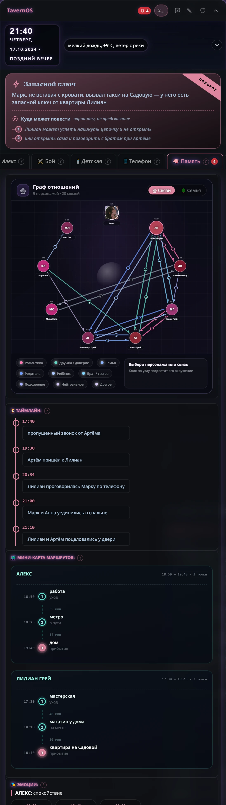</p>

</details>

<details><summary>📷 Генеалогическое дерево</summary>

<p align="center">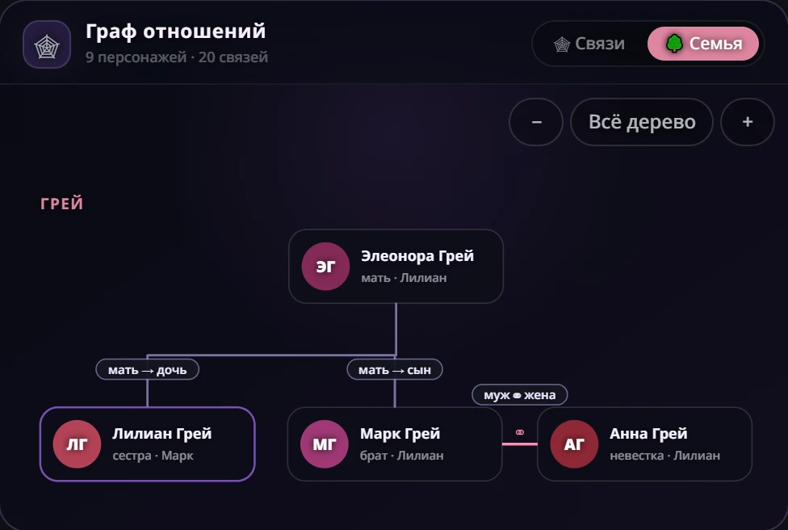</p>

</details>

### 🧺 Быт

Еда, сон, душ, стирка, уборка, одежда, деньги и дом **по всем прошлым ходам**: сколько прошло с последнего раза, долг сна за неделю, что лежит в стирке, знакомые цены, что сломалось, кто кому должен. «Надо бы в душ» считается по часам, жаре и нагрузке; «не по погоде» — когда персонаж в мороз без верха или в жару в пальто. Всё это HUD вычисляет сам из того, что модель и так пишет. Итог быта можно показывать модели одной строкой, только по теме разговора или макросом — или держать только для себя.

**Вес и калории.** В «Быте» у каждого своя карточка: вес, кривая, норма калорий с учётом активности и беременности и сколько человек ест в среднем. Свайпы не дают ложной прибавки: за один день сюжета считается последнее число. Если удалить ответ с весом, запись откатится.

**Убрать человека из «Быта».** Если кого-то считать больше не нужно, например героя, который умер или уехал, нажмите корзину рядом с его именем в весе, сне или гардеробе. После вопроса «Вы уверены?» его вес, сон, гардероб и раны пропадут из вкладки, а строка веса пропадёт из его карточки. Модель перестанет считать его вес и сон и не будет просить его взвесить, а сводка перейдёт к следующему человеку в сцене. Записи сохраняются: вернуть человека можно внизу вкладки, в разделе «Не считаются». Список у каждого чата свой, себя тоже можно убрать.

<details><summary>📷 Вкладка «Быт»</summary>

<p align="center">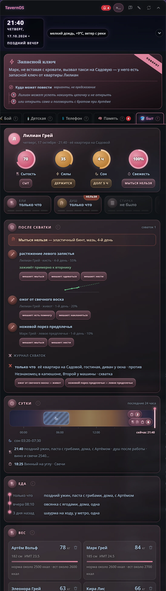</p>

</details>

### ⚔️ Бой

Появляется, только пока есть опасность: этап и очередь, дистанции, раны на силуэте, оружие с зарядом, адреналин с отходняком по времени сюжета, выдержка, укрытия, шкала погони. В мирных ходах модель этот блок не пишет и он ничего не стоит.

<details><summary>📷 Вкладка «Бой»</summary>

<p align="center">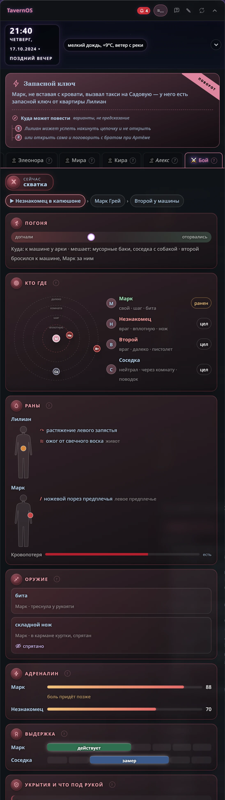</p>

</details>

### 💬 Словесная дуэль

Пока идёт спор: кто ведёт и насколько, кто что уступил, градус и воспоминание, всплывшее в споре.

### 📖 Дневник и 🕯 дневник тела

Личные записи персонажа своими словами (субъективные — он может ошибаться и врать самому себе) и дневник тела — запись о теле во время близости и после неё: чего оно хочет, что получает, что ноет и какие следы остались.

<p align="center">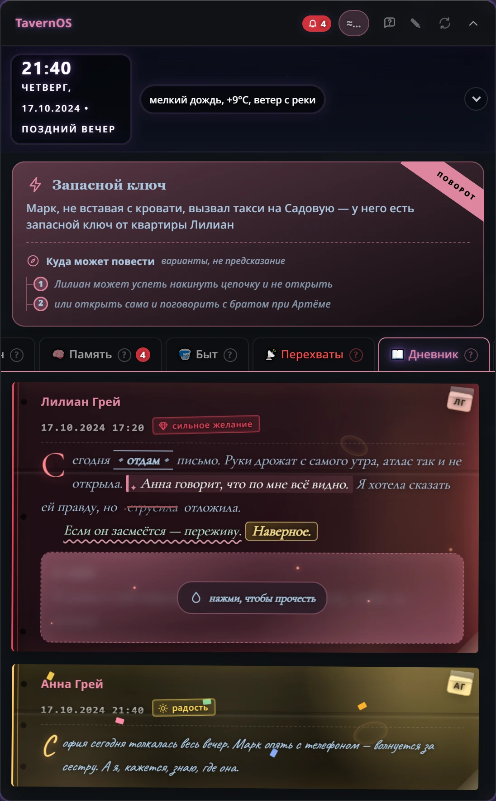</p>

### 🌙 Сны

Что снилось персонажам этой ночью — образами и намёками, а под каждым сном толкование: какой страх или желание за ним стоит. Сон закрыт дымкой и проясняется в несколько нажатий, как будто вспоминаешь его по утрам. Хороший способ показать то, в чём персонаж не признается даже в дневнике.

<p align="center">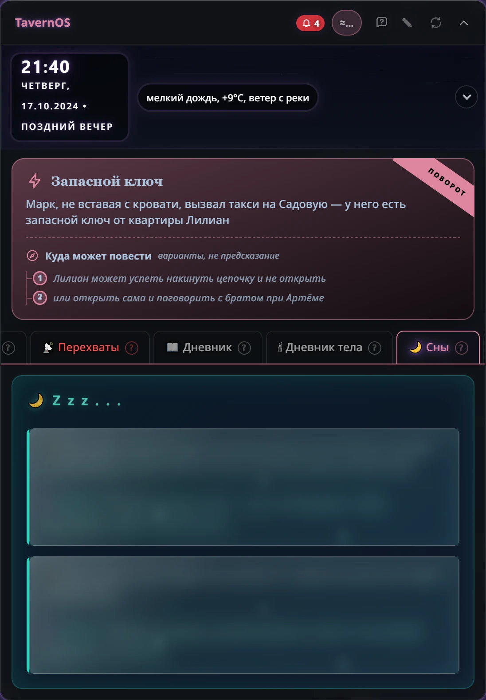</p>

<details><summary>📷 Сны после нескольких нажатий — дымка рассеялась</summary>

<p align="center">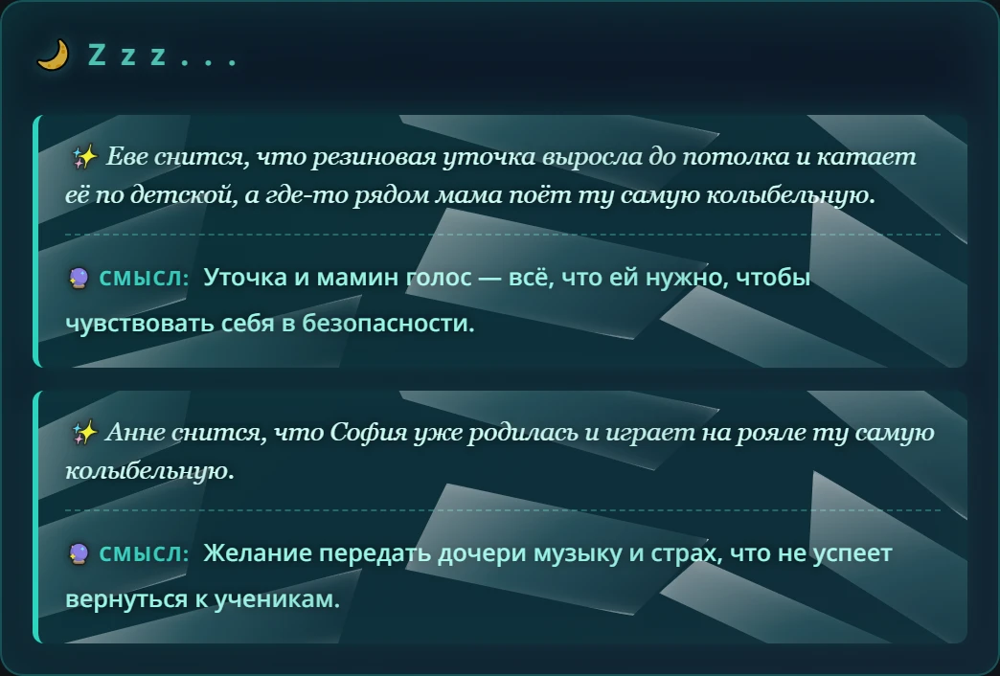</p>

</details>

### 🌸 Здоровье и семья

Для историй, где важны тело и семья, — три связанных блока. Каждый включается отдельно в группе «Персонажи» и появляется только у тех, к кому относится.

**Менструальный цикл.** Кольцо с днём цикла и текущей фазой, ожидаемые месячные, окно ПМС, задержка и сбой цикла от стресса. Под кольцом — советы по фазе и риск зачатия с учётом защиты; из этого блока можно «сделать тест». Маленькая кнопка «? почему N%» плавно раскрывает разбор процента: день цикла и где овуляция, шанс этого дня, сколько оставляет защита, что ещё снижает шанс (кормление, болезни) и итог умножением. Такой же разбор есть в модификаторах сцены — для своего шанса и для партнёра. Цикл ведётся у всех, у кого он есть, в том числе у вашего персонажа.

<details><summary>📷 Карточка цикла</summary>

<p align="center">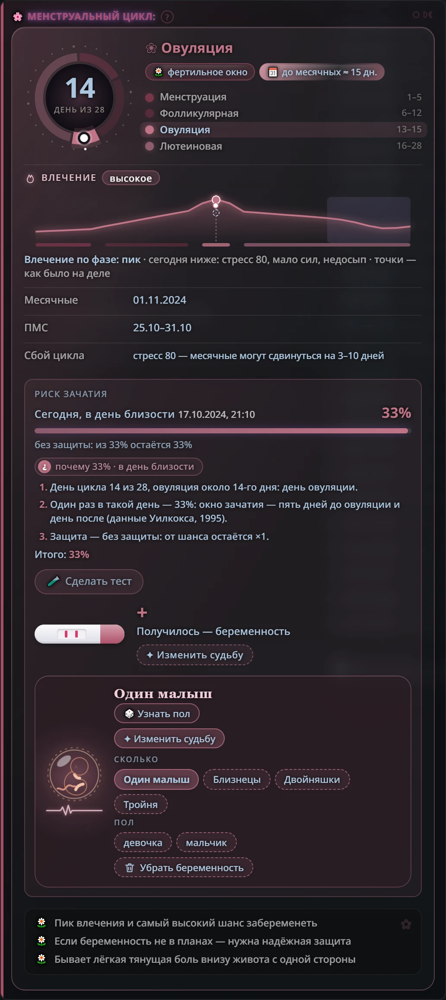</p>

</details>

**Беременность.** Срок в неделях и триместр, шкала до родов, размер малыша в сравнении с фруктом, что он уже умеет и какая веха дальше. Отец, симптомы, капризы в еде, кто уже знает, как проходит беременность, ближайший визит к врачу и советы по сроку, включая тревожные признаки. Число и пол малышей решает кубик, а при желании их можно «изменить судьбой». Модели это уходит скрытым фактом или не уходит вовсе, как выберете.

<details><summary>📷 Карточка беременности</summary>

<p align="center">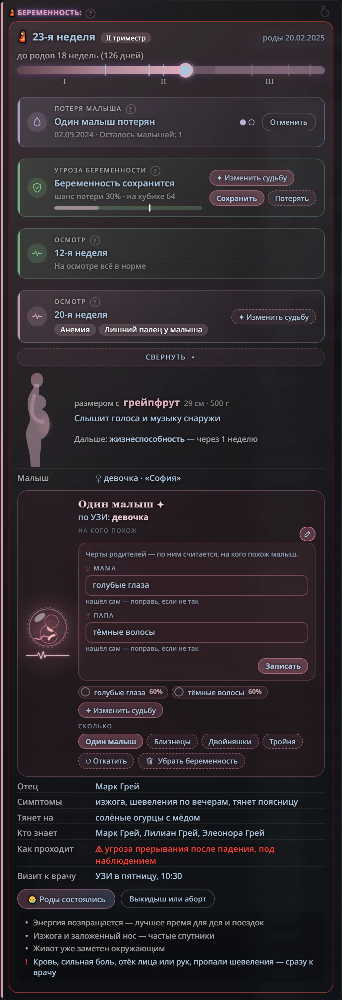</p>

</details>

**Убрать беременность.** Кнопка рядом с «Изменить судьбу» стирает беременность из HUD всего чата, как будто её не было: срок, малышей, итог кубика. Уже родившихся детей она не трогает, текст сообщений не меняет. Вернуть её можно через «↶» в шапке карточки.

**Выкидыш и аборт.** Модель отмечает выкидыш, аборт, замершую беременность или мертворождение меткой `lost`, а угроза и кровотечение остаются в строке «Как проходит». Если она этого не поняла, рядом с «Роды состоялись» есть кнопка **«Выкидыш или аборт»**: там выбираются вид и дата. У персонажа без поля беременности кнопка стоит на плашке с положительным тестом. HUD закрывает беременность только у этого персонажа: вместо счётчика появляется плашка, модель на следующем ходу узнаёт, что беременности больше нет. В отличие от «Убрать беременность», история остаётся: старые карточки показывают срок как было. «Отменить» на плашке возвращает всё, как было до отметки.

- **Восстановление зависит от срока.** До 13-й недели цикл вернётся примерно через 5 недель, с 13-й через 6, с 22-й через 8. Молоко появляется только на поздних сроках: с 16-й недели его может прийти немного, с 22-й оно приходит на 2–5 день и уходит за 1–2 недели.
- **Шанс зачатия.** Овуляция приходит раньше первых месячных, поэтому забеременеть снова можно быстро. До первой овуляции шанса почти нет, до первых месячных он немного ниже, потом обычный. После операции, травмы или инфекции ещё около трёх месяцев он чуть ниже.
- **Двойня и тройня.** Можно потерять не всех малышей: беременность продолжится с теми, кто остался.
- **Кубик угрозы.** Если в поле беременности написана угроза прерывания, HUD бросает кубик на исход. Шанс зависит от срока и тяжести. Вы узнаёте итог кнопкой и можете изменить судьбу, а модель получает его только после этого.
- **Напоминание о близости.** Полупрозрачная строка для вас: до какой даты лучше подождать после потери или аборта (от двух до шести недель по сроку, дольше при осложнении) и после родов (шесть недель). У свежей раны на корпусе — что близость будет болезненной. Модель этих напоминаний не видит.
- **Что остаётся в истории.** Вкладка «Беременности» в архиве показывает все роды и потери чата и кто о них знает. Потери видны и в «Хронологии» архива. В календарь телефона они не попадают. Если перегенерировать или удалить ход, где модель написала о потере, HUD снимет отметку сам. Отметка кнопкой остаётся, пока её не отменить.

**Осмотры.** На 12, 20 и 30 неделе кубик решает, что нашли: осложнения и особенности малыша. Итог открываете вы, судьбу можно изменить, модель узнаёт только открытое. Тяжёлые находки включаются отдельной галочкой. Режим раскрытия зависит от эпохи: в средневековье осмотров нет, и до родов никто ничего не знает. Журнал событий лежит в архиве и скачивается файлом.

**Роды и «Детская».** После кнопки «Роды состоялись» вместо беременности начинается послеродовой период: восстановление и кормление. Появляется вкладка **«Детская»** с карточкой на каждого малыша:
- **вехи развития** на шкале возраста: что уже умеет, что вот-вот появится, что будет позже;
- **нормы ухода по возрасту:** кормление, сон, подгузники, зубки;
- **таймеры:** когда кормить, сколько спит, когда меняли подгузник;
- **как у взрослых:** состояние, здоровье, мысли, любимые вещи, расписание, отношения и доверие к взрослым, страхи и первые слова.

Когда ребёнок подрастает (по умолчанию к трём годам), он переходит из «Детской» в обычные карточки персонажей.

<details><summary>📷 Вкладка «Детская»</summary>

<p align="center">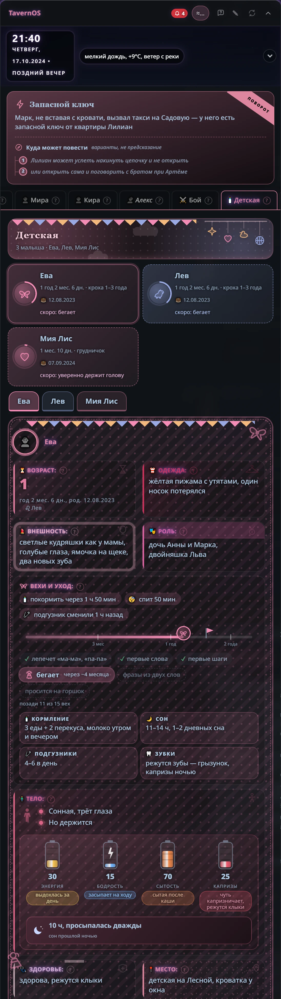</p>

</details>

### 🌍 Мир

Сводка на сегодня: новости, слухи, объявления, прогноз погоды, гороскоп, комментарии сети, курсы валют и цены, афиша (кино, театр, концерты), городские службы (пробки, транспорт, ЧП). Мир намеренно не копится с прошлых ходов, чтобы новости разных дней не смешивались.

**Комментарии сети** пишут обычные люди этого мира под своими никами: городской форум, чат, даркнет. Они знают только публичное и слитое, могут ошибаться и не обращаются к читателю.

**Праздники эпохи.** Праздники подбираются по эпохе, месту и вере: Россия, Европа со своим днём у страны, США, средневековье. Они видны в календаре телефона, за несколько дней до праздника в сцене появляется лёгкий фон, а на следующий день короткий итог. В фэнтези-мире их можно выключить в настройках.

<details><summary>📷 Вкладка «Мир»</summary>

<p align="center">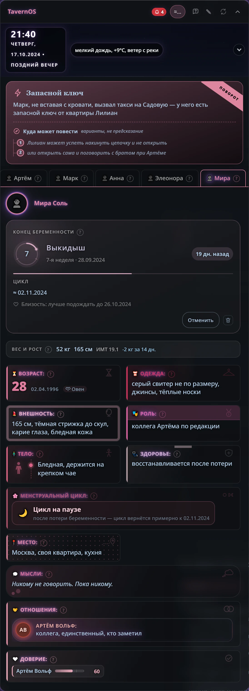</p>

</details>

### 🎵 Музыка сцены

Полоса «сейчас играет» над вкладками: **саундтрек** к моменту, как в кино, и музыка **в сцене** — то, что слышат сами герои (радио в машине, оркестр на балу). Подборка — отдельным небольшим запросом по сцене из HUD, заново только при смене сцены или по кнопке; каждую часть можно подобрать отдельно. Треки сверяются поиском, выдуманные помечаются. Кнопка ▶ играет прямо в Таверне: отрывок или полный трек. Громкость, число треков и пожелание («музыка для бега») — прямо в плейлисте. У трека — ♡ «нравится» и ⊘ «не предлагать»: следующие подборки ближе к вашему вкусу. Можно выбрать язык песен и мемный саундтрек (кнопкой или сам — в смешной сцене). Если в сцене играет радио, «В сцене» включает живой эфир: Радио Рекорд или станции мира. «Фон сцены» играет полные свободные треки по настроению сцены без пауз — из российского Фонау, Audius, Incompetech, а в средневековье ещё из Wikimedia Commons; после 30-секундного отрывка песни можно сразу переходить на него. Пока музыка играет, а карточка ушла из виду, у края — крошечный полупрозрачный значок. В телефоне персонажа — приложение «Музыка»: что он слушает сейчас, его плейлисты с названиями (модель собирает их по карточке, лорбукам и последним сообщениям, «Ещё» дописывает без повторов) и его «Нравится». В архиве — «Саундтрек» по главам. По умолчанию выключено.

<p align="center">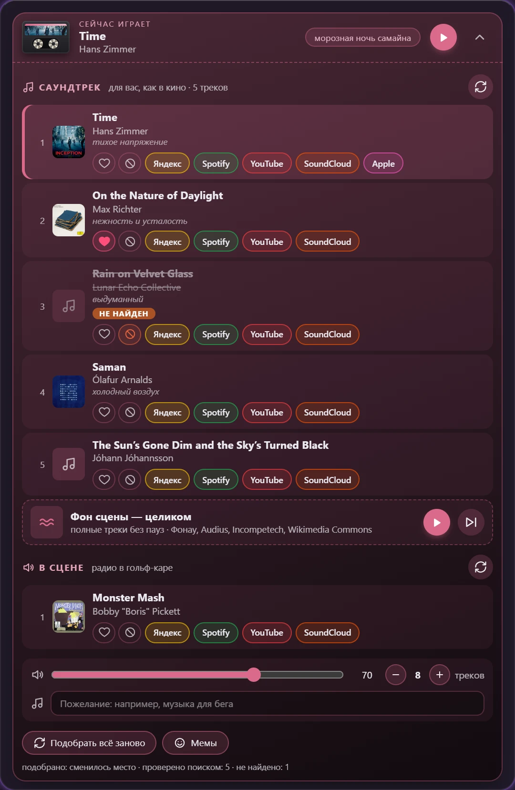</p>

<details><summary>📷 «Музыка» в телефоне и саундтрек в архиве</summary>

<p align="center">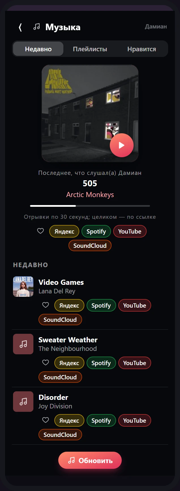 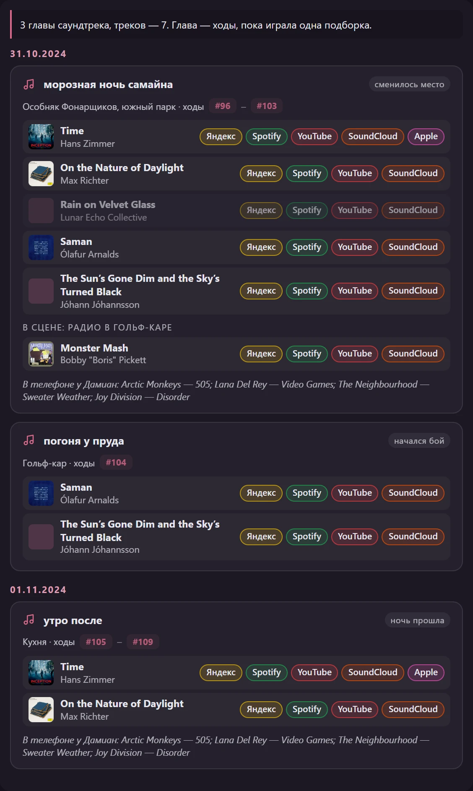</p>

</details>

### 🐾 Спутники

Животные, фамильяры, дроны: настроение, состояние, рацион, привязанность. Своя вкладка — только когда спутники есть.

<p align="center">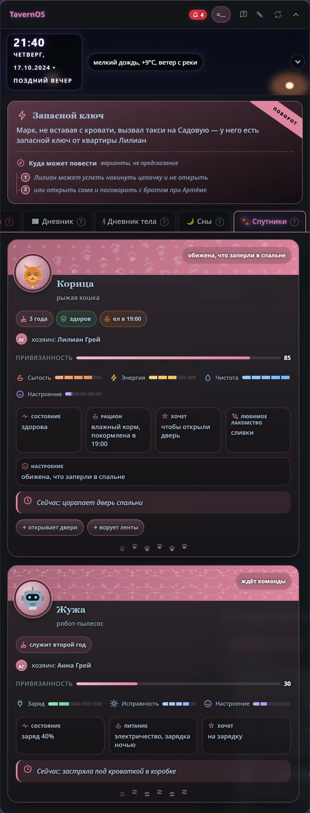</p>

### 📊 Свои статы

Чего-то не хватает — добавьте сами: голод, мана, репутация при дворе, розыск, слухи. Статов может быть сколько угодно. Каждому задаётся:
- **название и смысл** — в окошке пишете, что стат значит и от чего меняется; модель читает это как правило и пишет стат каждый ход;
- **вид** — число, кольцо с процентами, шкала 0–10, звёзды, описание или список меток;
- **значок и цвет** — акцент темы (по умолчанию), цвет одной из групп полей или свой;
- **чей он** — у каждого персонажа, у игрока или одно значение на всю историю (тогда и вкладка: персонажи, игрок, память, быт, мир).

На карточке стат — блок в стиле темы. Место выбирается в настройках («после поля „Роль“») или прямо на карточке: зажмите блок и тяните. Общий промпт своих статов можно переписать целиком, а одна галочка выключает их все — список при этом сохраняется. Имя каждого стата стоит прямо в схеме своего владельца — персонажа или игрока, — поэтому модель его не пропускает.

**Глубокая настройка.** В «Блоках HUD» каждый раздел разбит на группы, и любое поле — или даже отдельную подпись внутри поля — можно выключить. Выключенное аккуратно вырезается из инструкции: модель его не пишет, токены не тратятся.

Два раздела относятся не к полям ответа:
- **«Заметки модели»** — что HUD дописывает модели на ход: шрамы, впечатление от сдвига доверия, соперник, живые детали, запущенное состояние, просьба записать вес, праздники, сроки и приглашения. Внутри можно выключать отдельные части, например только калории в просьбе про вес.
- **«Подсказки на экране»** — что видите только вы: напоминания о близости, значки вопросов, разовые подсказки, осмотры и кубик угрозы.

### 🗄 Архив HUD

Сводка по всей истории чата, кнопка **🗄 Архив HUD** в настройках. Выберите диапазон (весь чат, последние 50 или 200 сообщений) и нажмите «Анализировать». Вкладки:

- **Секреты** — каждый секрет на последний момент: свежая формулировка, статус, кто знает и кто нет. Ниже раскрывается «Кто и когда узнал»: дата и время, имя, как узнал(а), смены статуса и первая формулировка. Если модель переписала секрет своими словами, это всё равно одна карточка.
- **Ружья** — ружья Чехова: какие нити ещё висят, какие выстрелили и в какой момент; под карточкой — история нити.
- **Отношения** — как менялись пары: смены отношения и доверия по ходам.
- **Доверие** — там же: график пары, причины сдвигов и шрамы.
- **Хронология** — сцены по дням сюжета: где были, сколько ходов, сколько прошло времени.
- **Беременности** — все беременности чата по ходам: срок с какой по какую неделю, даты, отец, кто знает, ожидаемые роды и исход (роды, выкидыш, аборт). Там же — как проходила (с историей по ходам), симптомы, осмотры, угроза прерывания и осложнения. Неоткрытые осмотры и исход угрозы не раскрываются.

Рядом с каждым номером хода стоит дата и время сцены этого хода. Вкладки показывают число записей.
- **Саундтрек** — главы музыки по дням (если включена музыка сцены).
- **Статистика** и **Дашборд** — сколько сообщений и дней, кто чаще говорит, длина ответов модели, повторы, скучные зоны, ритм сцен, доля диалога и описания, кто кого упоминает. Виджеты дашборда выбираются галочками.

Архив работает и для чатов, из которых HUD уже вычищен: HUD ведёт **летопись** — короткие выжимки каждого хода в отдельном файле вашей Таверны. К своей летописи можно подключить летопись другого чата того же персонажа (например, старой копии) — её ходы закроют пропуски без дублей. Подключается один чат: следующий заменяет предыдущий. Ветка открытого чата уже входит в его летопись, и HUD об этом скажет. Выбранный чат запоминается и остаётся выбранным при следующем открытии архива, а если в нём появились новые сообщения, архив перечитает его перед анализом. Есть поиск по отчёту и экспорт в JSON.

### 🗂 HUD сбоку

Карточку можно держать не в сообщениях, а в панели у края окна. Включается в настройках: **✨ Отображение → Где HUD**.

- **В сообщениях** — как раньше.
- **Сбоку и в сообщениях** — панель с HUD последнего ответа, карточки в чате остаются.
- **Только сбоку** — в сообщениях вместо карточки маленькая кнопка с временем и датой сцены из HUD этого хода; нажатие открывает ход в панели, а подсвечена кнопка того хода, что сейчас в панели. Полные карточки в ленте не собираются, и длинные чаты становятся заметно легче.

Панель открывается значком в верхней полосе Таверны и встаёт справа или слева (кнопка в шапке панели или настройка «Край»). Она идёт за последним ответом: новый ответ, свайп, перегенерация и правка обновляют её сами. Стрелками и точками листаются прошлые ходы, «к последнему» возвращает к свежему; открытая вкладка сохраняется при листании. Ширина тянется за край — от узкой до почти всего окна, поверх чата; у колонки чата она прилипает к ней («до чата»), и дальше панель сама занимает всё место до колонки. На телефоне панель выезжает поверх чата, закрывается тапом мимо неё. Все виды, темы и кнопки карточки работают и в панели.

### 🔞 Взрослые сцены (18+, необязательно)

Для историй с взрослым содержанием в расширении есть отдельный набор блоков. Они появляются только во время интимной сцены и вскоре после неё. Каждый выключается в настройках по отдельности, а можно отключить всю эту часть разом: тогда модель не получает о ней ни слова. Вне таких сцен этих блоков просто нет — ни на экране, ни в запросе.

Что они дают:

- **Ход сцены** — этап, обстановка, длительность, самочувствие и реакции персонажей, забота после.
- **Схематичные визуализации** — темп сцены и условные схемы, которые строятся из текста ответа сами, без дополнительных полей у модели.
- **Часы сцены** — сколько времени прошло по сюжету и что персонажи за это время пропустили по расписанию: ужин, звонок, встречу.

Цикл, беременность и «Детская» к этой части не относятся: они описаны выше, в разделе «Здоровье и семья», и включаются отдельно.

Эта часть инструкции — самая объёмная, поэтому по умолчанию она уходит модели **только пока сцена действительно идёт** (можно выбрать «всегда» или «никогда»). «Идёт» HUD понимает и по тексту, и по последнему HUD: возбуждение в физиологии, теле, мыслях или подтексте, желание в дневнике или дневнике тела. Скриншотов этих блоков в README нет намеренно.

---

## Инструменты

| Инструмент | Что делает |
|---|---|
| 🔄 **Перегенерация HUD** | Пересобирает только HUD сообщения, не трогая текст ответа. Можно через другой, более дешёвый профиль подключения, с выбранными лорбуками и описанием карточки. |
| ➕ **Создать HUD** | Кнопка на ответах без блока — дописать HUD к уже существующему сообщению. |
| ↶ **Версии HUD** | Прежний HUD не теряется при перегенерации — его можно вернуть одной кнопкой. |
| 🩺 **Проверка полноты** | После ответа HUD проверяется на обязательные поля. Неполный можно досоздать перегенерацией или просто получить предупреждение. Есть и проверка противоречий с бытом. |
| 🧩 **Дописывать пропущенное** | Если в прошлом HUD не было обязательного, вместе с обычным запросом едет короткая просьба включить это сейчас. Это не отдельная генерация. |
| 🎯 **Усиления** | Если модель в этом чате регулярно оставляет пустыми мысли, дневник или гороскоп, в инструкцию добавляется короткое напоминание. Счёт ведётся отдельно для каждой модели. |
| ❓ **Спросить про сюжет** | Окно вопросов к помощнику: почему персонаж так себя ведёт, что он скрывает, что может случиться дальше. Отвечает по HUD, последним сообщениям, заметкам автора, карточке, персоне и лорбукам — что выберете. В чат ничего не пишется. |
| 🎵 **Музыка сцены** | Полоса «сейчас играет» над вкладками: саундтрек к моменту и музыка, которую слышат сами герои. Подбирается отдельным небольшим запросом по сцене из HUD, заново только при смене сцены или по кнопке; «Саундтрек» и «В сцене» можно подбирать и по отдельности. Треки сверяются поиском по очереди — iTunes, NetEase, QQ Музыка, до первого найденного; выдуманные помечаются. Кнопка ▶ играет трек прямо в Таверне: отрывок 30 с из каталога iTunes или, по выбору, полный трек — с YouTube через зеркала Invidious, через неофициальный сервис NetEase или через MoodTube; следующий включается сам. Громкость, число треков и пожелание к подборке («музыка для бега») — прямо в раскрытом плейлисте. Есть и ссылки на Яндекс Музыку, Spotify, YouTube и SoundCloud, очередь MoodTube. ♡ «нравится» и ⊘ «не предлагать» у трека — ваш вкус: модель подбирает ближе к понравившемуся, запрещённое не предлагает. Язык песен; мемный саундтрек (разовой кнопкой, в смешной сцене или всегда). Радио в сцене: модель называет жанр станции — играет живой эфир Радио Рекорд (117 жанровых станций, для России и русских жанров) или станции мира из каталога radio-browser. Плавающий значок «что играет», пока карточка с музыкой ушла из виду. Фон сцены целиком: очередь полных свободных треков по настроению сцены без запроса к модели — Фонау (российская библиотека, поиск по-русски), Audius, Incompetech (каталог встроен), в средневековье — Wikimedia Commons; после отрывка песни — сразу он. Подборка хранится в ходе и в летописи; в архиве — вкладка «Саундтрек» с главами по дням. В телефоне персонажа — приложение «Музыка»: что он слушает сейчас, плейлисты с названиями (отдельный запрос по карточке, лорбукам и последним сообщениям; «Ещё» дописывает без повторов) и его собственное «Нравится» — оно уходит только в его запросы. По умолчанию выключено. |
| 📚 **Запомнить в лорбук** | Секрет или факт из HUD одной кнопкой превращается в запись лорбука — можно дать модели написать её по контексту сцены. |
| 🗄 **Архив HUD** | Сводка по всей истории чата: секреты, ружья Чехова, отношения, хронология, прошлые беременности, статистика и дашборд — как всё менялось и сколько прошло дней. С экспортом в JSON. |
| 🗑 **Вопрос перед удалением** | Перед удалением шрама, своего стата, темы, картинки, человека из «Быта» и другого важного HUD спрашивает «Вы уверены?» и говорит, можно ли это вернуть. |
| ≈ **Бюджет токенов** | Чип «≈4,1k» в карточке: сколько стоит инструкция HUD и что в ней сколько весит. |

---

## Оформление

Окно **🎨 Кастомизация** с живым предпросмотром:

- **27 готовых тем в 7 подборках** — Каваи, Dark Academia, Vamp, Киберпанк, Нуар, Средневековье, Фэнтези, Криминал, Web 1.0, Коттеджкор, Лёд, Глубина, Стимпанк, Дизельпанк, Солярпанк, Биопанк, Космоопера, Феодальная Япония, Древний Египет, Вестерн, Пираты, Ведьмовство, Вуду, Космохоррор, Фотолаборатория, Чаепитие, Буллет-джорнал. Светлые и тёмные; у многих тем есть запасные палитры — те же рисунки в других цветах.
- **Своя тема** — палитра, свечение, стекло (матовое, тонированное, прозрачное, перламутровое, жидкое), шрифты, размытие, отдельные цвета памяти, телефона, тревоги и перехватов. Тему можно сохранить в файл и переслать — при загрузке чужого файла берутся только знакомые поля с проверкой значений.
- **43 блока с альтернативными видами** — например, доверие полосками, сердцами, щитом, светофором или орбитами; страхи списком, термометрами, черепами, тучами или радаром; секреты сейфами, папками, сетью или конвертами; маршрут схемой, лентой, картой или билетами.
- **Порядок вкладок** — вкладки карточки (персонажи, телефон, память, быт, дневник…) расставляются в любом порядке прямо в чате: зажмите вкладку на полсекунды и перетащите вдоль полосы — пальцем или мышью, на телефоне тоже работает (короткое касание по-прежнему открывает вкладку, а свайп листает полосу). То же — в Кастомизации → 🗂 Вкладки: за ручку ⠿ или кнопками ↑ ↓. Любую вкладку можно закрепить первой или скрыть — скрытый блок всё равно пишется и копится, а рядом видно, сколько он стоит в токенах.
- **Аватарки** — одна картинка на любое число написаний имени; перечисленные вместе имена HUD считает одним человеком в графе, чатах и перехватах. Фото встают везде, где раньше были инициалы: в перехватах, телефоне, у питомцев и в других кружках.
- **Баннеры, рамки портретов, декоративные детали** — пластыри, бантики на вкладках, восковые печати, состаренная бумага, ханко, буквицы и другое, всё по отдельности.

<table><tr>
<td align="center">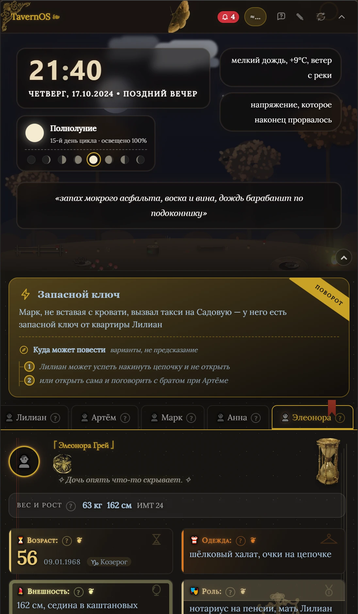<br>Dark Academia</td>
<td align="center">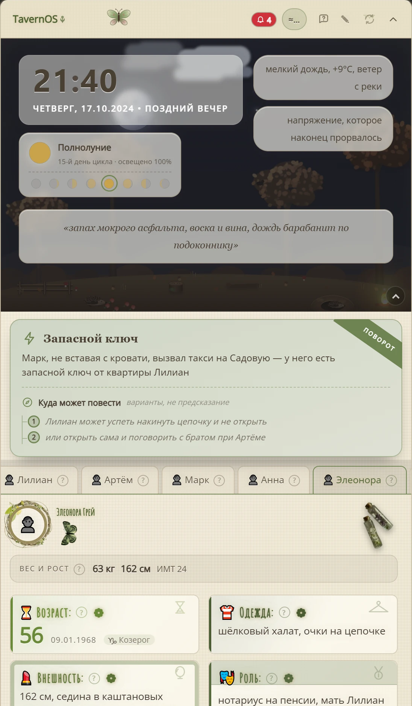<br>Коттеджкор</td>
<td align="center">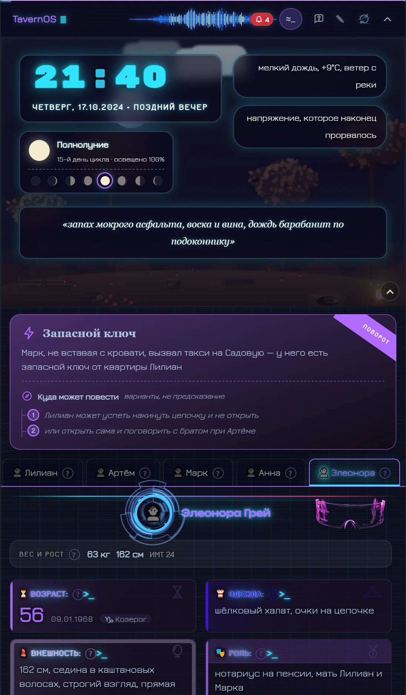<br>Киберпанк</td>
</tr></table>

Несколько альтернативных видов блоков (переключаются в «Кастомизации» → «Вид блоков»):

<table><tr>
<td align="center">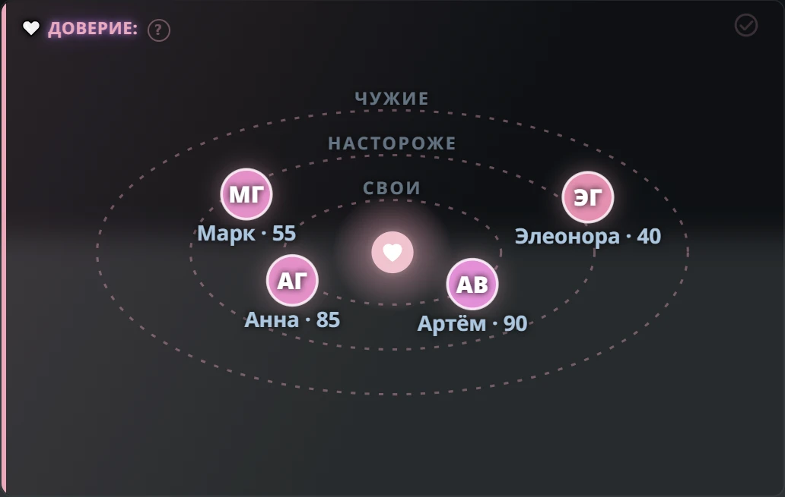<br>Доверие — орбиты</td>
<td align="center">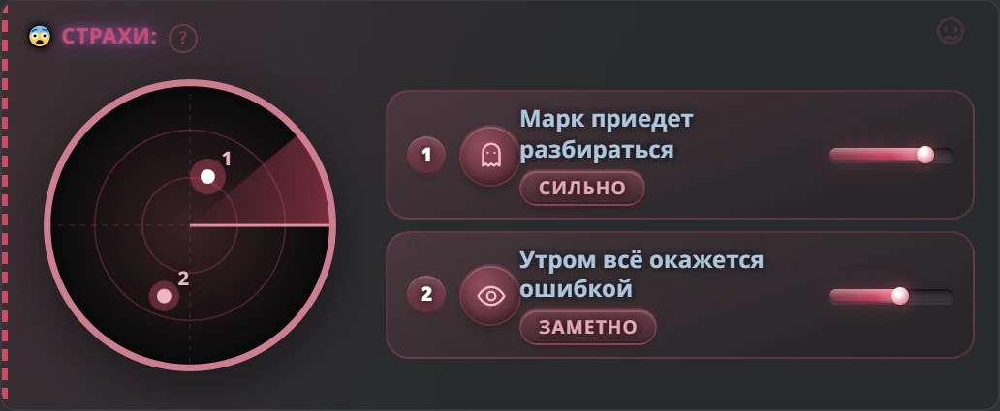<br>Страхи — радар</td>
<td align="center">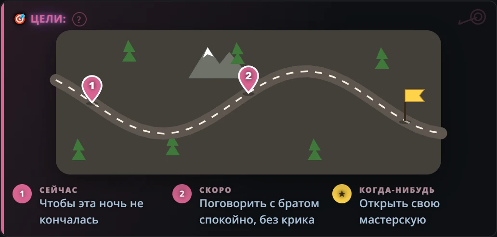<br>Цели — дорога</td>
</tr><tr>
<td align="center">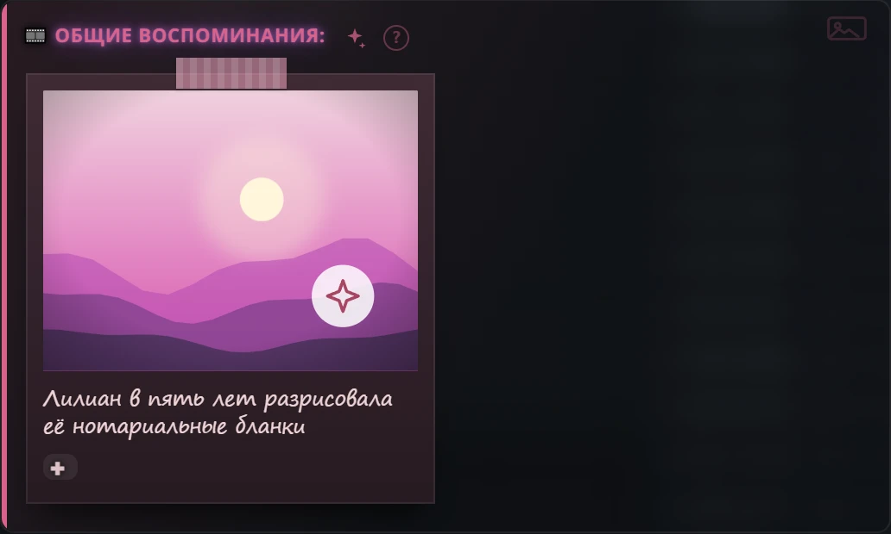<br>Воспоминания — полароиды</td>
<td align="center">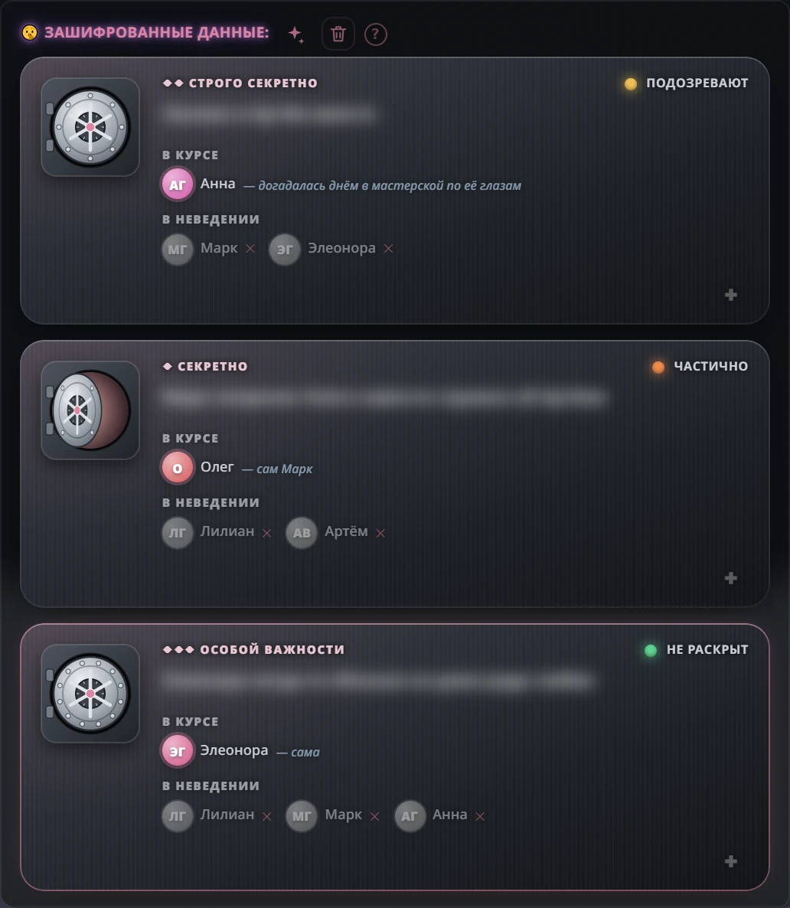<br>Секреты — сейфы</td>
<td align="center">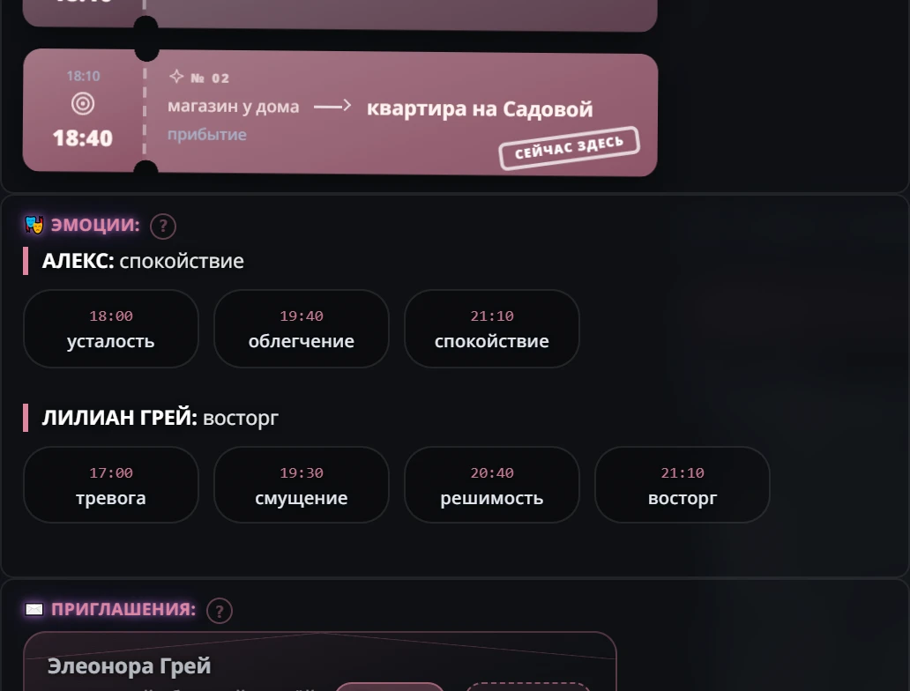<br>Маршрут — билеты</td>
</tr></table>

---

## Как это работает

1. **Инструкция.** Перед каждой генерацией расширение добавляет в запрос схему HUD — задачу, правила, коды полей. Включённые и выключенные модули собирают схему заново: выключенный модуль не стоит ни одного токена.
2. **Ответ.** Модель пишет обычный ответ и в конце — блок:

   ````text
   [HUD]
   ```json
   { "sc": { "T": "21:40 | поздний вечер", "Wt": "мелкий дождь, +9°C" }, "cs": [ { "N": "Марк", "Md": "…", "Th": "…" } ] }
   ```
   [/HUD]
   ````

   Ключи — короткие английские коды (`sc`, `cs`, `Th`), значения — полными словами на языке истории. На экране всё показывается по-русски.
3. **Карточка.** Блок разбирается (с починкой обрезанного и кривого JSON, запасным YAML-разбором) и превращается в карточку на месте сырого текста.
4. **Экономия контекста.** В следующих запросах старые HUD в истории заменяются короткими сводками `[HUD_SUMMARY]`, а последний HUD уходит модели снимком в конце инструкции — она обновляет его под новый ответ.
5. **Непрерывность.** Переписки, секреты, заметки, календарь и звонки собираются из прошлых ходов прямо перед отрисовкой. Это работает только на экране: текст сообщений и запрос к модели не меняются.
6. **Групповые чаты.** Таверна в режиме «по очереди» кладёт в запрос карточку только того, кто сейчас говорит. HUD же описывает всех, поэтому в инструкцию добавляются карточки остальных участников группы — облик и характер не расходятся с карточкой. При перегенерации HUD идут карточки всех участников. С «Склеивать карточки» Таверна отправляет их сама, и HUD ничего не добавляет.

### Какие запросы получают HUD

Инструкцию HUD получает **только запрос ответа в чат** — обычное сообщение, свайп, регенерация, продолжение. Всё остальное уходит без неё:

- **тихие генерации** Таверны — саммари, автоперевод, промпт для картинки;
- **Impersonate** — сообщение за игрока;
- **сырые запросы других расширений** (`generateRaw`): саммари, TunnelVision, работа с лорбуками;
- **прямые запросы расширений**, например **Ext Blocks**;
- **MemoryBooks** — запись памяти в лорбук;
- **служебные запросы самого HUD** — «Спросить про сюжет», запись в лорбук, подбор музыки.

**Свайп** читает HUD прошлого сообщения, а не заменяемого ответа. Шрамы, впечатления и приглашения из заменяемого ответа не уходят модели как уже случившееся.

Мало того: в таких чужих запросах блоки `[HUD]` из истории вырезаются, а на их место встаёт короткая сводка `[HUD_SUMMARY]` — дата, время, кто где и во что одет. Саммари и памяти знают, когда и где было дело, но не тащат в себя целый HUD.

---

## Работает в связке

- **[MoodTube](https://github.com/moonnsy/MoodTube)** — музыка сцены играет треки целиком прямо в Таверне через MoodTube: кнопка ▶ с источником «MoodTube», кнопки очереди в плейлисте и в саундтреке архива («всё в очередь MoodTube»). Если MoodTube уже сообщает модели свой трек, HUD свою строку про музыку не дублирует.
- **[SillyTavern-MemoryBooks](https://github.com/aikohanasaki/SillyTavern-MemoryBooks)** — с настройкой **«📚 MemoryBooks: считать сцену без полного HUD»** (группа «Лорбуки») MemoryBooks не получает полные блоки HUD: HUD сам заводит для него правило и подставляет вместо каждого блока короткую сводку. Сцена для памяти становится в разы короче, MemoryBooks не отклоняет её по размеру, а память всё равно знает дату, место и кто во что был одет.

---

## Безопасность и приватность

- **У HUD нет серверов.** Нет аккаунтов, аналитики, телеметрии, «облака» — расширение ничего никому не отправляет.
- **Всё хранится только в вашей SillyTavern.** Блоки HUD — внутри сообщений ваших чатов; летопись для архива — файлом на вашем же сервере Таверны (`user/files`); настройки — в браузере (`localStorage`) и копией в настройках расширений вашей Таверны (`settings.json`), кэш разборов — в IndexedDB браузера.
- **Модель видит только то, что уходит через ваш API** в SillyTavern — тот же канал, что и обычные ответы.
- **Единственное исключение — музыка сцены, и только если вы её включили.** Чтобы найти трек, HUD отправляет в каталог (iTunes, по выбору NetEase и QQ Музыка) **только исполнителя и название трека** — ни текста чата, ни имён персонажей. Полные треки, если выбрать такой источник, играют с зеркал YouTube (Invidious) или через MoodTube. Радио в сцене спрашивает каталог radio-browser.info **только жанр станции и код страны**; фон сцены спрашивает Фонау, Audius и Wikimedia Commons **только слова настроения** («тревожная», «dark ambient»); потоки играют напрямую со станций (Радио Рекорд — со своего сервера). Выключенная музыка не делает ни одного внешнего запроса.
- Тему можно загрузить из чужого файла — при этом берутся только знакомые поля, а значения проверяются, чтобы файл не мог подсунуть свою разметку.

---

## Производительность

Расширение рассчитано на чаты в сотни сообщений и на телефоны:

- **Быстрое открытие чата** — Таверна не раскрашивает блоки HUD как код, карточка последнего хода собирается первой, а старые ходы разбираются за ней небольшими порциями.
- **Ленивые вкладки** — собирается только открытая вкладка, остальные — при переключении.
- **Облегчение старых карточек** — у свёрнутой карточки в странице остаётся только заголовок; при открытии чата целиком собираются лишь последние несколько.
- **Виртуализация** — в чатах от 200 сообщений карточки вдали от экрана разбираются обратно в текст и собираются при прокрутке.
- **Лимит карточек** — можно держать в памяти только последние N.
- **Только сбоку** — полная карточка собирается одна, в панели сбоку; в сообщениях — маленькая кнопка вместо карточки.
- **Кэш разборов** в IndexedDB и фоновый поток для тяжёлого разбора истории.
- **Кэш контекста KoboldCpp** — в Text Completion инструкция HUD встаёт обычным промптом расширения Таверны перед префиксом ответа: она учтена в бюджете контекста и не меняется между ходами, поэтому KoboldCpp не пересчитывает весь чат заново на каждом ответе. Запросы с negative prompt тоже получают инструкцию и не требуют второго запроса-починки.
- **🗜 Разгрузить чат** (⚡ Производительность) — полные HUD старых ходов, неактивных свайпов и копий сообщений уезжают в файлы Таверны, на их месте остаётся сводка хода. Таверна при каждом сохранении переписывает чат целиком, и лёгкий файл сохраняется заметно быстрее: чат на 111 ответов похудел с 67 до 29 МБ. Модель видит те же сводки, что и раньше; быт, архив и списки из прошлых ходов читают полные блоки из файла; «Вернуть всё» восстанавливает чат байт в байт, а у каждой сводки есть кнопка «вернуть полный HUD».

---

## Установка

1. В SillyTavern откройте **Расширения → Установить расширение** и вставьте адрес репозитория: `https://github.com/alewwi/HUD`
   *Или вручную:* положите папку расширения в `data/<ваш-пользователь>/extensions/HUD` (или в `public/scripts/extensions/third-party/`) и перезагрузите страницу.
2. В **Расширениях** появится блок **📊 TavernOS**.
3. Включите **🔌 HUD в каждом ответе** — тогда основная модель пишет HUD вместе с ответом. Если не хотите тратить на него каждый ответ, оставьте выключенным: под ответами будет кнопка **➕ Создать HUD**, и HUD напишется отдельным запросом только по нажатию — можно другим, более дешёвым профилем.
4. Отправьте сообщение — под ответом появится карточка.

Требуется SillyTavern **1.12** или новее (проверено на 1.18). Расширение работает с любым API, который поддерживает Chat Completion или Text Completion. HUD генерирует та же модель, что ведёт историю; перегенерацию и помощника можно отправить через отдельный профиль подключения.

### Рекомендации для старта

- Начните с умеренного набора модулей и включайте остальное по мере надобности: каждый модуль добавляет поля в схему. Сколько весит каждый раздел, видно в чипе бюджета токенов.
- Телефон целиком — около 800 токенов на ход; выключите приложения, которыми не пользуетесь.
- **«Сколько развёрнутых HUD оставлять» = 1** — модель видит только снимок последнего HUD, остальные сжаты в сводки. Это оптимум по цене и качеству.
- Хорошо справляются модели с большим контекстом и аккуратным следованием формату. Если модель роняет поля, включите «Дописывать пропущенное» и «Усиления».

---

## Настройки

Все настройки — в блоке **📊 TavernOS** в «Расширениях» и в окне «Кастомизация».

**🌐 Язык / Language** — самый первый пункт, вне групп: RU или ENG. Меняет язык интерфейса (карточки, окна, настройки, уведомления) и язык, на котором модель пишет значения HUD. После выбора страница перезагружается. Перевод — слоем поверх разметки по словарю (`i18n.js`, `i18n-en.js`); имена персонажей и текст сообщений чата не переводятся.

**Одни настройки на всех устройствах.** Настройки HUD хранятся и в браузере, и в настройках расширений Таверны, поэтому ПК и телефон, открывающие одну Таверну, видят одно и то же: при загрузке берётся копия, сохранённая позже. Фоны и баннеры, загруженные файлом, остаются на своём устройстве — тяжёлые картинки на сервер не отправляются.

| Раздел | Что настраивается |
|---|---|
| 🧩 Блоки HUD | HUD в каждом ответе (сетевой перехват) или только по кнопке; блок игрока; эпоха (телефон или шкатулка) и отдельные приложения; перехваты или подслушанное; память и ружья Чехова; болезни, беременность, роды и малыши, цикл; «что о тебе думают»; генеалогическое дерево; состояние тела; повороты сюжета; спутники; блоки взрослых сцен (каждый отдельно); словесная дуэль; бой (сам решает, всегда, никогда); быт и норма сна; дневник, сны, мир, экономика, афиша, городские службы, гороскоп. «Глубокая настройка» — выключить отдельные поля и подписи, они вырезаются из инструкции. Галочки новых функций: значки вопросов, разовые подсказки, приглашения, сроки нитей, шрамы, праздники эпохи, живые детали, запущенное состояние, вес, осмотры, кубик угрозы, выкидыш и аборт, напоминания о близости. |
| 📊 Свои статы | Общий выключатель; список статов: название, смысл, вид, значок, цвет, чей, вкладка и место; общий промпт с кнопкой «Вернуть общий текст». |
| ✨ Отображение | Где HUD: в сообщениях, сбоку и в сообщениях, только сбоку; ширина панели (своя или до чата) и край (справа или слева). Пояснения-вопросики; списки из прошлых ходов: сколько ходов смотреть назад, предел записей в списке и сообщений в переписке. |
| ⚡ Производительность | Облегчение старых карточек, сколько карточек собирать сразу, ленивые вкладки, Performance Mode, виртуализация, лимит карточек; 🗜 разгрузить чат и вернуть всё. |
| 🖼️ Аватарки | Картинки на имена персонажей, закреплённые аватарки. |
| 📚 Лорбуки | Какие лорбуки добавлять к запросу перегенерации HUD; сколько сообщений слать при записи в лорбук. |
| 🤖 Генерация | Лимит токенов HUD; инструкция отдельным сообщением; снимок последнего HUD; проверка полноты; «Дописывать пропущенное»; противоречия с бытом; часть про взрослые сцены (авто, всегда, никогда); усиления; сколько развёрнутых HUD оставлять; контекст и профиль для перегенерации. |
| ❓ Ассистент | Кнопка «Спросить про сюжет»; что видит помощник (сообщения, HUD, заметки автора, карточка, персона, лорбуки); профиль, лимит ответа и системный промпт. |
| 🎵 Музыка сцены | Подбор музыки к сцене; обновление при смене сцены; профиль подключения; средневековье (старинная музыка или киношный саундтрек); вид полосы (кассета, пластинка, свиток); сколько ждать подборку (любое число секунд, 0 — без таймера); лимит ответа (от 2048 токенов — с запасом для думающих моделей); встроенный плеер и источник (отрывки, YouTube через зеркала, NetEase, MoodTube); проверка треков поиском и запасные сервисы (NetEase, QQ); промпт: свои правила вкуса, сколько сообщений читать, карточка персонажа, персона, свои лорбуки; музыка в сцене — модели одной строкой; язык песен, мемный саундтрек, радио в сцене, плавающий значок, очистка «нравится» и запретов; фон сцены целиком, «после отрывка — фон», источники фона (Фонау, Audius, Incompetech, Wikimedia Commons). |
| ⚠️ !!ОПАСНО!! Удалить HUD из чата | Самый последний пункт. Навсегда вырезает блоки `[HUD]` из всех сообщений и свайпов открытого чата вместе с сохранёнными версиями HUD и подборками музыки. Перед удалением спрашивает и показывает, сколько сообщений и блоков затронет. |

### Мини-гайд: что за что отвечает

Настройки разложены по группам — раскройте нужную. Ниже — самое важное в каждой.

**🌐 Язык / Language** — язык интерфейса и значений HUD. Самый первый пункт.

**🧩 Блоки HUD** — что вообще будет в карточке. Каждый выключенный блок исчезает и с экрана, и из инструкции модели, то есть экономит токены.
- *Эпоха* — «современность» (телефон и перехваты) или «средневековье» (шкатулка и подслушанное); приложения телефона и разделы шкатулки включаются по одному.
- *Память и сюжет* — таймлайн, секреты, маршруты; ружья Чехова; карточки поворотов сюжета.
- *Персонажи* — блок игрока, «Что о тебе думают», генеалогическое дерево, спутники.
- *Тело и здоровье* — болезни и травмы, состояние тела (энергия, сон, стресс), цикл, беременность, роды и «Детская». Пол и число малышей можно отдавать модели скрытым фактом или не отдавать вовсе.
  Здесь же своя галочка у каждой новой функции:
  - для экрана: значки вопросов, разовые подсказки, напоминания о близости;
  - для сюжета: приглашения, сроки нитей, шрамы отношений, праздники эпохи;
  - для тела: живые детали, запущенное состояние, вес и калории;
  - для беременности: осмотры, тяжёлые находки, кубик угрозы, выкидыш и аборт.

  Выключенная функция пропадает с экрана и из запроса к модели. Отдельные части выключаются в «Глубокой настройке», разделы «Заметки модели» и «Подсказки на экране».
- *Быт* — вкладка быта; «Быт → модели» решает, видит ли модель итог (одной строкой, только по теме или через макрос `{{hudByt}}`); норма сна.
- *Близость* — части для взрослых сцен и режим «сам решает / всегда / никогда».
- *Бой и споры* — бой (сам решает, всегда, никогда) и словесная дуэль.
- *Дневник, сны и мир* — дневник, сны, мир, экономика, афиша, городские службы, гороскоп.

**🤖 Генерация** — как HUD уходит модели и как проверяется.
- *HUD в каждом ответе* — главный выключатель: включено — модель пишет HUD в каждом ответе; выключено — HUD только по кнопке «➕ Создать HUD», отдельным запросом.
- *Инструкция отдельным сообщением* — схема уходит последним сообщением после пресета и истории. Выключите, если бэкенд не принимает системное сообщение в конце.
- *Снимок последнего HUD* — модель обновляет прошлый HUD, а не строит мир заново. Сильно помогает непрерывности.
- *Сколько развёрнутых HUD оставлять* — остальные в истории сжимаются в сводки. Оптимум — 1.
- *Проверка ответа* — что делать с неполным HUD (предупредить или досоздать), противоречия с бытом, «Дописывать пропущенное», «Усиления».
- *Перегенерация HUD* — профиль подключения (можно дешевле основного), сколько сообщений слать, лимит токенов.

**📚 Лорбуки** — какие лорбуки добавлять к перегенерации HUD; сколько сообщений слать при записи в лорбук; связка с MemoryBooks.

**✨ Отображение** — где HUD (в сообщениях или в панели сбоку, см. «🗂 HUD сбоку»), вопросики-пояснения, набор значков, сводки `[HUD_SUMMARY]` карточкой. *Списки из прошлых ходов* — сколько ходов назад смотреть и сколько записей держать на экране (только на экране, в запрос это не уходит).

**🖼️ Аватарки персонажей** — своя картинка на имя (или на несколько написаний одного имени), закреплённые аватарки игрока и персонажа.

**❓ Ассистент** — кнопка «Спросить про сюжет»: что он видит (сколько сообщений, HUD, заметки автора, карточка, персона, лорбуки), профиль, лимит ответа, свой системный промпт.

**🎵 Музыка сцены** — включение и автообновление при смене сцены, профиль, вид полосы, средневековая музыка, встроенный плеер и источник звука, проверка треков поиском, сколько ждать подборку, лимит ответа, свой промпт и контекст для подбора.

**⚡ Производительность** — облегчение старых карточек, ленивые вкладки, ускорение двух правил Таверны; для чатов от 200 сообщений — Performance Mode и виртуализация; лимит карточек. *🗜 Разгрузить чат* — полные HUD старых ходов в отдельные файлы Таверны, на их месте сводки хода; «↩ Вернуть всё» ставит их обратно.

**🧹 Обслуживание** — «Почистить кэш»: убирает сохранённые отчёты архива и пометки-реакции; настройки, темы и аватарки остаются.

**💾 Настройки в файл** — все настройки HUD одним файлом: основные, кастомизация, свои темы и статы, картинки. «Сохранить в файл» выгружает их, «Загрузить из файла» заменяет текущие и перезагружает страницу. Чаты и записи HUD в файл не входят. API-ключи и пароли в него тоже не попадают: HUD их не хранит, а если ключ вставлен в поле с текстом, такое поле не сохранится.

**🧳 Перед удалением расширения** — кнопка рядом с разделом ниже. Возвращает выгруженные HUD в открытый чат и убирает служебные файлы с диска: файлы разгрузки и летопись этого чата. Чат и HUD в нём остаются целыми. Если выгружены другие чаты персонажа, HUD назовёт их, а файлы разгрузки оставит.

**⚠️ !!ОПАСНО!! Удалить HUD из чата** — в самом конце настроек, нарочно отдельно. Насовсем вырезает HUD из открытого чата: блоки `[HUD]` во всех сообщениях и свайпах, сохранённые версии HUD, подборки музыки. Текст ответов, сводки `[HUD_SUMMARY]` и упоминания HUD внутри `<plan>` остаются. Вместе с карточками пропадёт и всё, что HUD помнил по ним: телефон, дневник, отношения. Перед удалением окно с числом сообщений и блоков; отменить нельзя, поэтому сначала сохраните копию чата (меню чата → «Управление файлами чата» → экспорт).

Внешний вид (темы, цвета, шрифты, вид каждого блока) — в окне **🎨 Кастомизация**, кнопка вверху настроек.

### Макросы

| Макрос | Значение |
|---|---|
| `{{hudLast}}` | Последний HUD чата компактным JSON с короткими кодами, без пустых и выключенных полей. Поддерживает `{{if hudLast}}…{{/if}}` в новом движке макросов. |
| `{{hudByt}}` | Итог быта и часов сцены одной строкой («не ели 7 ч; долг сна 6 ч; ужин 19:00 пропущен») — если в настройке «Быт → модели» выбран макрос. |

---

## Вопросы и ответы

**Расширение меняет мои сообщения?**
Нет. Блок `[HUD]` остаётся в тексте ответа как есть — карточка рисуется поверх него. Перенос списков из прошлых ходов работает только на экране. Сообщения меняются, только когда вы сами нажимаете перегенерацию HUD, «Создать HUD» или возврат прежней версии.

**Сколько это стоит в токенах?**
Зависит от включённых модулей: инструкция собирается под них, а чип бюджета показывает её вес по разделам. Старые HUD в истории сжимаются в короткие сводки, поэтому история не раздувается с каждым ходом.

**Куда уходят данные?**
Никуда, кроме вашего API в SillyTavern. У HUD нет своих серверов; подробности — в разделе «Безопасность и приватность».

**Модель пишет HUD с ошибками.**
Разборщик чинит типичные поломки: обрезанный ответ, пропущенные запятые, кавычки внутри строк, YAML вместо JSON. Если блок неполный, включите проверку полноты — HUD досоздастся перегенерацией.

**Можно без взрослого контента?**
Да. Все такие блоки отключаются по отдельности, а соответствующую часть инструкции можно выключить совсем — модель о ней не узнает.

**Как убрать HUD из чата или удалить расширение?**
Чтобы удалить только расширение, сначала нажмите в открытом чате **🧳 Убрать служебные файлы** в конце настроек: HUD вернётся в сообщения, файлы разгрузки и летопись уйдут с диска, чат останется целым. Сама Таверна при удалении расширения стирает только его папку. Если HUD из чата нужно убрать совсем:
Откройте чат и нажмите **⚠️ !!ОПАСНО!! Удалить HUD из чата** в конце настроек: блоки вырежутся из всех сообщений и свайпов, текст ответов останется. Сделайте это в каждом чате, где HUD больше не нужен, — потом расширение можно удалять. Если хотите только спрятать блоки, не трогая файлы, добавьте в расширении Regex правило с «Alter Chat Display» и «Alter Outgoing Prompt»: `/\[HUD\](?:(?!\[HUD\])[\s\S])*?\[\/HUD\]/gi` с пустой заменой.

**Чат открыт на двух устройствах.**
Таверна принимает сохранение старой копии молча: последнее сохранение побеждает. Поэтому после удаления или возврата на другом устройстве HUD предложит обновить чат, а перед сохранением поверх спросит ещё раз. Правки текста и новые сообщения HUD не отслеживает: тут по-прежнему лучше обновлять страницу, переходя на другое устройство.

**Что переносится на другое устройство?**
Всё лежит на сервере Таверны, поэтому с любого устройства видно одно и то же: чаты, HUD, журнал удалений, настройки, летопись. В браузере остаются только реакции и кэш разбора. На другой сервер обычный экспорт чата файлы HUD не забирает: перед переносом верните выгруженные HUD в чат кнопкой «↩ Вернуть всё» или кнопкой **🧳 Убрать служебные файлы**.

**Настройки на ПК и телефоне разные.**
С версии 23.88.7 настройки HUD хранятся и в Таверне, и при загрузке берётся более свежая копия. Измените любую настройку на устройстве, чей вид вам нравится, — второе подхватит её после перезагрузки страницы. Фоны и баннеры, загруженные файлом, переносятся только вручную.

**Персонаж умер или уехал, а «Быт» всё ещё его считает.**
Нажмите корзину рядом с его именем в весе, сне или гардеробе. Модель перестанет считать его вес и сон. Вернуть человека можно внизу «Быта», в разделе «Не считаются».

**Тормозит в длинном чате.**
Включите ленивые вкладки, облегчение старых карточек и Performance Mode; уменьшите «Сразу собирать последних карточек» и задайте лимит карточек. Если долго сохраняется и открывается сам чат — нажмите **🗜 Разгрузить** (⚡ Производительность → 🗜 Разгрузить чат): файл чата станет в разы легче, а всё вернётся одной кнопкой.

---

## История изменений

Последняя версия — **23.88.91**:

- Шрамы доверия напоминаются модели реже — раз в восемь ответов.
- Архив: у беременности — как проходила, симптомы, осмотры, угроза и осложнения; дашборд видит скрытые ходы, «Частота NSFW-сцен» больше не пустая.
- Сны точнее делятся на кошмары и обычные; спутники и галочки архива — в цветах темы.
- Модель пишет HUD короче: «nc» вместо неизменного, мир раз в день, память обновлениями; HUD сам разворачивает это в полный. Пробный кэш провайдера для Chat Completion.
- Архив: без дублей секретов и ружей, у секрета — история «кто и когда узнал», у ходов — дата и время, все беременности, новый вид.
- В английском режиме модель переписывает по-английски русские значения, оставшиеся с начала чата.
- В архиве выбранный чат больше не слетает при закрытии, а выросший чат перечитывается перед анализом.
- Потери беременности больше не стоят в календаре телефона.
- Человека можно убрать из «Быта» руками: модель перестанет считать его вес и сон, а вернуть можно внизу вкладки.
- В архиве снова понятно добавляются другие чаты, а модель больше не читает устаревшие скрытые факты.
- У всех новых функций есть галочка в основных настройках, а в глубоких появились разделы «Заметки модели» и «Подсказки на экране».
- Вес: свайпы больше не дают ложную прибавку, удаление сообщений откатывает запись.
- Свайп не отправляет модели то, что случилось в заменяемом ответе; «не приеду» больше не считается согласием.
- Большая проверка всех тем, эпох и видов блоков: окно кастомизации на светлых темах, шапка в узкой карточке, Буллет-джорнал, перевод.
- Списки плашек листаются ровно за пальцем и помещаются в окно вкладки.
- Чат открывается намного быстрее: на длинном чате текст появляется примерно на 13 секунд раньше.
- Свайп листает весь ход насквозь: список, вкладку и чат.
- Плашка «Без сознания» не вешается за чужое состояние из мыслей и подтекста.
- Код вышел под лицензией GNU AGPL-3.0.
- Вопрос «Вы уверены?» перед удалением: окно говорит, можно ли это вернуть.
- Поле «Тело» просит состояние, а не пересказ действий.
- После ответа на значок карточка остаётся на той же вкладке.
- Заметки о потере беременности и одного из двойни уходят, только пока HUD их не записал.
- Свайп смотрит на HUD прошлого сообщения.
- Заметки про шрамы и запущенное состояние уходят модели раз в три ответа.
- Полупрозрачные напоминания о близости после потери, родов и свежей раны, только для вас.
- Настройки и кастомизация сохраняются в файл и загружаются обратно.
- Значок на вкладке, где HUD ждёт вашего ответа.
- Разовая подсказка модели: плашка уходит в следующий ответ и держится на всех его свайпах.
- Шрамы отношений, инерция после сдвигов, причины доверия и график в архиве.
- Живые детали, запущенное состояние, вес и калории.
- Осмотры при беременности, режимы раскрытия и журнал.
- Праздники эпохи, приглашения, сроки сюжетных нитей.
- Комментарии сети теперь пишут люди внутри мира.

Полная история — в [CHANGELOG.md](CHANGELOG.md).

## Разработка

```bash
node tests/run.mjs                          # все наборы тестов
node tests/tools/audit-chat.mjs "<чат.jsonl>"  # прогон реального чата: разбор и отрисовка каждого хода
node tests/tools/build-cq.mjs               # пересобрать копии стилей для узкой карточки
node bump-version.cjs 23.61.1               # сменить версию ассетов (без этого телефон держит старые модули)
node tests/tools/docs-shots.mjs [--lang en] [--era medieval] # снимки для README (Таверна должна быть запущена)
```

Английский интерфейс: новая русская подпись в разметке переводится словарём `i18n-en.js` — целая строка в `СЛОВАРЬ_EN`, строка с числами или подстановками в `ШАБЛОНЫ_EN`. Подписи в CSS (`content`) дублируются в `css/lang-en.css`, русские примеры в инструкции модели — в `prompt-en.js`. `node tests/i18n.mjs` проверяет переводчик, инструкцию без кириллицы, CSS и разбор английских значений.

---

## Лицензия

Код TavernOS HUD выходит под лицензией [GNU AGPL-3.0](LICENSE): его можно копировать и менять, но изменённые версии должны оставаться открытыми под этой же лицензией. Картинки из `img/` и снимки из `docs/screens/` под неё не входят, часть из них принадлежит другим авторам. Подробности в [NOTICE.md](NOTICE.md).
