# TavernOS HUD — живая приборная панель для ролевых чатов в SillyTavern

<p align="center"><b>RU</b> · <a href="README.en.md">ENG</a></p>

> Каждый ответ модели получает карточку состояния мира: время и погода сцены, что на ком надето, кто что думает и скрывает, чей телефон разрывается от сообщений, сколько часов персонаж не спал и не ел, кто кому кем приходится — и всё это не теряется от хода к ходу.

<p align="center">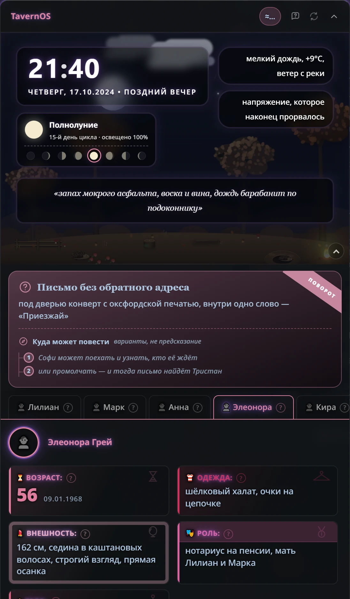</p>

TavernOS — расширение для [SillyTavern](https://github.com/SillyTavern/SillyTavern), которое просит модель вместе с каждым ответом присылать компактный блок `[HUD]` и превращает его в интерактивную карточку с вкладками прямо под сообщением. Интерфейс на русском или английском (переключатель **🌐 Язык / Language** в самом верху настроек), модель при этом пишет короткие английские коды — так дешевле в токенах.

---

## Зачем это нужно

Длинные ролевые истории ломаются на мелочах, и это знает каждый, кто играл больше сотни сообщений:

- **Модель забывает.** Персонаж «снова» в куртке, которую снял три сцены назад. Рана, полученная вчера, исчезла. Был вечер — стало утро без единого скачка времени.
- **Состояние размазано по тексту.** Чтобы вспомнить, кому персонаж должен денег, где лежит пистолет и о чём он соврал, приходится листать чат.
- **Не видно закулисья.** Что персонаж на самом деле думает, что скрывает, с кем переписывается, пока вы не смотрите, — всё это остаётся у модели в голове или пропадает совсем.
- **Мир стоит на месте.** Нет новостей, погоды, цен, слухов — истории не за что зацепиться.
- **Память стоит токенов.** Вести трекеры вручную в каждом сообщении — дорого и утомительно.

TavernOS берёт это на себя:

- **Состояние всегда перед глазами.** Одна карточка — и видно, где, когда, кто, в чём, с кем и в каком настроении.
- **Непрерывность без лишних токенов.** Переписки, секреты, заметки и события копятся из прошлых ходов *только на экране* — в запрос к модели не уходит ни одного лишнего символа. Старые HUD в истории сжимаются в короткие сводки, последний уходит модели снимком, чтобы она обновляла мир, а не придумывала его заново.
- **Второй слой истории.** Мысли, подтекст, «ожидание и реальность», страхи, перехваченные чужие переписки, дневники, сны — то, чего нет в самом тексте ответа.
- **HUD сам считает то, что модели считать не нужно.** Сколько часов назад ели и спали, долг сна за неделю, что пора в душ, хватит ли денег, что персонаж пропустил по расписанию, пока был занят. Модель для этого ничего не пишет.
- **Красиво.** 24 темы, 43 блока с альтернативными видами, погода и время суток на фоне, аватарки — карточка, которую хочется открывать, а не таблица.

---

## Как это выглядит

Под каждым ответом модели — карточка **TavernOS**:

- **Шапка сцены** — часы, дата, погода, фаза луны, настроение места. Фон меняется по времени суток и погоде: дождь, снег, туман, закат, ночь.
- **Полоса вкладок** — персонажи сцены, вы, телефон, память, быт, перехваты, дневник, сны, детская, мир и другие. Вкладка появляется, только когда в ней есть что показать.
- **Карточка поворота** — если в ходе случился настоящий поворот сюжета, над вкладками всплывает плашка: что произошло и куда это может повести.
- **Вопросики** рядом с названиями вкладок и полей — по нажатию объяснение: что это, почему показалось и как это читать.

Старые карточки сворачиваются в полоску заголовка и раскрываются по нажатию — длинный чат остаётся лёгким.

---

## Возможности

### 🎬 Сцена

Время, дата, погода, место и атмосфера. Фаза суток считается по часам с поправкой на месяц (зимой солнце садится раньше), с праздничным оформлением в новогодние дни. Фаза луны — на диске в шапке.

### 👤 Персонажи

Отдельная вкладка на каждого, кого модель описала в ходе:

- **Облик и состояние** — одежда, внешность, роль, тело, физиология, здоровье, инвентарь, место.
- **Внутреннее** — настроение, мысли, цели, расписание, страхи, реплики, скрытый подтекст, «ожидание vs реальность», ключевое в ходе, флаг-монитор, ревность, глубина конфликта, риск разоблачения.
- **Отношения и доверие** — к каждому по шкале от 0 до 100; смещения доверия видны от хода к ходу.
- **Состояние тела** — энергия, бодрость, сытость, стресс, сон и дела на завтра.
- **Болезни и травмы** — стадия, симптомы, лечение и шкала выздоровления; следы на теле с таймером заживания.
- **Общие воспоминания** — копятся по ходам: одно и то же воспоминание в новой формулировке не дублируется.

<details><summary>📷 Вкладка персонажа целиком</summary>

<p align="center">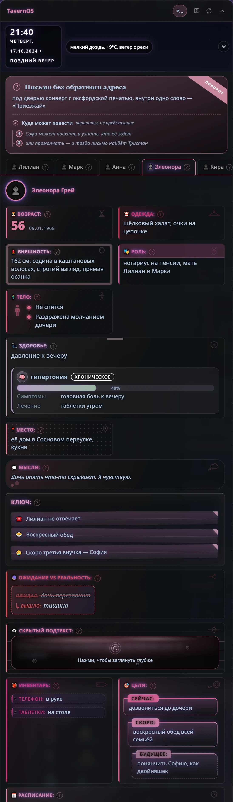</p>

</details>

### 🙋 Вы

Тот же набор про вашего персонажа — каким его видит модель снаружи: одежда, внешность, здоровье, отношения, локация. И сводка **«Что о тебе думают»**: как к вам относится и насколько доверяет каждый персонаж (считается из карточек, модель ничего не дописывает).

### 📱 Телефон персонажа

Полноценный смартфон с экраном блокировки и уведомлениями: **сообщения** (фото, видео, голосовые с расшифровкой, звонки, ответы на сообщения, удалённые сообщения), **контакты, кошелёк** с транзакциями, **календарь, галерея, заметки, карты, поиск, журнал звонков, погода, здоровье**. Каждое приложение включается отдельно: выключенное не просится у модели и не занимает места в запросе.

<p align="center">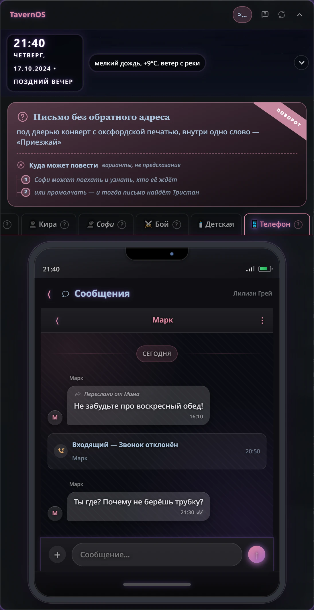</p>

<details><summary>📷 Приложения телефона: рабочий стол, кошелёк, календарь, здоровье, карты</summary>

<table><tr>
<td align="center">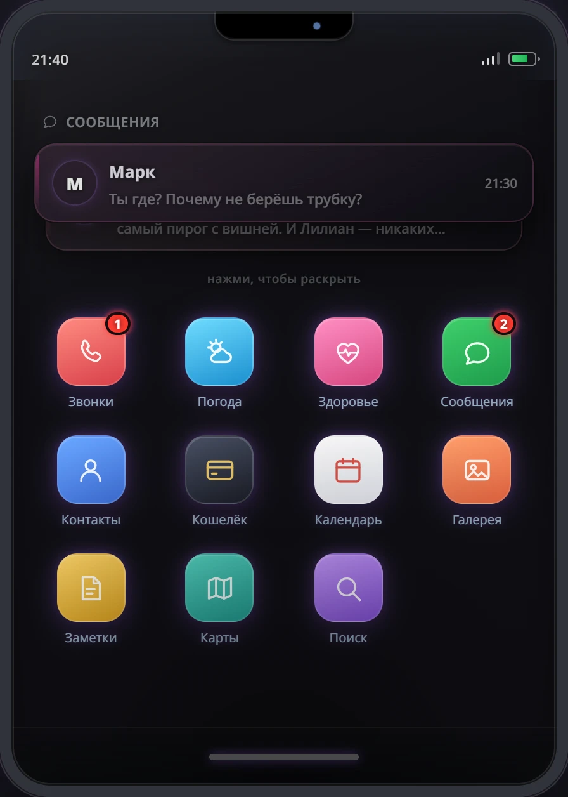<br>Рабочий стол</td>
<td align="center">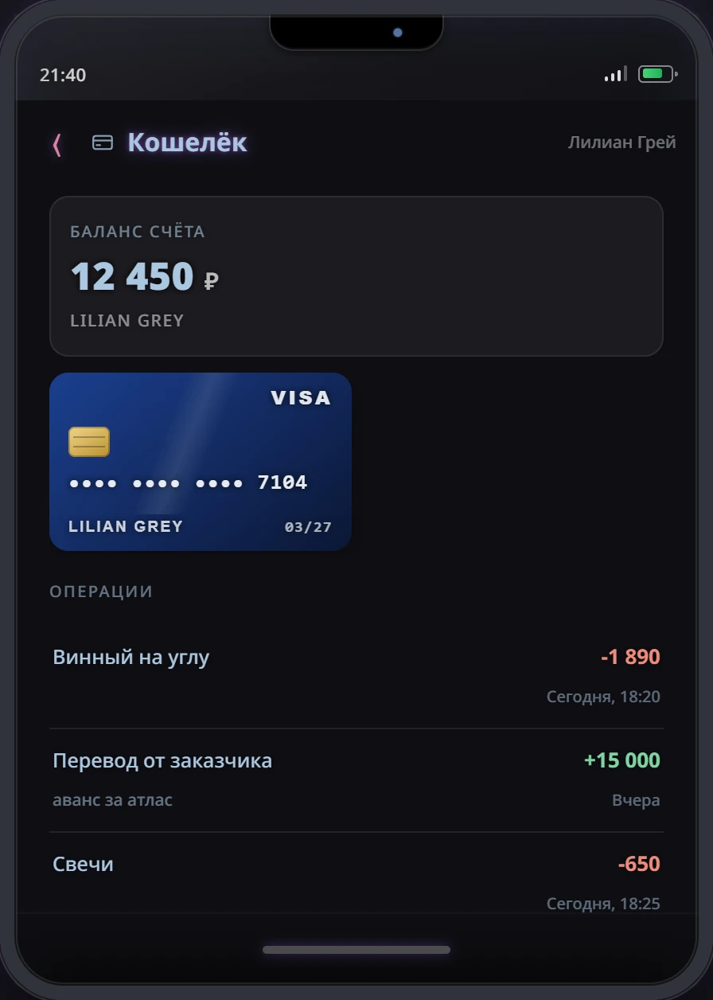<br>Кошелёк</td>
<td align="center">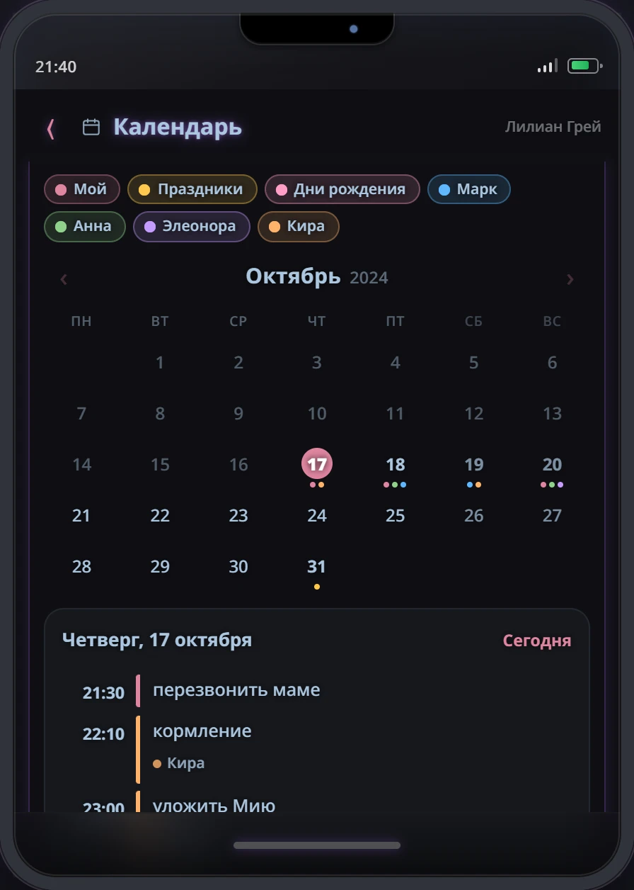<br>Календарь</td>
</tr><tr>
<td align="center">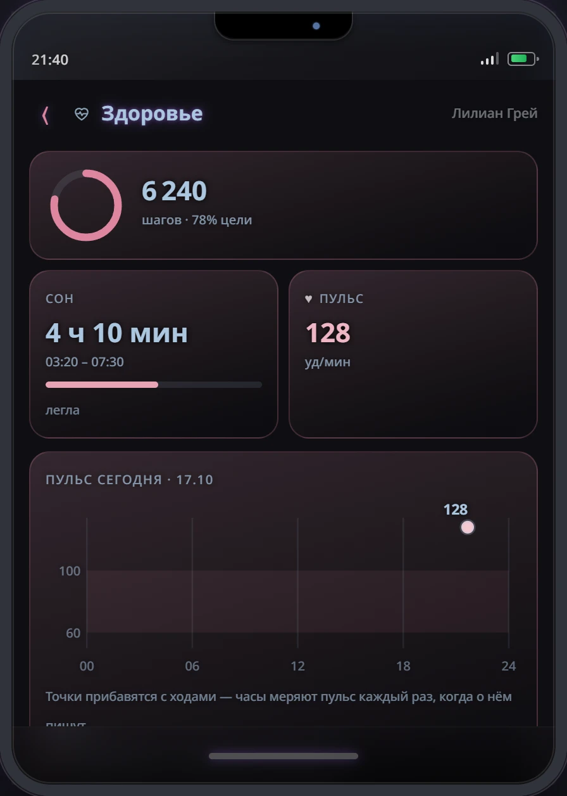<br>Здоровье</td>
<td align="center">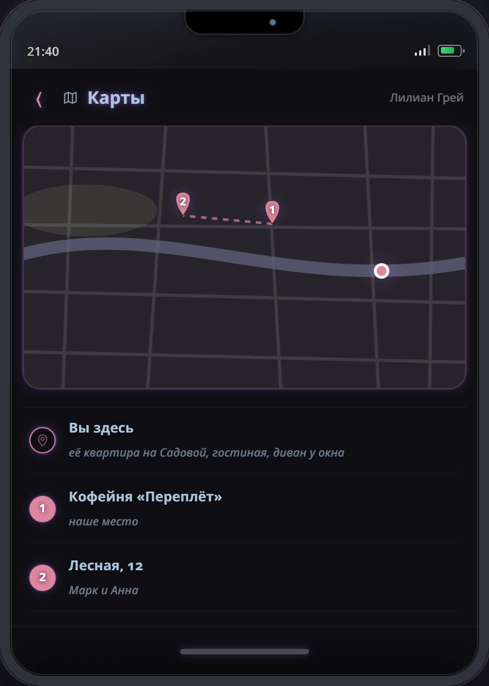<br>Карты</td>
<td></td>
</tr></table>

</details>

### 📡 Перехваты

Чужие переписки и разговоры, которые ваш персонаж знать не должен, — взгляд поверх плеча автора. Появляются только тогда, когда модель сама решила показать закулисье.

<p align="center">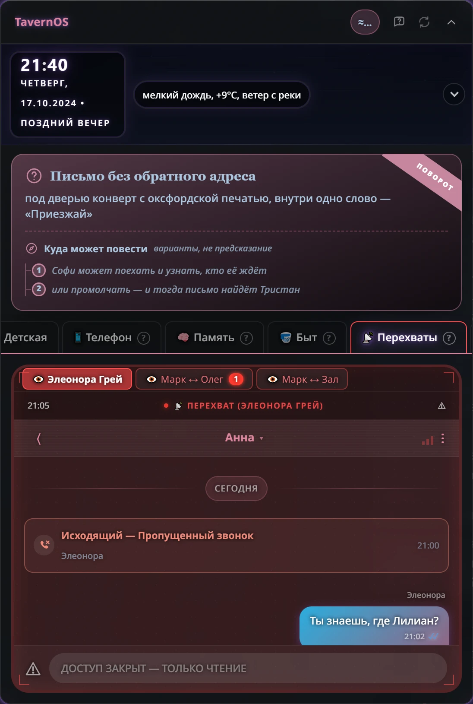</p>

### 🗝️ Средневековье: шкатулка и подслушанное

Для сеттингов до телефонов вместо смартфона — **шкатулка**: письма с печатями (печать ломается при открытии), святцы с фазой луны, кошель с приходной книгой, записи пером, карта, грамоты и памятные вещи. Вместо перехватов — **подслушанное**: разговоры сквозь стену и тайком вскрытые чужие письма. Эпоха переключается одной настройкой.

### 🧠 Память

Вкладка, где копится история, а не срез:

- **Таймлайн** и **важное** — что случилось и в каком порядке.
- **Секреты** — кто что скрывает и от кого, уровень опасности и огласки. Секрет можно одной кнопкой вписать в лорбук — тогда модель будет помнить его и без HUD.
- **Ружья Чехова** — незакрытые сюжетные нити: обещания, угрозы, намёки, загадки.
- **Эмоции** — как менялось настроение главных персонажей; **маршрут** — где они побывали за этот отрезок.
- **Граф отношений** — паутина связей всех персонажей: романтика, дружба, конфликт, ревность, страх, подозрение, семья, родители и дети, начальство, наставники, долг, запретное, подельники, общая группа. Узлы с аватарками, нажатие на узел или связь подсвечивает окружение, граф разворачивается на весь экран.
- **Генеалогическое дерево** — второй вид того же графа, когда в отношениях нашлось родство.

<details><summary>📷 Вкладка «Память» с графом отношений</summary>

<p align="center">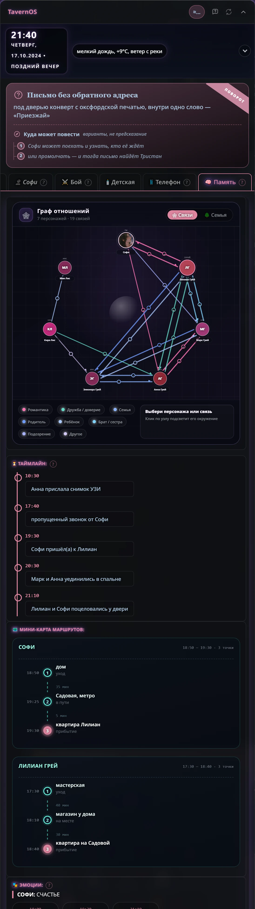</p>

</details>

<details><summary>📷 Генеалогическое дерево</summary>

<p align="center">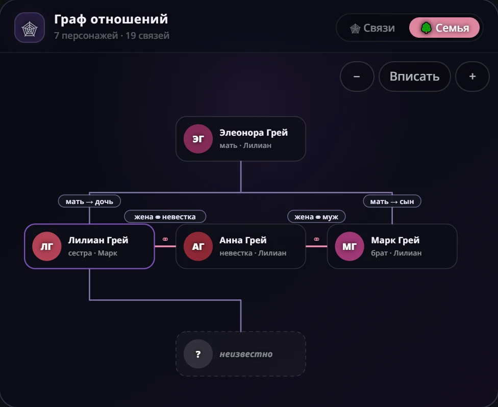</p>

</details>

### 🧺 Быт

Еда, сон, душ, стирка, уборка, одежда, деньги и дом **по всем прошлым ходам**: сколько прошло с последнего раза, долг сна за неделю, что лежит в стирке, знакомые цены, что сломалось, кто кому должен. «Надо бы в душ» считается по часам, жаре и нагрузке; «не по погоде» — когда персонаж в мороз без верха или в жару в пальто. Всё это HUD вычисляет сам из того, что модель и так пишет. Итог быта можно показывать модели одной строкой, только по теме разговора или макросом — или держать только для себя.

<details><summary>📷 Вкладка «Быт»</summary>

<p align="center">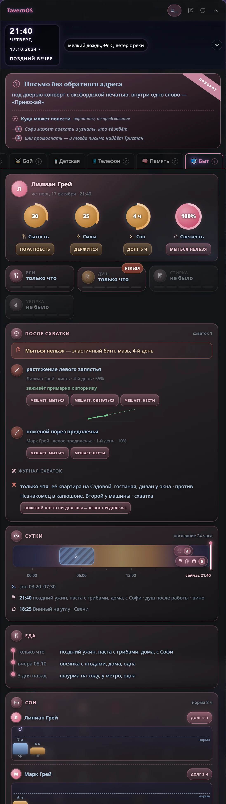</p>

</details>

### ⚔️ Бой

Появляется, только пока есть опасность: этап и очередь, дистанции, раны на силуэте, оружие с зарядом, адреналин с отходняком по времени сюжета, выдержка, укрытия, шкала погони. В мирных ходах модель этот блок не пишет и он ничего не стоит.

<details><summary>📷 Вкладка «Бой»</summary>

<p align="center">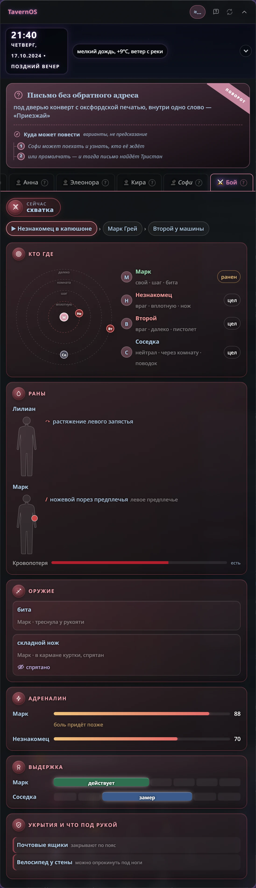</p>

</details>

### 💬 Словесная дуэль

Пока идёт спор: кто ведёт и насколько, кто что уступил, градус и воспоминание, всплывшее в споре.

### 📖 Дневник и 🕯 дневник тела

Личные записи персонажа своими словами (субъективные — он может ошибаться и врать самому себе) и дневник тела — запись о теле во время близости и после неё: чего оно хочет, что получает, что ноет и какие следы остались.

<p align="center">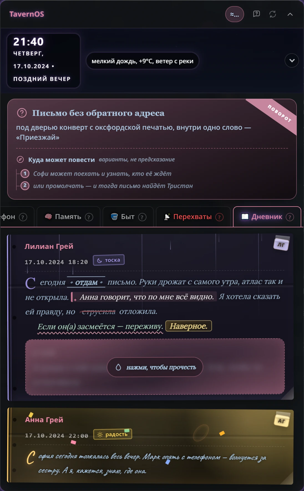</p>

### 🌙 Сны

Что снилось персонажам этой ночью — образами и намёками, а под каждым сном толкование: какой страх или желание за ним стоит. Сон закрыт дымкой и проясняется в несколько нажатий, как будто вспоминаешь его по утрам. Хороший способ показать то, в чём персонаж не признается даже в дневнике.

<p align="center">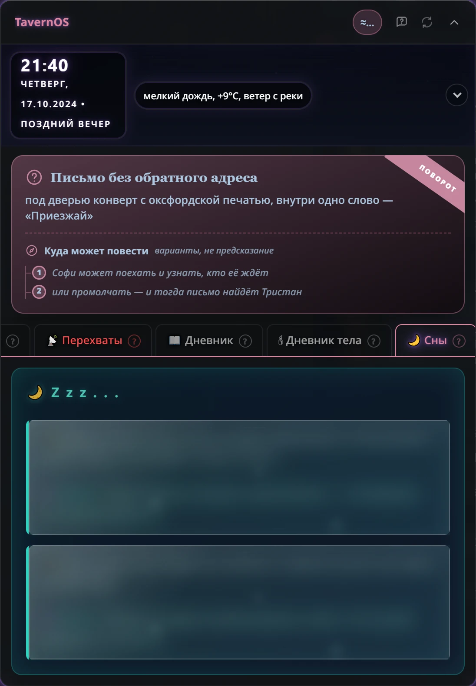</p>

<details><summary>📷 Сны после нескольких нажатий — дымка рассеялась</summary>

<p align="center">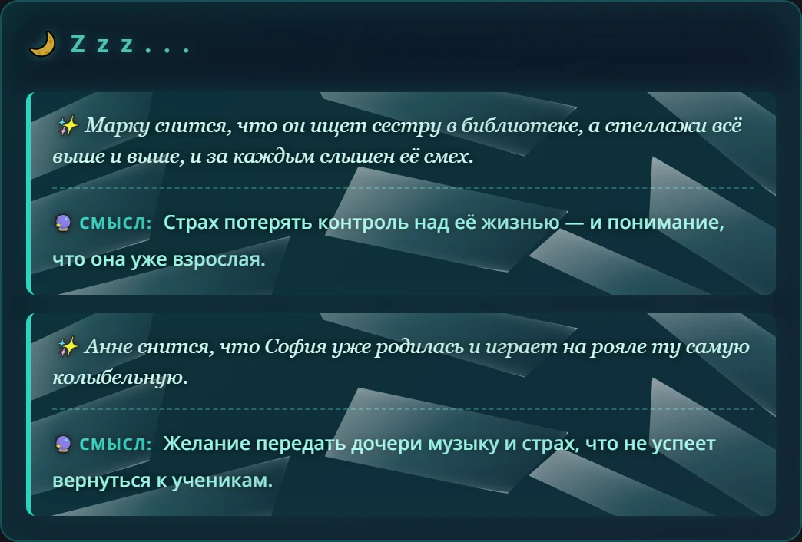</p>

</details>

### 🌸 Здоровье и семья

Для историй, где важны тело и семья, — три связанных блока. Каждый включается отдельно в группе «Персонажи» и появляется только у тех, к кому относится.

**Менструальный цикл.** Кольцо с днём цикла и текущей фазой, ожидаемые месячные, окно ПМС, задержка и сбой цикла от стресса. Под кольцом — советы по фазе и риск зачатия с учётом защиты; из этого блока можно «сделать тест». Цикл ведётся у всех, у кого он есть, в том числе у вашего персонажа.

<details><summary>📷 Карточка цикла</summary>

<p align="center">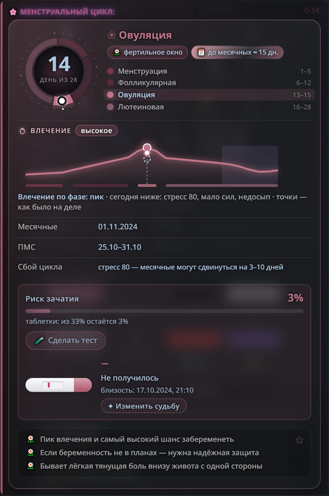</p>

</details>

**Беременность.** Срок в неделях и триместр, шкала до родов, размер малыша в сравнении с фруктом, что он уже умеет и какая веха дальше. Отец, симптомы, капризы в еде, кто уже знает, как проходит беременность, ближайший визит к врачу и советы по сроку, включая тревожные признаки. Число и пол малышей решает кубик, а при желании их можно «изменить судьбой». Модели это уходит скрытым фактом или не уходит вовсе, как выберете.

<details><summary>📷 Карточка беременности</summary>

<p align="center">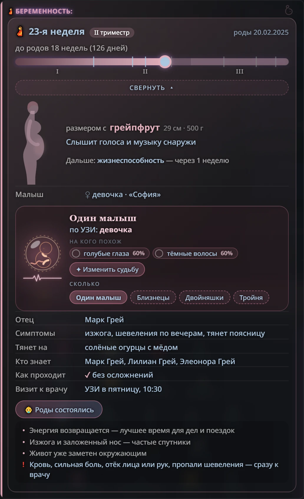</p>

</details>

**Роды и «Детская».** После кнопки «Роды состоялись» вместо беременности начинается послеродовой период: восстановление и кормление. Появляется вкладка **«Детская»** с карточкой на каждого малыша:
- **вехи развития** на шкале возраста: что уже умеет, что вот-вот появится, что будет позже;
- **нормы ухода по возрасту:** кормление, сон, подгузники, зубки;
- **таймеры:** когда кормить, сколько спит, когда меняли подгузник;
- **как у взрослых:** состояние, здоровье, мысли, любимые вещи, расписание, отношения и доверие к взрослым, страхи и первые слова.

Когда ребёнок подрастает (по умолчанию к трём годам), он переходит из «Детской» в обычные карточки персонажей.

<details><summary>📷 Вкладка «Детская»</summary>

<p align="center">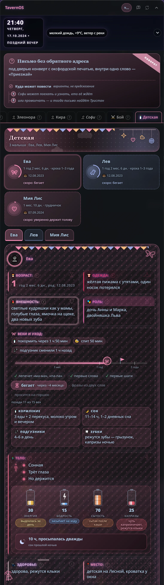</p>

</details>

### 🌍 Мир

Сводка на сегодня: новости, слухи, объявления, прогноз погоды, гороскоп, комментарии сети, курсы валют и цены, афиша (кино, театр, концерты), городские службы (пробки, транспорт, ЧП). Мир намеренно не копится с прошлых ходов, чтобы новости разных дней не смешивались.

<details><summary>📷 Вкладка «Мир»</summary>

<p align="center">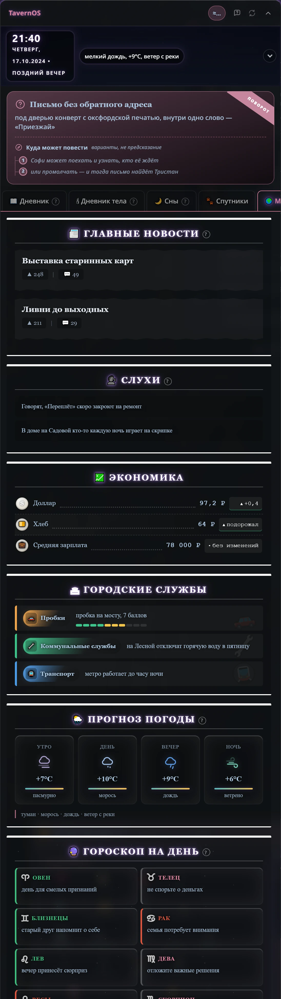</p>

</details>

### 🎵 Музыка сцены

Полоса «сейчас играет» над вкладками: **саундтрек** к моменту, как в кино, и музыка **в сцене** — то, что слышат сами герои (радио в машине, оркестр на балу). Подборка — отдельным небольшим запросом по сцене из HUD, заново только при смене сцены или по кнопке; каждую часть можно подобрать отдельно. Треки сверяются поиском, выдуманные помечаются. Кнопка ▶ играет прямо в Таверне: отрывок или полный трек. Громкость, число треков и пожелание («музыка для бега») — прямо в плейлисте. У трека — ♡ «нравится» и ⊘ «не предлагать»: следующие подборки ближе к вашему вкусу. Можно выбрать язык песен и мемный саундтрек (кнопкой или сам — в смешной сцене). Если в сцене играет радио, «В сцене» включает живой эфир: Радио Рекорд или станции мира. «Фон сцены» играет полные свободные треки по настроению сцены без пауз — из российского Фонау, Audius, Incompetech, а в средневековье ещё из Wikimedia Commons; после 30-секундного отрывка песни можно сразу переходить на него. Пока музыка играет, а карточка ушла из виду, у края — крошечный полупрозрачный значок. В телефоне персонажа — приложение «Музыка»: что он слушает сейчас, его плейлисты с названиями (модель собирает их по карточке, лорбукам и последним сообщениям, «Ещё» дописывает без повторов) и его «Нравится». В архиве — «Саундтрек» по главам. По умолчанию выключено.

<p align="center">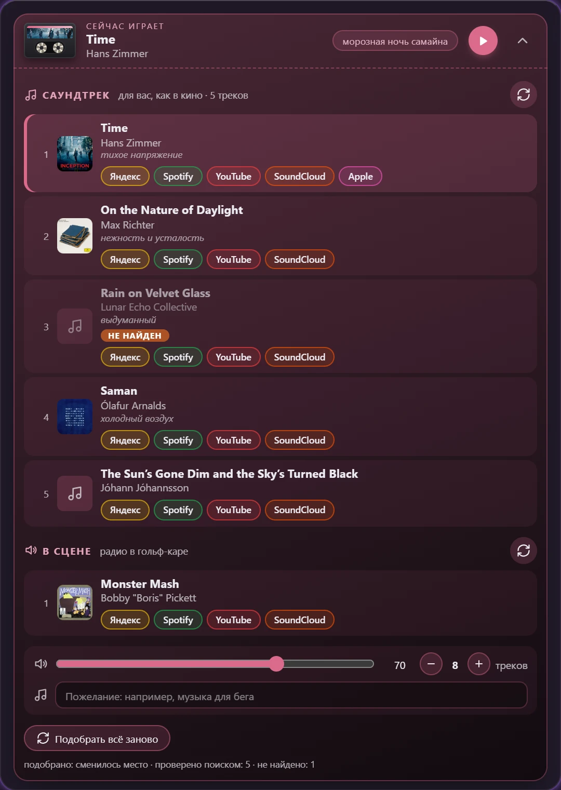</p>

<details><summary>📷 «Музыка» в телефоне и саундтрек в архиве</summary>

<p align="center">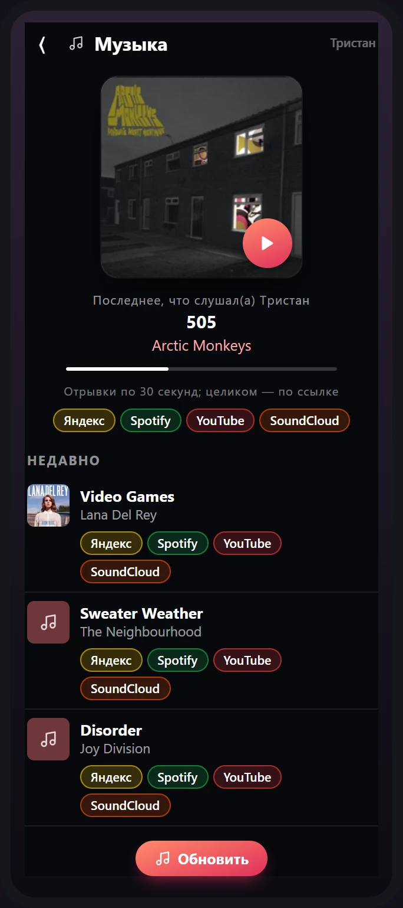 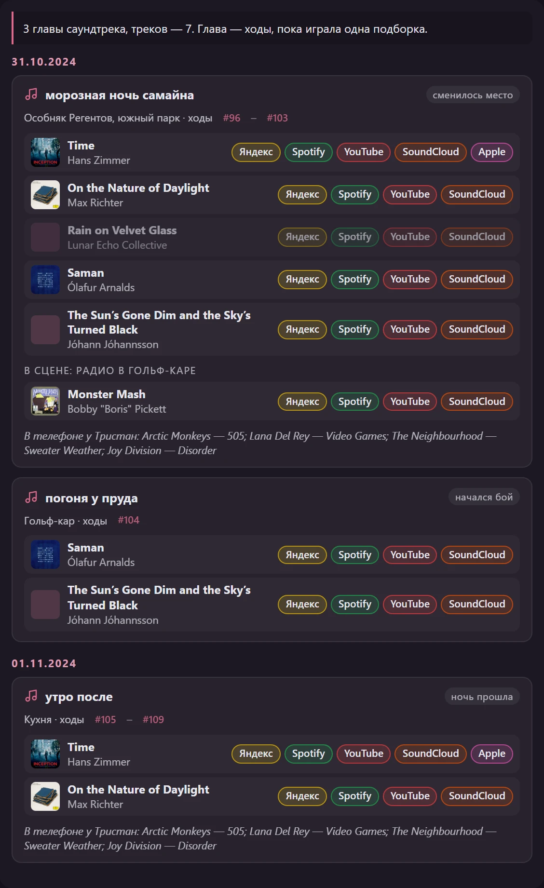</p>

</details>

### 🐾 Спутники

Животные, фамильяры, дроны: настроение, состояние, рацион, привязанность. Своя вкладка — только когда спутники есть.

<p align="center">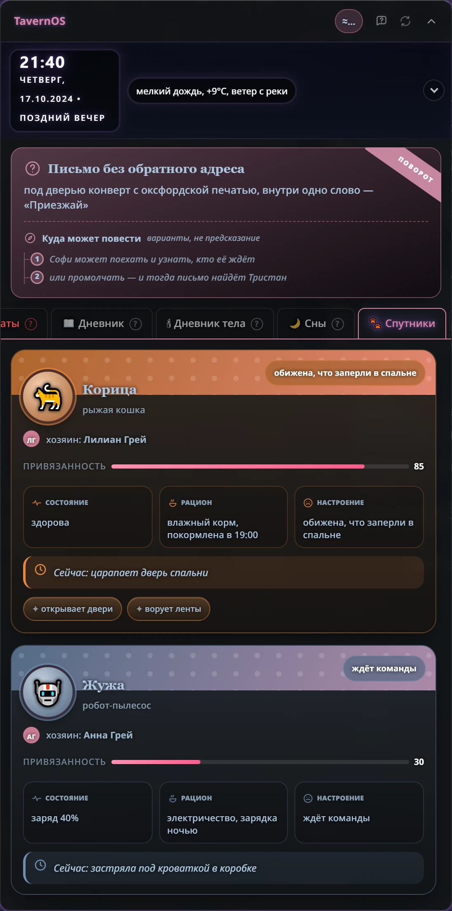</p>

### 🗄 Архив HUD

Сводка по всей истории чата, кнопка **🗄 Архив HUD** в настройках. Выберите диапазон (весь чат, последние 50 или 200 сообщений) и нажмите «Анализировать». Вкладки:

- **Секреты** — каждый секрет за историю: кто знает и кто нет, когда появился и когда упоминался последний раз.
- **Ружья** — ружья Чехова: какие нити ещё висят, какие выстрелили и в какой момент.
- **Отношения** — как менялись пары: смены отношения и доверия по ходам.
- **Хронология** — сцены по дням сюжета: где были, сколько ходов, сколько прошло времени.
- **Саундтрек** — главы музыки по дням (если включена музыка сцены).
- **Статистика** и **Дашборд** — сколько сообщений и дней, кто чаще говорит, длина ответов модели, повторы, скучные зоны, ритм сцен, доля диалога и описания, кто кого упоминает. Виджеты дашборда выбираются галочками.

Архив работает и для чатов, из которых HUD уже вычищен: HUD ведёт **летопись** — короткие выжимки каждого хода в отдельном файле вашей Таверны. К своей летописи можно подключить летопись другого чата того же персонажа (например, старой копии) — её ходы закроют пропуски без дублей. Есть поиск по отчёту и экспорт в JSON.

### 🗂 HUD сбоку

Карточку можно держать не в сообщениях, а в панели у края окна. Включается в настройках: **✨ Отображение → Где HUD**.

- **В сообщениях** — как раньше.
- **Сбоку и в сообщениях** — панель с HUD последнего ответа, карточки в чате остаются.
- **Только сбоку** — в сообщениях вместо карточки маленькая кнопка с временем и датой сцены из HUD этого хода; нажатие открывает ход в панели, а подсвечена кнопка того хода, что сейчас в панели. Полные карточки в ленте не собираются, и длинные чаты становятся заметно легче.

Панель открывается значком в верхней полосе Таверны и встаёт справа или слева (кнопка в шапке панели или настройка «Край»). Она идёт за последним ответом: новый ответ, свайп, перегенерация и правка обновляют её сами. Стрелками и точками листаются прошлые ходы, «к последнему» возвращает к свежему; открытая вкладка сохраняется при листании. Ширина тянется за край — от узкой до почти всего окна, поверх чата; у колонки чата она прилипает к ней («до чата»), и дальше панель сама занимает всё место до колонки. На телефоне панель выезжает поверх чата, закрывается тапом мимо неё. Все виды, темы и кнопки карточки работают и в панели.

### 🔞 Взрослые сцены (18+, необязательно)

Для историй с взрослым содержанием в расширении есть отдельный набор блоков. Они появляются только во время интимной сцены и вскоре после неё. Каждый выключается в настройках по отдельности, а можно отключить всю эту часть разом: тогда модель не получает о ней ни слова. Вне таких сцен этих блоков просто нет — ни на экране, ни в запросе.

Что они дают:

- **Ход сцены** — этап, обстановка, длительность, самочувствие и реакции персонажей, забота после.
- **Схематичные визуализации** — темп сцены и условные схемы, которые строятся из текста ответа сами, без дополнительных полей у модели.
- **Часы сцены** — сколько времени прошло по сюжету и что персонажи за это время пропустили по расписанию: ужин, звонок, встречу.

Цикл, беременность и «Детская» к этой части не относятся: они описаны выше, в разделе «Здоровье и семья», и включаются отдельно.

Эта часть инструкции — самая объёмная, поэтому по умолчанию она уходит модели **только пока сцена действительно идёт** (можно выбрать «всегда» или «никогда»). Скриншотов этих блоков в README нет намеренно.

---

## Инструменты

| Инструмент | Что делает |
|---|---|
| 🔄 **Перегенерация HUD** | Пересобирает только HUD сообщения, не трогая текст ответа. Можно через другой, более дешёвый профиль подключения, с выбранными лорбуками и описанием карточки. |
| ➕ **Создать HUD** | Кнопка на ответах без блока — дописать HUD к уже существующему сообщению. |
| ↶ **Версии HUD** | Прежний HUD не теряется при перегенерации — его можно вернуть одной кнопкой. |
| 🩺 **Проверка полноты** | После ответа HUD проверяется на обязательные поля. Неполный можно досоздать перегенерацией или просто получить предупреждение. Есть и проверка противоречий с бытом. |
| 🧩 **Дописывать пропущенное** | Если в прошлом HUD не было обязательного, вместе с обычным запросом едет короткая просьба включить это сейчас. Это не отдельная генерация. |
| 🎯 **Усиления** | Если модель в этом чате регулярно оставляет пустыми мысли, дневник или гороскоп, в инструкцию добавляется короткое напоминание. Счёт ведётся отдельно для каждой модели. |
| ❓ **Спросить про сюжет** | Окно вопросов к помощнику: почему персонаж так себя ведёт, что он скрывает, что может случиться дальше. Отвечает по HUD, последним сообщениям, заметкам автора, карточке, персоне и лорбукам — что выберете. В чат ничего не пишется. |
| 🎵 **Музыка сцены** | Полоса «сейчас играет» над вкладками: саундтрек к моменту и музыка, которую слышат сами герои. Подбирается отдельным небольшим запросом по сцене из HUD, заново только при смене сцены или по кнопке; «Саундтрек» и «В сцене» можно подбирать и по отдельности. Треки сверяются поиском по очереди — iTunes, NetEase, QQ Музыка, до первого найденного; выдуманные помечаются. Кнопка ▶ играет трек прямо в Таверне: отрывок 30 с из каталога iTunes или, по выбору, полный трек — с YouTube через зеркала Invidious, через неофициальный сервис NetEase или через MoodTube; следующий включается сам. Громкость, число треков и пожелание к подборке («музыка для бега») — прямо в раскрытом плейлисте. Есть и ссылки на Яндекс Музыку, Spotify, YouTube и SoundCloud, очередь MoodTube. ♡ «нравится» и ⊘ «не предлагать» у трека — ваш вкус: модель подбирает ближе к понравившемуся, запрещённое не предлагает. Язык песен; мемный саундтрек (разовой кнопкой, в смешной сцене или всегда). Радио в сцене: модель называет жанр станции — играет живой эфир Радио Рекорд (117 жанровых станций, для России и русских жанров) или станции мира из каталога radio-browser. Плавающий значок «что играет», пока карточка с музыкой ушла из виду. Фон сцены целиком: очередь полных свободных треков по настроению сцены без запроса к модели — Фонау (российская библиотека, поиск по-русски), Audius, Incompetech (каталог встроен), в средневековье — Wikimedia Commons; после отрывка песни — сразу он. Подборка хранится в ходе и в летописи; в архиве — вкладка «Саундтрек» с главами по дням. В телефоне персонажа — приложение «Музыка»: что он слушает сейчас, плейлисты с названиями (отдельный запрос по карточке, лорбукам и последним сообщениям; «Ещё» дописывает без повторов) и его собственное «Нравится» — оно уходит только в его запросы. По умолчанию выключено. |
| 📚 **Запомнить в лорбук** | Секрет или факт из HUD одной кнопкой превращается в запись лорбука — можно дать модели написать её по контексту сцены. |
| 🗄 **Архив HUD** | Сводка по всей истории чата: секреты, ружья Чехова, отношения, хронология, статистика и дашборд — как всё менялось и сколько прошло дней. С экспортом в JSON. |
| ≈ **Бюджет токенов** | Чип «≈4,1k» в карточке: сколько стоит инструкция HUD и что в ней сколько весит. |

---

## Оформление

Окно **🎨 Кастомизация** с живым предпросмотром:

- **24 готовые темы в 7 подборках** — Каваи, Dark Academia, Vamp, Киберпанк, Нуар, Средневековье, Фэнтези, Криминал, Web 1.0, Коттеджкор, Лёд, Глубина, Стимпанк, Дизельпанк, Солярпанк, Биопанк, Космоопера, Феодальная Япония, Древний Египет, Вестерн, Пираты, Ведьмовство, Вуду, Космохоррор. Светлые и тёмные.
- **Своя тема** — палитра, свечение, стекло (матовое, тонированное, прозрачное, перламутровое, жидкое), шрифты, размытие, отдельные цвета памяти, телефона, тревоги и перехватов. Тему можно сохранить в файл и переслать — при загрузке чужого файла берутся только знакомые поля с проверкой значений.
- **43 блока с альтернативными видами** — например, доверие полосками, сердцами, щитом, светофором или орбитами; страхи списком, термометрами, черепами, тучами или радаром; секреты сейфами, папками, сетью или конвертами; маршрут схемой, лентой, картой или билетами.
- **Порядок вкладок** — вкладки карточки (персонажи, телефон, память, быт, дневник…) расставляются в любом порядке прямо в чате: зажмите вкладку на полсекунды и перетащите вдоль полосы — пальцем или мышью, на телефоне тоже работает (короткое касание по-прежнему открывает вкладку, а свайп листает полосу). То же — в Кастомизации → 🗂 Вкладки: за ручку ⠿ или кнопками ↑ ↓. Любую вкладку можно закрепить первой или скрыть — скрытый блок всё равно пишется и копится, а рядом видно, сколько он стоит в токенах.
- **Аватарки** — одна картинка на любое число написаний имени; перечисленные вместе имена HUD считает одним человеком в графе, чатах и перехватах.
- **Баннеры, рамки портретов, декоративные детали** — пластыри, бантики на вкладках, восковые печати, состаренная бумага, ханко, буквицы и другое, всё по отдельности.

<table><tr>
<td align="center">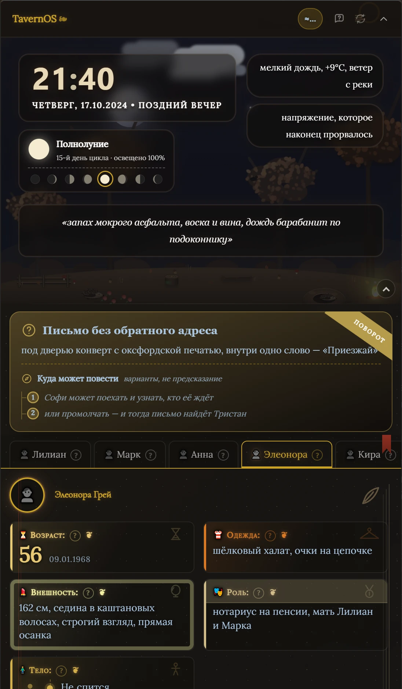<br>Dark Academia</td>
<td align="center">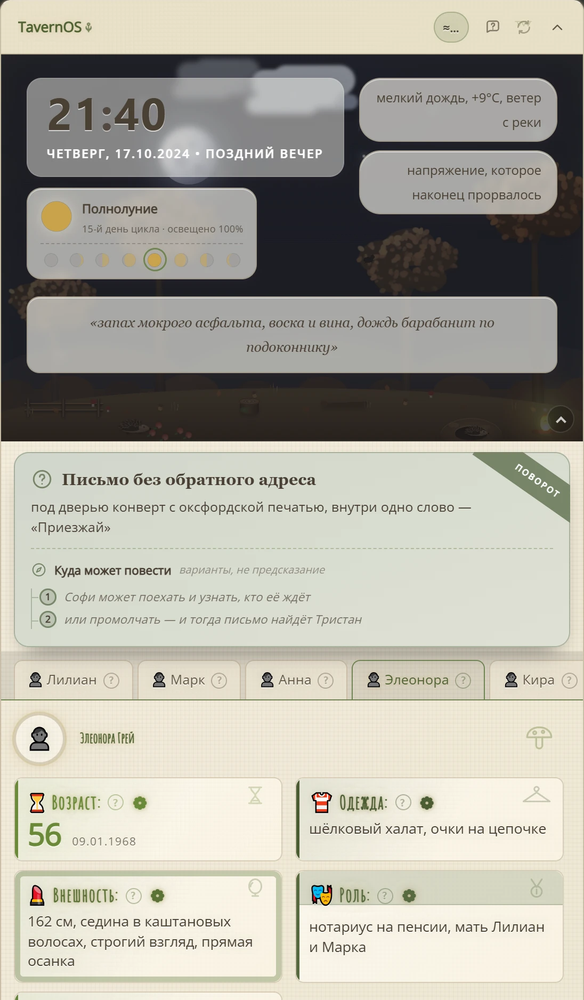<br>Коттеджкор</td>
<td align="center">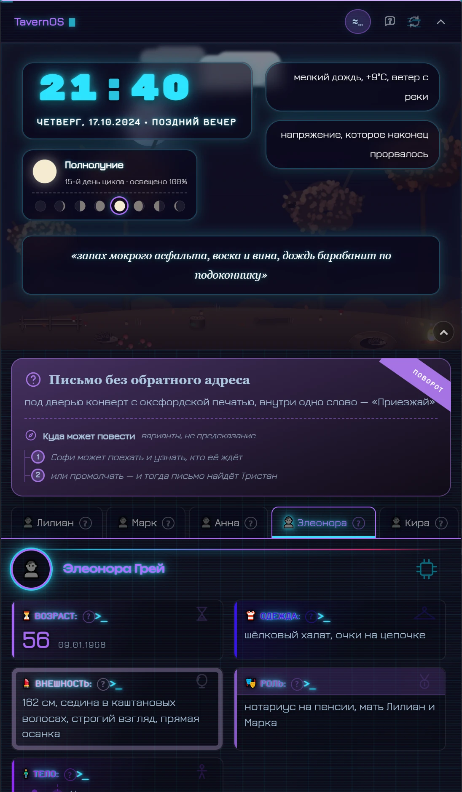<br>Киберпанк</td>
</tr></table>

Несколько альтернативных видов блоков (переключаются в «Кастомизации» → «Вид блоков»):

<table><tr>
<td align="center">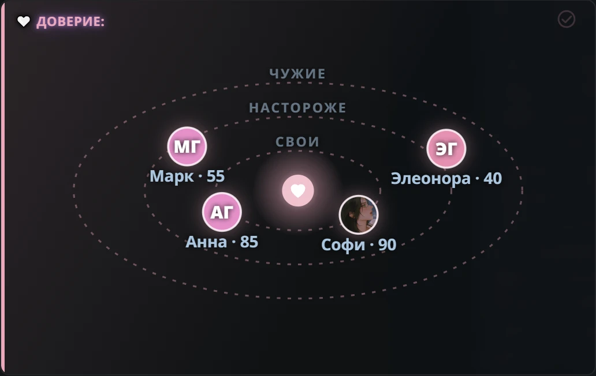<br>Доверие — орбиты</td>
<td align="center">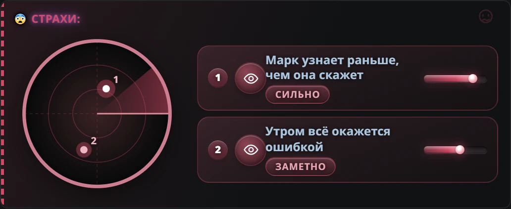<br>Страхи — радар</td>
<td align="center">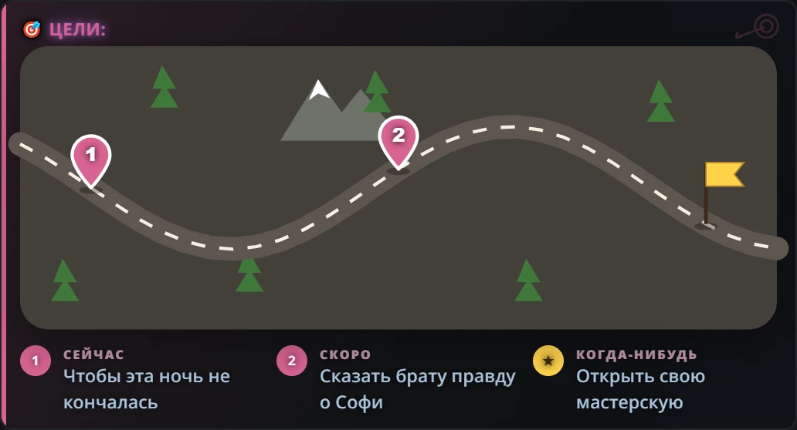<br>Цели — дорога</td>
</tr><tr>
<td align="center">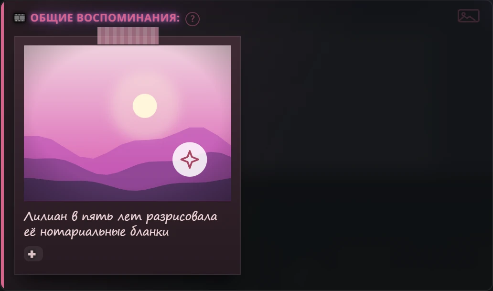<br>Воспоминания — полароиды</td>
<td align="center">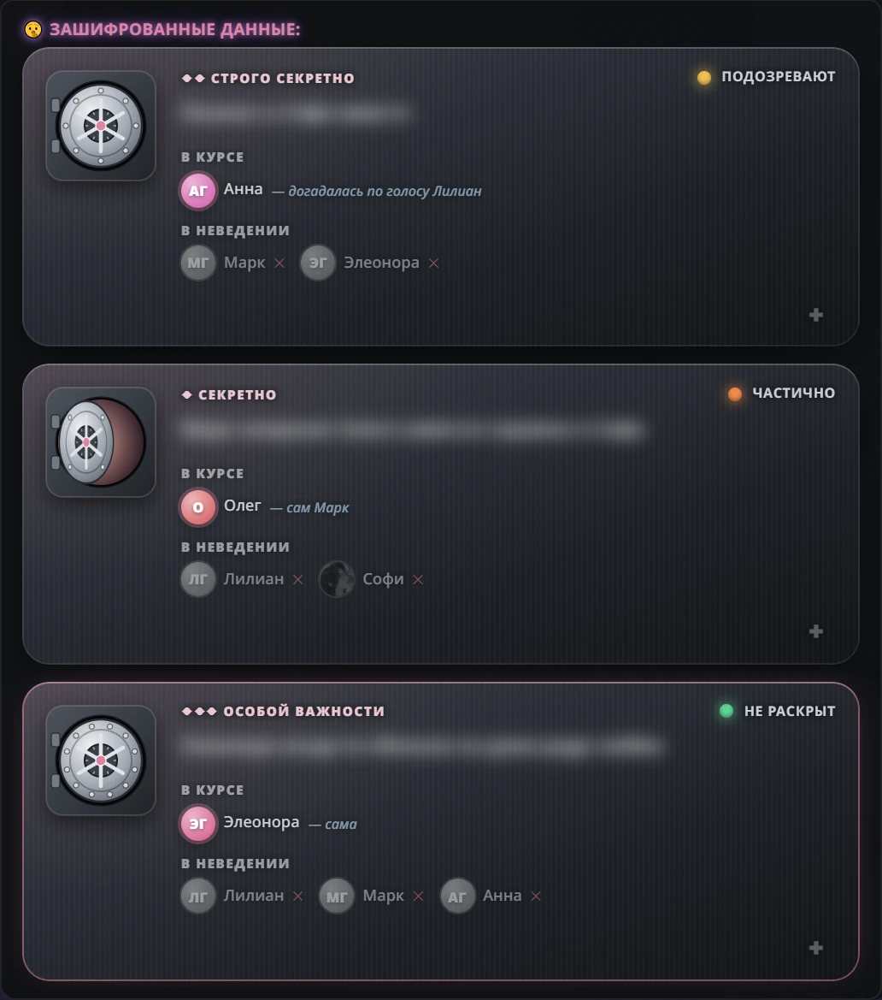<br>Секреты — сейфы</td>
<td align="center">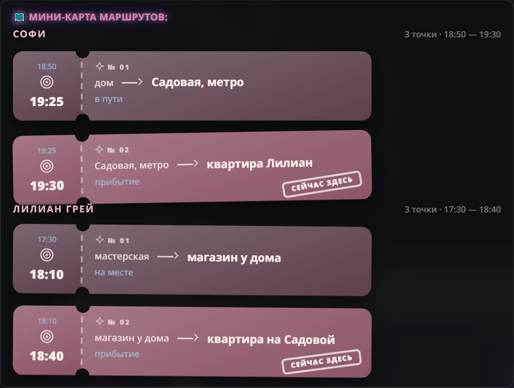<br>Маршрут — билеты</td>
</tr></table>

---

## Как это работает

1. **Инструкция.** Перед каждой генерацией расширение добавляет в запрос схему HUD — задачу, правила, коды полей. Включённые и выключенные модули собирают схему заново: выключенный модуль не стоит ни одного токена.
2. **Ответ.** Модель пишет обычный ответ и в конце — блок:

   ````text
   [HUD]
   ```json
   { "sc": { "T": "21:40 | поздний вечер", "Wt": "мелкий дождь, +9°C" }, "cs": [ { "N": "Марк", "Md": "…", "Th": "…" } ] }
   ```
   [/HUD]
   ````

   Ключи — короткие английские коды (`sc`, `cs`, `Th`), значения — полными словами на языке истории. На экране всё показывается по-русски.
3. **Карточка.** Блок разбирается (с починкой обрезанного и кривого JSON, запасным YAML-разбором) и превращается в карточку на месте сырого текста.
4. **Экономия контекста.** В следующих запросах старые HUD в истории заменяются короткими сводками `[HUD_SUMMARY]`, а последний HUD уходит модели снимком в конце инструкции — она обновляет его под новый ответ.
5. **Непрерывность.** Переписки, секреты, заметки, календарь и звонки собираются из прошлых ходов прямо перед отрисовкой. Это работает только на экране: текст сообщений и запрос к модели не меняются.

### Какие запросы получают HUD

Инструкцию HUD получает **только запрос ответа в чат** — обычное сообщение, свайп, регенерация, продолжение. Всё остальное уходит без неё:

- **тихие генерации** Таверны — саммари, автоперевод, промпт для картинки;
- **Impersonate** — сообщение за игрока;
- **сырые запросы других расширений** (`generateRaw`): саммари, TunnelVision, работа с лорбуками;
- **прямые запросы расширений**, например **Ext Blocks**;
- **MemoryBooks** — запись памяти в лорбук;
- **служебные запросы самого HUD** — «Спросить про сюжет», запись в лорбук, подбор музыки.

Мало того: в таких чужих запросах блоки `[HUD]` из истории вырезаются, а на их место встаёт короткая сводка `[HUD_SUMMARY]` — дата, время, кто где и во что одет. Саммари и памяти знают, когда и где было дело, но не тащат в себя целый HUD.

---

## Работает в связке

- **[MoodTube](https://github.com/moonnsy/MoodTube)** — музыка сцены играет треки целиком прямо в Таверне через MoodTube: кнопка ▶ с источником «MoodTube», кнопки очереди в плейлисте и в саундтреке архива («всё в очередь MoodTube»). Если MoodTube уже сообщает модели свой трек, HUD свою строку про музыку не дублирует.
- **[SillyTavern-MemoryBooks](https://github.com/aikohanasaki/SillyTavern-MemoryBooks)** — с настройкой **«📚 MemoryBooks: считать сцену без полного HUD»** (группа «Лорбуки») MemoryBooks не получает полные блоки HUD: HUD сам заводит для него правило и подставляет вместо каждого блока короткую сводку. Сцена для памяти становится в разы короче, MemoryBooks не отклоняет её по размеру, а память всё равно знает дату, место и кто во что был одет.

---

## Безопасность и приватность

- **У HUD нет серверов.** Нет аккаунтов, аналитики, телеметрии, «облака» — расширение ничего никому не отправляет.
- **Всё хранится только в вашей SillyTavern.** Блоки HUD — внутри сообщений ваших чатов; летопись для архива — файлом на вашем же сервере Таверны (`user/files`); настройки — в браузере (`localStorage`), кэш разборов — в IndexedDB браузера.
- **Модель видит только то, что уходит через ваш API** в SillyTavern — тот же канал, что и обычные ответы.
- **Единственное исключение — музыка сцены, и только если вы её включили.** Чтобы найти трек, HUD отправляет в каталог (iTunes, по выбору NetEase и QQ Музыка) **только исполнителя и название трека** — ни текста чата, ни имён персонажей. Полные треки, если выбрать такой источник, играют с зеркал YouTube (Invidious) или через MoodTube. Радио в сцене спрашивает каталог radio-browser.info **только жанр станции и код страны**; фон сцены спрашивает Фонау, Audius и Wikimedia Commons **только слова настроения** («тревожная», «dark ambient»); потоки играют напрямую со станций (Радио Рекорд — со своего сервера). Выключенная музыка не делает ни одного внешнего запроса.
- Тему можно загрузить из чужого файла — при этом берутся только знакомые поля, а значения проверяются, чтобы файл не мог подсунуть свою разметку.

---

## Производительность

Расширение рассчитано на чаты в сотни сообщений и на телефоны:

- **Ленивые вкладки** — собирается только открытая вкладка, остальные — при переключении.
- **Облегчение старых карточек** — у свёрнутой карточки в странице остаётся только заголовок; при открытии чата целиком собираются лишь последние несколько.
- **Виртуализация** — в чатах от 200 сообщений карточки вдали от экрана разбираются обратно в текст и собираются при прокрутке.
- **Лимит карточек** — можно держать в памяти только последние N.
- **Только сбоку** — полная карточка собирается одна, в панели сбоку; в сообщениях — маленькая кнопка вместо карточки.
- **Кэш разборов** в IndexedDB и фоновый поток для тяжёлого разбора истории.

---

## Установка

1. В SillyTavern откройте **Расширения → Установить расширение** и вставьте адрес репозитория: `https://github.com/alewwi/HUD`
   *Или вручную:* положите папку расширения в `data/<ваш-пользователь>/extensions/HUD` (или в `public/scripts/extensions/third-party/`) и перезагрузите страницу.
2. В **Расширениях** появится блок **📊 TavernOS**.
3. Включите **🔌 HUD в каждом ответе** — тогда основная модель пишет HUD вместе с ответом. Если не хотите тратить на него каждый ответ, оставьте выключенным: под ответами будет кнопка **➕ Создать HUD**, и HUD напишется отдельным запросом только по нажатию — можно другим, более дешёвым профилем.
4. Отправьте сообщение — под ответом появится карточка.

Требуется SillyTavern **1.12** или новее (проверено на 1.18). Расширение работает с любым API, который поддерживает Chat Completion или Text Completion. HUD генерирует та же модель, что ведёт историю; перегенерацию и помощника можно отправить через отдельный профиль подключения.

### Рекомендации для старта

- Начните с умеренного набора модулей и включайте остальное по мере надобности: каждый модуль добавляет поля в схему. Сколько весит каждый раздел, видно в чипе бюджета токенов.
- Телефон целиком — около 800 токенов на ход; выключите приложения, которыми не пользуетесь.
- **«Сколько развёрнутых HUD оставлять» = 1** — модель видит только снимок последнего HUD, остальные сжаты в сводки. Это оптимум по цене и качеству.
- Хорошо справляются модели с большим контекстом и аккуратным следованием формату. Если модель роняет поля, включите «Дописывать пропущенное» и «Усиления».

---

## Настройки

Все настройки — в блоке **📊 TavernOS** в «Расширениях» и в окне «Кастомизация».

**🌐 Язык / Language** — самый первый пункт, вне групп: RU или ENG. Меняет язык интерфейса (карточки, окна, настройки, уведомления) и язык, на котором модель пишет значения HUD. После выбора страница перезагружается. Перевод — слоем поверх разметки по словарю (`i18n.js`, `i18n-en.js`); имена персонажей и текст сообщений чата не переводятся.

| Раздел | Что настраивается |
|---|---|
| 🧩 Блоки HUD | HUD в каждом ответе (сетевой перехват) или только по кнопке; блок игрока; эпоха (телефон или шкатулка) и отдельные приложения; перехваты или подслушанное; память и ружья Чехова; болезни, беременность, роды и малыши, цикл; «что о тебе думают»; генеалогическое дерево; состояние тела; повороты сюжета; спутники; блоки взрослых сцен (каждый отдельно); словесная дуэль; бой (сам решает, всегда, никогда); быт и норма сна; дневник, сны, мир, экономика, афиша, городские службы, гороскоп. |
| ✨ Отображение | Где HUD: в сообщениях, сбоку и в сообщениях, только сбоку; ширина панели (своя или до чата) и край (справа или слева). Пояснения-вопросики; списки из прошлых ходов: сколько ходов смотреть назад, предел записей в списке и сообщений в переписке. |
| ⚡ Производительность | Облегчение старых карточек, сколько карточек собирать сразу, ленивые вкладки, Performance Mode, виртуализация, лимит карточек. |
| 🖼️ Аватарки | Картинки на имена персонажей, закреплённые аватарки. |
| 📚 Лорбуки | Какие лорбуки добавлять к запросу перегенерации HUD; сколько сообщений слать при записи в лорбук. |
| 🤖 Генерация | Лимит токенов HUD; инструкция отдельным сообщением; снимок последнего HUD; проверка полноты; «Дописывать пропущенное»; противоречия с бытом; часть про взрослые сцены (авто, всегда, никогда); усиления; сколько развёрнутых HUD оставлять; контекст и профиль для перегенерации. |
| ❓ Ассистент | Кнопка «Спросить про сюжет»; что видит помощник (сообщения, HUD, заметки автора, карточка, персона, лорбуки); профиль, лимит ответа и системный промпт. |
| 🎵 Музыка сцены | Подбор музыки к сцене; обновление при смене сцены; профиль подключения; средневековье (старинная музыка или киношный саундтрек); вид полосы (кассета, пластинка, свиток); сколько ждать подборку (любое число секунд, 0 — без таймера); лимит ответа (от 2048 токенов — с запасом для думающих моделей); встроенный плеер и источник (отрывки, YouTube через зеркала, NetEase, MoodTube); проверка треков поиском и запасные сервисы (NetEase, QQ); промпт: свои правила вкуса, сколько сообщений читать, карточка персонажа, персона, свои лорбуки; музыка в сцене — модели одной строкой; язык песен, мемный саундтрек, радио в сцене, плавающий значок, очистка «нравится» и запретов; фон сцены целиком, «после отрывка — фон», источники фона (Фонау, Audius, Incompetech, Wikimedia Commons). |

### Мини-гайд: что за что отвечает

Настройки разложены по группам — раскройте нужную. Ниже — самое важное в каждой.

**🌐 Язык / Language** — язык интерфейса и значений HUD. Самый первый пункт.

**🧩 Блоки HUD** — что вообще будет в карточке. Каждый выключенный блок исчезает и с экрана, и из инструкции модели, то есть экономит токены.
- *Эпоха* — «современность» (телефон и перехваты) или «средневековье» (шкатулка и подслушанное); приложения телефона и разделы шкатулки включаются по одному.
- *Память и сюжет* — таймлайн, секреты, маршруты; ружья Чехова; карточки поворотов сюжета.
- *Персонажи* — блок игрока, «Что о тебе думают», генеалогическое дерево, спутники.
- *Тело и здоровье* — болезни и травмы, состояние тела (энергия, сон, стресс), цикл, беременность, роды и «Детская». Пол и число малышей можно отдавать модели скрытым фактом или не отдавать вовсе.
- *Быт* — вкладка быта; «Быт → модели» решает, видит ли модель итог (одной строкой, только по теме или через макрос `{{hudByt}}`); норма сна.
- *Близость* — части для взрослых сцен и режим «сам решает / всегда / никогда».
- *Бой и споры* — бой (сам решает, всегда, никогда) и словесная дуэль.
- *Дневник, сны и мир* — дневник, сны, мир, экономика, афиша, городские службы, гороскоп.

**🤖 Генерация** — как HUD уходит модели и как проверяется.
- *HUD в каждом ответе* — главный выключатель: включено — модель пишет HUD в каждом ответе; выключено — HUD только по кнопке «➕ Создать HUD», отдельным запросом.
- *Инструкция отдельным сообщением* — схема уходит последним сообщением после пресета и истории. Выключите, если бэкенд не принимает системное сообщение в конце.
- *Снимок последнего HUD* — модель обновляет прошлый HUD, а не строит мир заново. Сильно помогает непрерывности.
- *Сколько развёрнутых HUD оставлять* — остальные в истории сжимаются в сводки. Оптимум — 1.
- *Проверка ответа* — что делать с неполным HUD (предупредить или досоздать), противоречия с бытом, «Дописывать пропущенное», «Усиления».
- *Перегенерация HUD* — профиль подключения (можно дешевле основного), сколько сообщений слать, лимит токенов.

**📚 Лорбуки** — какие лорбуки добавлять к перегенерации HUD; сколько сообщений слать при записи в лорбук; связка с MemoryBooks.

**✨ Отображение** — где HUD (в сообщениях или в панели сбоку, см. «🗂 HUD сбоку»), вопросики-пояснения, набор значков, сводки `[HUD_SUMMARY]` карточкой. *Списки из прошлых ходов* — сколько ходов назад смотреть и сколько записей держать на экране (только на экране, в запрос это не уходит).

**🖼️ Аватарки персонажей** — своя картинка на имя (или на несколько написаний одного имени), закреплённые аватарки игрока и персонажа.

**❓ Ассистент** — кнопка «Спросить про сюжет»: что он видит (сколько сообщений, HUD, заметки автора, карточка, персона, лорбуки), профиль, лимит ответа, свой системный промпт.

**🎵 Музыка сцены** — включение и автообновление при смене сцены, профиль, вид полосы, средневековая музыка, встроенный плеер и источник звука, проверка треков поиском, сколько ждать подборку, лимит ответа, свой промпт и контекст для подбора.

**⚡ Производительность** — облегчение старых карточек, ленивые вкладки, ускорение двух правил Таверны; для чатов от 200 сообщений — Performance Mode и виртуализация; лимит карточек.

**🧹 Обслуживание** — «Почистить кэш»: убирает сохранённые отчёты архива и пометки-реакции; настройки, темы и аватарки остаются.

Внешний вид (темы, цвета, шрифты, вид каждого блока) — в окне **🎨 Кастомизация**, кнопка вверху настроек.

### Макросы

| Макрос | Значение |
|---|---|
| `{{hudLast}}` | Последний HUD чата компактным JSON с короткими кодами, без пустых и выключенных полей. Поддерживает `{{if hudLast}}…{{/if}}` в новом движке макросов. |
| `{{hudByt}}` | Итог быта и часов сцены одной строкой («не ели 7 ч; долг сна 6 ч; ужин 19:00 пропущен») — если в настройке «Быт → модели» выбран макрос. |

---

## Вопросы и ответы

**Расширение меняет мои сообщения?**
Нет. Блок `[HUD]` остаётся в тексте ответа как есть — карточка рисуется поверх него. Перенос списков из прошлых ходов работает только на экране. Сообщения меняются, только когда вы сами нажимаете перегенерацию HUD, «Создать HUD» или возврат прежней версии.

**Сколько это стоит в токенах?**
Зависит от включённых модулей: инструкция собирается под них, а чип бюджета показывает её вес по разделам. Старые HUD в истории сжимаются в короткие сводки, поэтому история не раздувается с каждым ходом.

**Куда уходят данные?**
Никуда, кроме вашего API в SillyTavern. У HUD нет своих серверов; подробности — в разделе «Безопасность и приватность».

**Модель пишет HUD с ошибками.**
Разборщик чинит типичные поломки: обрезанный ответ, пропущенные запятые, кавычки внутри строк, YAML вместо JSON. Если блок неполный, включите проверку полноты — HUD досоздастся перегенерацией.

**Можно без взрослого контента?**
Да. Все такие блоки отключаются по отдельности, а соответствующую часть инструкции можно выключить совсем — модель о ней не узнает.

**Тормозит в длинном чате.**
Включите ленивые вкладки, облегчение старых карточек и Performance Mode; уменьшите «Сразу собирать последних карточек» и задайте лимит карточек.

---

## Разработка

```bash
node tests/run.mjs                          # все наборы тестов
node tests/tools/audit-chat.mjs "<чат.jsonl>"  # прогон реального чата: разбор и отрисовка каждого хода
node tests/tools/build-cq.mjs               # пересобрать копии стилей для узкой карточки
node bump-version.cjs 23.61.1               # сменить версию ассетов (без этого телефон держит старые модули)
node tests/tools/docs-shots.mjs [--lang en] # снимки для README (Таверна должна быть запущена)
```

Английский интерфейс: новая русская подпись в разметке переводится словарём `i18n-en.js` — целая строка в `СЛОВАРЬ_EN`, строка с числами или подстановками в `ШАБЛОНЫ_EN`. Подписи в CSS (`content`) дублируются в `css/lang-en.css`, русские примеры в инструкции модели — в `prompt-en.js`. `node tests/i18n.mjs` проверяет переводчик, инструкцию без кириллицы, CSS и разбор английских значений.
